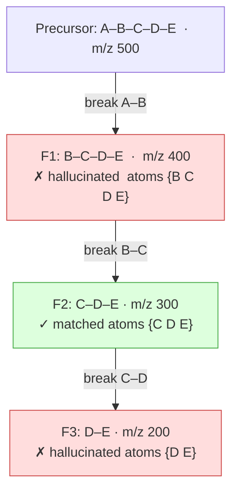
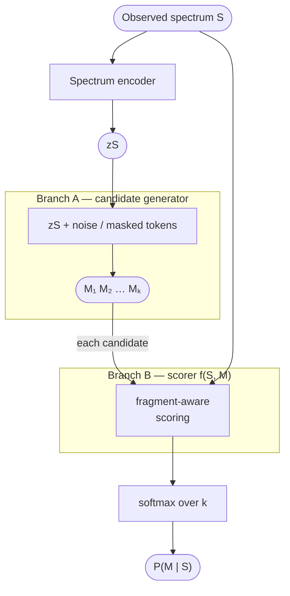
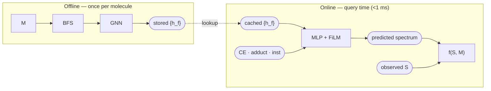

# DAG-Guided Molecular Generation from Mass Spectra

## 1. FRIGID

Reference: FRIGID (Bohde et al., 2026) — https://arxiv.org/abs/2604.16648

Diffusion LM over SAFE sequences conditioned on spectrum. At inference, uses ICEBERG as
a forward oracle to iteratively remask tokens:

- Generate M → run ICEBERG → match simulated peaks to observed (±20 ppm)
- Matched fragment atoms: `+1`; hallucinated fragment atoms: `−γ`
- Aggregate to SAFE token level via **min** over constituent atoms → remask → re-denoise


### Problems with FRIGID

**1. ICEBERG's flat fragment list breaks scoring and remasking.**

**Background — fragmentation DAG.** When a molecule fragments in the mass spectrometer,
it does so stepwise: the precursor loses one substructure to produce a depth-1 fragment;
that fragment loses another to produce a depth-2 fragment; and so on. This hierarchy is a
DAG rooted at the precursor. A key consequence: every fragment at depth d+1 is a
structural sub-part of its parent, so its atoms are a strict subset:

```
atoms(F2) ⊂ atoms(F1)
```

**Root cause.** ICEBERG returns fragments as a flat list with no parent-child
relationships. FRIGID therefore has no access to this hierarchy, which causes two failures
in sequence: wrong atom scoring, then wrong remasking decisions.

**Concrete example.** A five-atom chain A–B–C–D–E, three fragments:



What ICEBERG gives FRIGID — depth and parentage are hidden:

| Fragment | m/z | Match | Depth (hidden) | Parent (hidden) |
|---|---|---|---|---|
| F1 | 400 | ✗ | 1 | precursor |
| F2 | 300 | ✓ | 2 | F1 |
| F3 | 200 | ✗ | 3 | F2 |

**Failure 1 — wrong atom scores.** FRIGID scores each atom by every fragment it belongs
to, then takes `min`. Atoms {C,D,E} belong to both F1 (hallucinated) and F2 (matched):

| Atom | Score via F1 | Score via F2 | min → final |
|---|---|---|---|
| C, D, E | −γ | +1 | **−γ** |
| B | −γ | — | **−γ** |

F2 is correct evidence — but `min(+1, −γ) = −γ` erases it.

**Failure 2 — wrong remasking order.** Without the DAG, FRIGID cannot distinguish F1
(hallucinated at depth 1) from F3 (hallucinated at depth 3 whose parent F2 is matched).
The correct repair is top-down:

```
1. Find shallowest hallucination: F1 (depth 1)
2. F1's child F2 is matched → protect atoms {C, D, E}
3. Remask only atom B (F1-unique)
4. Next: F3 (depth 3), no matched children → remask atoms {D, E}
```

Instead, all of {B,C,D,E} are scored −γ and the entire right half of the molecule is
remasked at once — destroying F2 even though it was correct evidence.

**2. No proper posterior.**
Iterative remasking is not an approximation to any well-defined distribution;
P(M | S) ∝ p(S | M) × p(M) is never computed.


## 3. Proposed plan

**Goal:** one MS/MS spectrum → calibrated distribution over generated molecules.

- Not: spectrum → fingerprint → one molecule
- Not: spectrum → one molecule
- Output: `M₁: 0.41   M₂: 0.19   M₃: 0.08   …`

```
P(M | S) ∝ p(S | M) × p(M)
P(Mₖ | S) ≈ softmax_k[ f(S, Mₖ) + log p(Mₖ) ]
```



*Figure 1. Branch A generates candidates; Branch B scores each; softmax yields the posterior.*

### 3.1 Branch A — Molecule Generator

Branch A learns P(M | S): one spectrum → 100–1000 candidate molecules.

| | |
|---|---|
| **Architecture** | SAFE / SELFIES / graph diffusion / flow matching |
| **Pretraining** | Unconditional molecule LM on large databases |
| **Fine-tuning** | Conditional generation on paired (spectrum, molecule) data |
| **Inference** | Sample candidates; filter invalids and duplicates |

### 3.2 Branch A Options

| Option | When to use |
|---|---|
| **Database retrieval** | Known chemical space; Branch B alone gives the posterior |
| **Frozen generator** (FRIGID-style, trained independently) | De novo, inference-time composition |
| **Joint ELBO** (generator maximises E[log p(S\|M)] − KL) | Maximum performance; needs reparameterisable generation |

### 3.3 Branch B — Fragment-Aware Scorer

`f(S, M)` approximates `log p(S | M)` on a **comparable scale** across all candidates.
Inputs: observed peak m/z and intensities; candidate fragment masses and formulae;
matched vs. unmatched peaks; hallucinated predicted fragments.

Branch A quality is a hard floor: if proposal `q(M | S)` is poor, Branch B selects the
least-wrong candidate, not the correct one. The unbiased posterior requires:

```
P(Mᵢ | S) ∝ p(S | Mᵢ) × p(Mᵢ) / q(Mᵢ | S)
```

**GNN speedup.** If Branch B uses a GNN over the fragment DAG and conditions on
CE/adduct/inst at the MLP level, the GNN is context-independent → fragment embeddings
`{h_f}` can be precomputed offline; online cost = one MLP pass + sparse peak matching.



*Figure 2. Precomputed GNN embeddings make softmax over database-scale candidate sets tractable.*

### 3.4 Training

| Stage | Objective |
|---|---|
| **1 — Generator pretraining** | Unconditional molecule LM on SMILES / SELFIES / SAFE |
| **2 — Spectrum-conditioned generation** | Branch A conditional generation loss (spectrum → true molecule) |
| **3 — Scorer training** | InfoNCE with hard negatives: same-formula, same-mass, same-class, random decoys |
| **4 — Joint fine-tuning** | L_generation + λ₁ L_scoring + λ₂ L_fragment_consistency + λ₃ L_calibration |


---

## 4. Spectrum-to-DAG Generation

The observed spectrum is a partially-observed DAG: peak m/z values are node labels;
which molecular subgraphs produce those masses is the inference target. The precursor is
the DAG root.

### 4.1 DAG Branch Regeneration

```
1.  DAG = BFS(M)
2.  matched, unmatched = match_peaks(DAG, S)
3.  for peak p in unmatched (high intensity first):
        F_p = formula_from_mass(p.mz, precursor_formula)
        if subgraph_search(M, F_p):
            add branch to DAG              # Case 1 — free, M unchanged
        else:
            queue_edit(M, F_p, protected=atoms_in_matched_fragments)
4.  apply minimal edits (Case 2)
5.  rebuild DAG, score with Branch B → iterate
```

| | Case 1 | Case 2 |
|---|---|---|
| Trigger | F_p reachable from M's atoms; BFS depth-limited | F_p cannot be any atom subset of M |
| Operation | Add DAG branch; M unchanged | Edit M to introduce subgraph with formula F_p |
| Generation needed | No | Yes — scaffold decoration at specific attachment points |
| Matched fragments | Preserved | Protected atoms fixed |

**Noise limitation.** Formula-coincidental matches at depth 3–4 receive IOS reward under
CE. Effective only for genuinely depth-limited fragments; discrimination margin between
correct and wrong candidates matters more than absolute AR.

### 4.2 Native DAG Diffusion

Diffuse directly on the molecular graph; recompute DAG(M) = BFS(M) at each denoising
step; use Branch B as the score function ∇ log p(M | S). Molecule and DAG are the same
object — no rebuild inconsistency.

| Challenge | Description |
|---|---|
| Variable-size DAGs | Fragment count varies widely across molecules |
| Discrete topology | Which bonds break is discrete; standard diffusion is continuous |
| Root recovery | Root node uniquely determines the entire DAG — must be consistent top-down and bottom-up |
| Shared substructures | Same formula fragment can appear under multiple parents |

Related work: Junction Tree VAE (tree of substructures, VAE, no spectrum conditioning);
DiGress (graph diffusion, no DAG, no spectrum); FRIGID (SAFE string diffusion, DAG is
external).

