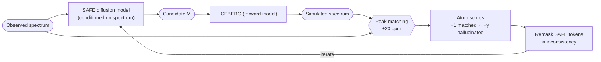
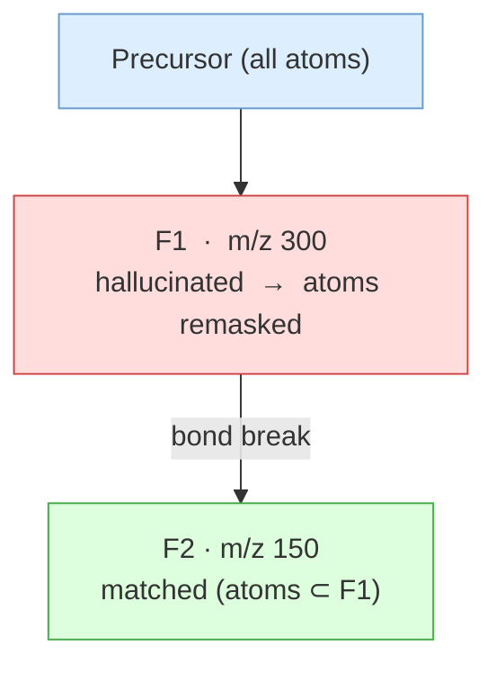
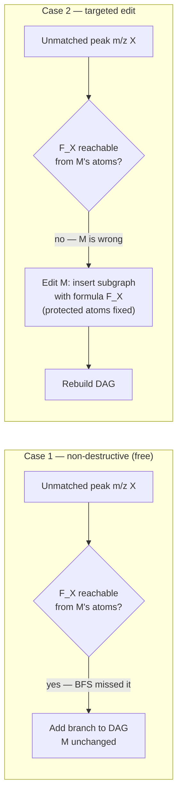
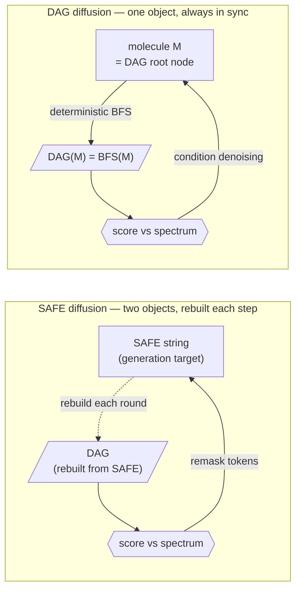

# DAG-Guided Molecular Generation from Mass Spectra

Analysis of FRIGID's inference-time scaling approach, its limitations, and a cleaner
alternative based on spectrum-guided DAG branch regeneration.

Reference: FRIGID (Bohde et al., 2026) — https://arxiv.org/abs/2604.16648

---

## 1. FRIGID's Inference-Time Scaling — What It Does

FRIGID is a diffusion language model over SAFE sequences conditioned on mass spectra.
At inference time it uses ICEBERG as a forward fragmentation oracle to refine generated
candidates via iterative remasking:

1. Generate candidate molecule M via diffusion (conditioned on spectrum)
2. Run ICEBERG on M → simulated spectrum (fragments + intensities)
3. Match simulated peaks to observed spectrum (20 ppm tolerance)
   - Matched fragment: simulated peak aligns with observed peak → **consistent**
   - Unmatched fragment: simulated peak has no observed counterpart → **hallucination**
4. Compute atom-level consistency scores (Eq. 5 in paper):
   - Atoms in matched fragments: `+1`
   - Atoms in hallucinated fragments: `−γ`
   - Aggregated to SAFE token level via minimum over constituent atoms
5. Remask tokens proportional to inconsistency → re-denoise → iterate



*Figure 1. FRIGID's iterative inference-time scaling loop.*

---

## 2. Why FraGNNet Is a Stronger Oracle Than ICEBERG

Formula-level AR/AP metrics from `formula_ann_exp.ipynb` (NIST23 scaffold split, merged spectra):

| Model | AR (recall) | AP (precision) | AWP (wt. precision) |
|---|---|---|---|
| FraGNNet-D4 | **0.809** | 0.984 | **0.9991** |
| ICEBERG | 0.656 | **0.993** | — |
| GrAFF | 0.951 | 0.611 | 0.802 |

**AR gap (0.809 vs 0.656):** For a correct candidate molecule, FraGNNet matches ~23% more
true fragment formulas. More atoms accumulate `+1` scores → stronger keep-signal for correct
molecules per remasking round.

**AWP=0.9991:** The fragments FraGNNet assigns high predicted intensity to are essentially
always real. A high-intensity hallucination is an almost certain signal that the candidate
molecule is structurally wrong — much sharper discrimination than ICEBERG's flat `+1/−γ`.

**Intensity-weighted scoring:** FRIGID uses binary `+1/−γ`. FraGNNet outputs a full
probability distribution over fragments. Replacing the binary scores with:
```
matched fragment i:      score += predicted_intensity[i]
hallucinated fragment i: score -= γ × predicted_intensity[i]
```
gives a continuous, confidence-weighted atom score. The AWP guarantee means high-confidence
predictions are reliable enough to use as strong signals.

**OOS head as a global gate:** FraGNNet's `pred_oos_prob` provides a per-molecule confidence
estimate. This can gate the remasking step (skip if OOS prob is low → molecule likely correct)
or scale γ dynamically (uncertain candidate → more aggressive remasking).

**Atom masks are correct:** FraGNNet's BFS produces fragment nodes as exact atom subsets of
the candidate molecule (connected components after bond removal). For the vast majority of
DAG nodes (BFS-generated fragments), the atom-to-fragment mapping is exact and usable
directly for FRIGID-style atom scoring. The only exception is neutral loss fragments
(same atom set as precursor, different formula) which have no well-defined atom subset.

---

## 3. The Core Problem: Remasking Breaks DAG Consistency

FRIGID's atom scoring treats all fragments as independent. They are not — the DAG is
hierarchical: every fragment is an atom subset of its parent.



*Figure 2. Remasking F1 silently destroys F2. The parent-child dependency is invisible to FRIGID's flat scoring.*

Remasking F1's atoms destroys F2. A matched fragment at depth 2 is silently broken by
fixing a hallucinated fragment at depth 1.

FRIGID's `min` aggregation partially mitigates this: an atom appearing in both a matched
and hallucinated fragment gets a mixed score. But it does not account for the tree
structure — F2 existing depends on F1's atoms. They cannot be scored independently.

**Path consistency:** A fragment is only meaningful if its entire ancestral chain in the
DAG is chemically sound. A matched F2 under a hallucinated F1 may be a spurious mass
coincidence, not a real fragmentation pathway. FraGNNet's explicit parent-child DAG
makes this checkable; ICEBERG's flat fragment list does not.

**Correct remasking order:** Top-down, not fragment-level:
1. Identify the shallowest hallucinated fragment in the DAG
2. Check whether its children are matched
3. If children are matched: protect those atoms, remask only atoms unique to the parent
4. If children are also hallucinated: remask the whole subtree

This is only possible with an explicit DAG structure.

---

## 4. Do We Need to Run FraGNNet Every Round?

No. BFS and GNN are separable:

| Step | Cost | Depends on spectrum? |
|---|---|---|
| BFS (Cython) — enumerate fragment atom masks | ~ms | No |
| GNN forward — predict fragment intensities | ~100 ms/batch | No (uses CE/adduct) |

FRIGID's atom scoring only needs: *does fragment F's mass appear in the observed spectrum?*
This is `BFS fragment formula → mass → lookup in observed m/z list (±tolerance)` — no GNN
required for the consistency check itself.

**Practical schedule:**
- **Round 1:** Full BFS + GNN → intensity-weighted atom scores → remask
- **Round 2+:** BFS only (fast) → binary mass-lookup scoring → remask
- **Final reranking:** Full BFS + GNN on top-k surviving candidates

The GNN's value is the AWP guarantee on intensity-weighted scoring. For intermediate rounds,
BFS-only consistency checking is sufficient and much faster.

---

## 5. The Right Fix: Spectrum-Guided DAG Branch Regeneration

The fundamental mismatch in FRIGID is that the molecule (SAFE) and the DAG are separate
objects. Remasking SAFE tokens and rebuilding the DAG every round creates structural
inconsistencies. The cleaner approach is to operate directly on the DAG.

### 5.1 Key Observation

The observed spectrum IS a partially-observed DAG:
- **Node labels are known**: each observed peak at m/z X gives a fragment mass (= a DAG
  node label)
- **Node structures are unknown**: which molecular subgraphs produce those masses is the
  inference target

The generative task is: given observed m/z labels, fill in the molecular structures at
each DAG node while maintaining parent-child bond-break consistency. The root node of the
recovered DAG IS the precursor molecule.

### 5.2 Two Types of Missing Branches

**Case 1 — Formula can be a subgraph of M, BFS just missed it:**

```
observed peak at m/z X
→ compute formula F_X from mass + precursor formula
→ F_X is reachable from M's atom set but BFS timed out / depth-limited
→ ADD the branch to the DAG without modifying M
```

Non-destructive, free. All existing matched fragments preserved. This is the prioritized
BFS + 2-bond ring pre-pass (§5/5a of the improvement plan), but triggered on-demand at
inference for specifically unmatched peaks rather than applied blindly at preprocessing time.

**Case 2 — Formula cannot be any subgraph of M:**

```
observed peak at m/z X
→ formula F_X cannot exist as atom subset of M
→ M is structurally wrong somewhere
→ need to EDIT M to introduce a substructure producing F_X
```

Only here is generation/diffusion needed. The edit is maximally constrained:
- Known target: introduce a subgraph with formula F_X
- Known constraints: preserve all atoms in matched fragments (untouchable)
- Known attachment: the edit connects to the rest of M at specific positions

### 5.3 The Algorithm

```
1.  DAG = BFS(M)                         # baseline DAG
2.  matched, unmatched = match_peaks(DAG, observed_spectrum)
3.  for peak p in unmatched (high intensity first):
        F_p = formula_from_mass(p.mz, precursor_formula)
        candidates = subgraph_search(M, F_p)   # exact + H-transfer variants
        if candidates:
            add branches to DAG              # Case 1 — free
        else:
            queue_edit(M, F_p, protected_atoms=atoms_in_matched_fragments)
4.  apply minimal edits for queued Case 2 items
5.  rebuild DAG from edited M
6.  score with GNN → iterate
```



*Figure 3. Two cases for unmatched peaks. Diffusion/generation is needed only for Case 2.*

### 5.4 Comparison to FRIGID

| Aspect | FRIGID remasking | Branch re-gen |
|---|---|---|
| Primary operation | Destructive (masks SAFE tokens) | Additive (Case 1 free, edit only if needed) |
| Breaks matched fragments | Yes — by construction | No (Case 1 never touches M) |
| Guided by | What's wrong (hallucinations) | What's missing (unmatched peaks) |
| Generation target | Entire masked region | Specific formula at specific DAG depth |
| DAG consistency | Violated and rebuilt each round | Maintained throughout |
| Oracle role | External scorer after generation | Integrated — DAG IS the generation object |

### 5.5 The Generative Model's Role Shrinks Dramatically

In FRIGID, the diffusion model solves full de novo generation conditioned on the spectrum.
In the branch re-gen scheme, the generative model only needs to solve:

> *Insert a substructure with formula F_X at attachment points A, B on molecule M,
> keeping atoms in set S fixed.*

This is **scaffold decoration / fragment insertion** — a far more constrained conditional
generation problem than de novo synthesis. It is simpler to train, faster at inference,
and produces fewer invalid molecules.

A fragment-level graph generative model (generate a subgraph with target formula conditioned
on attachment points and fixed atoms) would suffice. No full sequence diffusion required.

### 5.6 Inference Cost: Use a Cascaded Resampling Schedule

The naive version is too slow. Running full BFS + FraGNNet GNN scoring for every candidate
at every resampling step would make inference prohibitively expensive. The practical version
must be a cascade:

```
many candidates
→ cheap formula/precursor filters
→ BFS-only mass/formula consistency
→ full FraGNNet scoring on top-k
→ DAG-guided masked resampling on the best candidates only
→ final full FraGNNet rerank
```

**Key rule:** use FraGNNet as the expensive oracle, not as the inner-loop operation for
every particle at every step.

**Efficient schedule:**
- **Initial pool:** generate many de novo molecules.
- **Cheap pass:** filter by precursor formula/adduct validity and simple spectrum overlap.
- **BFS-only pass:** compute fragment atom masks/formulas and match theoretical fragment
  masses to observed peaks. This is enough to identify matched fragments, hallucinated
  fragments, and candidate atom masks for resampling.
- **Full FraGNNet pass:** run GNN scoring only on the top-k candidates from the cheap/BFS
  stages.
- **Masked resampling:** refine only the best candidates, and only atoms/subgraphs implicated
  by DAG mismatch.
- **Final rerank:** run full FraGNNet on the final candidate pool.

Example inference loop:

```
1. Generate 1000 candidate molecules.
2. Apply formula/adduct/precursor sanity filters.
3. Run BFS-only mass matching on all survivors.
4. Run full FraGNNet scoring on top 100.
5. Select top 20 for DAG-guided masked resampling.
6. Generate N local refinements per selected candidate.
7. Repeat BFS-only → top-k FraGNNet → resample for 2-3 rounds.
8. Final full FraGNNet rerank.
```

Additional speed levers:
- Cache `SMILES/InChIKey → DAG`, fragment formula tables, and candidate scores.
- Batch all FraGNNet calls; avoid one-molecule-at-a-time scoring.
- Use shallow DAGs or lower `max_depth` in early rounds, then deeper/multi-cut DAGs only
  for the final rerank.
- Focus early matching on high-intensity observed peaks and high-confidence predicted peaks.
- Train a lightweight surrogate scorer for early ranking, with FraGNNet reserved for
  verification.

This makes the method an inference-time scaling strategy rather than an always-on expensive
simulation loop: most candidates are discarded cheaply, and the full oracle is reserved for
the small set where detailed DAG evidence can change the answer.

---

## 6. Toward Native DAG Diffusion

Branch re-gen is still a hybrid — molecule-level edits for Case 2. The fully consistent
formulation is to do diffusion directly in DAG space.

### 6.1 Why SAFE Diffusion Is Mismatched



*Figure 4. SAFE diffusion rebuilds the DAG from scratch each round (dashed). In DAG diffusion, molecule and DAG are the same object — the precursor is the DAG root node.*

The molecule and DAG are always out of sync. The DAG is reconstructed from scratch after
every generation step.

### 6.2 DAG Diffusion Formulation

Forward process: corrupt a (molecule, DAG, spectrum) triple
- Perturb atom/bond features in the molecular graph
- DAG changes naturally as molecule changes (DAG = BFS(molecule))

Reverse process: starting from noise, denoise the molecular graph conditioned on the observed
spectrum. At each denoising step:
- Compute DAG(current_molecule)
- Score DAG consistency with spectrum (FraGNNet as score function)
- Use this as conditioning signal for the next denoising step

The forward model is the **score function** `∇ log p(M | spectrum)`, not an external oracle.
Inference-time scaling is built in — each denoising step IS a DAG consistency refinement.

### 6.3 Key Research Challenges

| Challenge | Description |
|---|---|
| Variable-size DAGs | Different molecules have DAGs of very different sizes |
| Discrete structure | DAG topology (which bonds break) is discrete; diffusion on continuous spaces is standard, discrete is harder |
| Root recovery | Root node determines entire DAG — diffusion must be consistent bottom-up AND top-down |
| Shared substructures | Same formula fragment can appear under multiple parents |

### 6.4 Relation to Prior Work

| Work | Similarity | Difference |
|---|---|---|
| Junction Tree VAE (Jin et al. 2018) | Generates molecules via tree of substructures | VAE not diffusion; junction tree not fragmentation DAG; no spectrum conditioning |
| DiGress (Vignac et al. 2022) | Diffusion on molecular graphs | Not conditioned on spectra; no hierarchical DAG |
| FRIGID (Bohde et al. 2026) | Spectrum-conditioned generation with forward model scoring | Diffuses on SAFE strings; DAG is external oracle, not generation object |

DAG diffusion combines the structural inductive bias of junction tree generation with
diffusion dynamics and spectrum conditioning — a genuinely new model class.

---

## 7. Summary: Three Levels of Improvement

| Level | Approach | Effort | Gain |
|---|---|---|---|
| **Near-term** | Replace ICEBERG with FraGNNet as FRIGID oracle; use intensity-weighted + DAG-depth-weighted atom scoring; top-down remasking respecting parent-child hierarchy | Low | Stronger signal, fewer consistency violations |
| **Medium-term** | Spectrum-guided DAG branch re-gen: Case 1 (non-destructive DAG expansion for depth-limited BFS fragments), Case 2 (targeted molecule edit for truly missing substructures) | Medium | Eliminates the destructive remasking problem entirely |
| **Long-term** | Native DAG diffusion: diffuse directly on the fragmentation DAG, with FraGNNet as the score function, recovering the precursor molecule as the DAG root node | High | Fully consistent — molecule and DAG are the same object throughout generation |

The central insight across all three levels: **the fragmentation DAG is not an external
oracle for evaluating molecules — it IS the structured intermediate representation that
connects molecular structure to mass spectrum.** Generation should happen in DAG space,
not in molecular string space with DAGs bolted on afterward.
