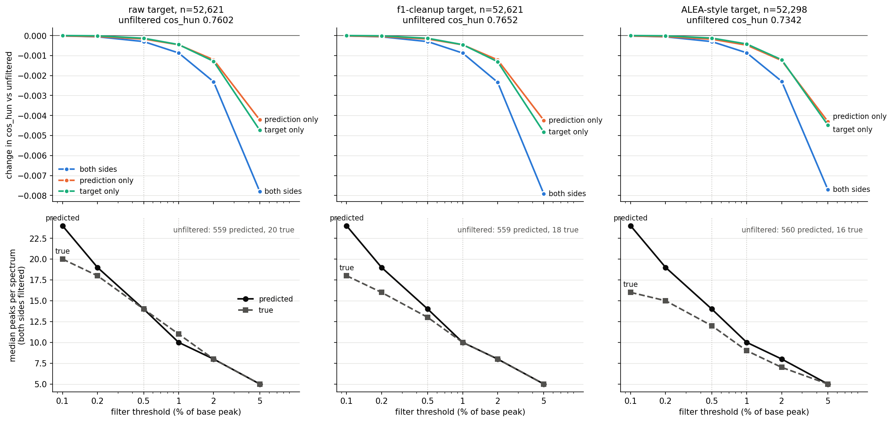
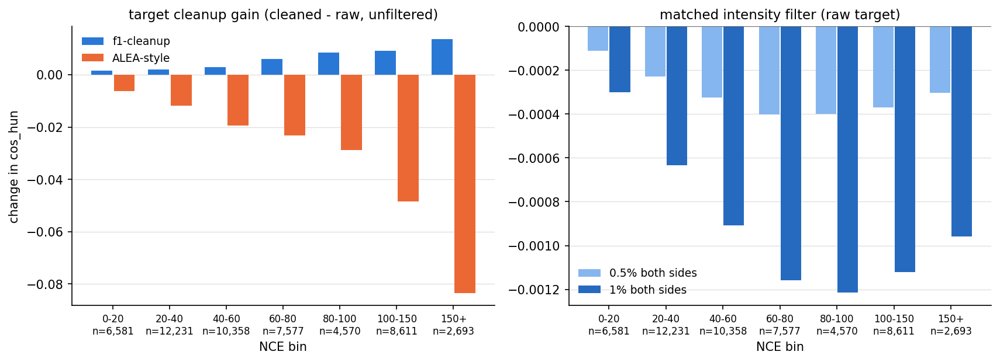
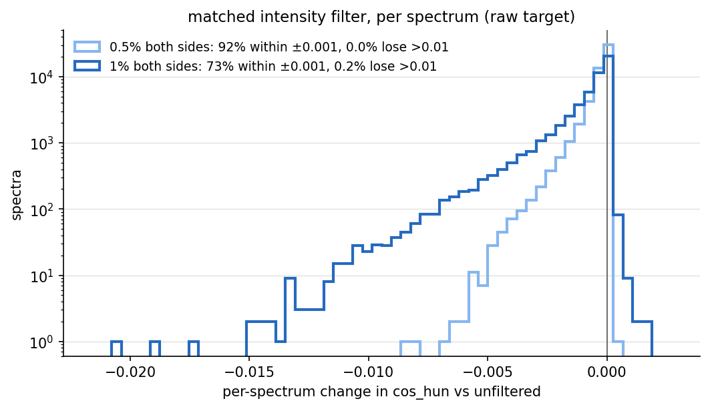

# Matched intensity filter and target cleanup on MASSter `3bej6fq7`

> **Status:** FINDING · **Updated:** 2026-09-24
> What does it cost to drop weak peaks from both the prediction and the NIST20 target at the same
> relative threshold, and what do target cleanups do to the score? Offline, on **test**, from **one
> unfiltered prediction** of `3bej6fq7` (unmerged `[M+H]+`/FT); every variant is a filter on the
> target or a post-hoc filter on that one prediction. Filtering both sides at **0.5% of the base
> peak costs −0.0003 `cos_hun`, 1% costs −0.0009**, the same on every target. The f1 cleanup (20 ppm
> centroid, subformula filter at the FT instrument tolerance, above-precursor cut) adds **+0.0050**,
> rising with NCE; it is the target changing, not the model. The literal **ALEA-style** cleanup
> (20 ppm centroid, fixed 5 ppm subformula) **lowers** the score by **−0.025** (to −0.083 at NCE
> 150+): with no m/z floor, 5 ppm is under 1 mDa below m/z 200 and deletes real fragments. Val gives
> the same numbers.

## Method

Script: [`scripts/eval/matched_intensity_filter.py`](../../../scripts/eval/matched_intensity_filter.py)
(`targets`, `score`, `plot`); tests in `tests/test_matched_intensity_filter.py`.

- **Model and split.** `3bej6fq7` `f0_mh_ft_control`, best checkpoint `model-epoch=061`
  (`saved_ckpts/f0_mh_ft_control_3bej6fq7.ckpt`), `data/split/nist20_inchikey` **test**, 52,621
  spectra. Test, because that checkpoint was selected on val.
- **One prediction.** A single `run_save_inference_eval.py` export with `--min_peak_int 0` (every
  peak, candidates at one m/z summed with exact m/z kept; median 559 peaks per spectrum) under
  [`f0_mh_ft_control.yml`](../../../config/masster/mh_ft_clean_2026_09_22/f0_mh_ft_control.yml),
  code at `ef1c77fa` plus the working tree. Its in-model `cos_sim_0.01` is 0.73614, the cross-eval's
  recorded 0.7361. Nothing below re-runs the model.
- **Targets.** All three come from f0's config through the dataset's own `clean_spectra`, so the
  cleanup is applied to the target only (`targets` stage, `spec_params` overrides):

  | target | overrides on f0 | spectra |
  | --- | --- | ---: |
  | raw | none | 52,621 |
  | f1 cleanup | `centroid_peaks`, `filter_subformula_peaks`, `filter_above_precursor_peaks` on (f0's settings: 20 ppm fixed centroid, subformula at the FT instrument tolerance of 10 ppm with a 200 Da floor, cut above precursor + tolerance) | 52,621 |
  | ALEA-style | `centroid_peaks` on at 20 ppm fixed; `filter_subformula_peaks` on at `subformula_ppm: 5.0`, `subformula_use_instrument_tolerance: false`; `filter_above_precursor_peaks` on (a no-op here: the 5 ppm subformula filter already leaves nothing above precursor + tolerance, and rebuilding with and without the cut gives identical peaks) | 52,298 |

  These are the only `spec_params` keys where f0 and f1 differ, so the f1 row is exactly f1's
  target. Emptied spectra are dropped (`drop_empty_spectra`).
- **Intensity filter.** For threshold `t`, a peak survives when its intensity is strictly above
  `t` times the spectrum's largest peak: the rule of `target_rel_ints_thresh`. On the target this is
  `batched_rel_filter_func`. On the prediction it acts on peaks, not candidates: candidates at one
  m/z (4 decimals) are summed first, as the model does before scoring, and a candidate survives when
  its peak does. Three modes per threshold: both sides (the matched comparison), prediction only,
  target only.
- **Metrics.** `cos_hun` is the Hungarian cosine at the FT tolerance on round-aggregated peaks, the
  in-model `cos_hun` and `cos_hun_inst_tol` (identical on this FT-only split). Its unfiltered raw
  row reproduces the export: 0.76016 against 0.76016, 67 spectra differing by more than 1e-5.
  `cos_sim` is the 0.01 Da binned cosine. It sits 0.0004 above the export and differs per spectrum
  on ~3% of spectra, where a target peak lies exactly on a bin edge (the model bins float32
  targets). Its changes track `cos_hun` to within 0.0003, so the tables report `cos_hun`.

## Result



**Targets**, unfiltered (`masster_matched_intensity_filter_test_targets.csv`; retention is per
spectrum against the raw target, averaged):

| target | spectra | intensity kept | peaks kept | raw base peak kept | median peaks | `cos_hun` | vs raw, same spectra | spectra up / down |
| --- | ---: | ---: | ---: | ---: | ---: | ---: | ---: | ---: |
| raw | 52,621 | 1 | 1 | 1 | 20 | 0.7602 | — | — |
| f1 cleanup | 52,621 | 0.976 | 0.883 | 0.993 | 18 | 0.7652 | +0.0050 | 62% / 5% |
| ALEA-style | 52,298 | 0.918 | 0.818 | 0.937 | 16 | 0.7342 | **−0.0254** | 57% / 20% |

**Matched intensity filter**, change in `cos_hun` from the unfiltered score on the same target
(`masster_matched_intensity_filter_test_summary.csv`):

| threshold | both sides, raw | both sides, f1 | both sides, ALEA-style | prediction only, raw | target only, raw | median peaks, pred / true (raw) |
| --- | ---: | ---: | ---: | ---: | ---: | ---: |
| none | 0 | 0 | 0 | 0 | 0 | 559 / 20 |
| 0.1% | −0.00002 | −0.00002 | −0.00002 | −0.00002 | 0.00000 | 24 / 20 |
| 0.2% | −0.00006 | −0.00006 | −0.00006 | −0.00005 | −0.00001 | 19 / 18 |
| **0.5%** | **−0.00030** | **−0.00030** | **−0.00030** | −0.00017 | −0.00013 | 14 / 14 |
| **1%** | **−0.00087** | **−0.00088** | **−0.00086** | −0.00046 | −0.00045 | 10 / 11 |
| 2% | −0.00231 | −0.00233 | −0.00229 | −0.00121 | −0.00128 | 8 / 8 |
| 5% | −0.00780 | −0.00792 | −0.00770 | −0.00422 | −0.00473 | 5 / 5 |

- **The filter cost does not depend on the target.** The three both-sides columns agree to 0.0002
  at every threshold, so a cleanup's effect is the same with or without a matched filter.
- **The costs add.** Both sides equals prediction only plus target only through 1% (−0.00087
  against −0.00091), and is smaller at higher thresholds (−0.0078 against −0.0090 at 5%).
- **From 0.2% up, the filtered prediction has the target's peak count** (medians within one peak on
  the raw target).



**By collision energy** (`masster_matched_intensity_filter_test_by_nce.csv`):

| NCE | spectra | f1 cleanup vs raw | ALEA-style vs raw | 1% both sides, raw |
| --- | ---: | ---: | ---: | ---: |
| 0-20 | 6,581 | +0.0015 | −0.0062 | −0.0003 |
| 20-40 | 12,231 | +0.0019 | −0.0117 | −0.0006 |
| 40-60 | 10,358 | +0.0028 | −0.0195 | −0.0009 |
| 60-80 | 7,577 | +0.0059 | −0.0232 | −0.0012 |
| 80-100 | 4,570 | +0.0086 | −0.0288 | −0.0012 |
| 100-150 | 8,611 | +0.0093 | −0.0483 | −0.0011 |
| 150+ | 2,693 | +0.0136 | −0.0834 | −0.0010 |

Both cleanups act mostly at high NCE, in opposite directions; the filter cost is flat above NCE 40.



**Per spectrum** (raw target, both sides): at 0.5%, 92% of spectra move by less than 0.001 and the
worst loses 0.0086. At 1%, 73% move by less than 0.001, 2.7% lose more than 0.005 and the worst
loses 0.021. About a fifth gain slightly (at most +0.0017), where the dropped weak peaks had been
unmatched.

## ALEA-style target

[ALEA](../../notes/aime_deepms2reasoner.md) (DeepMS2Reasoner's graph transformer, from the AIMe paper) scores against targets whose "peaks were merged within
20 ppm mass tolerance and filtered to retain signals explainable by chemically feasible molecular
subformulas within 5 ppm; spectra with no explainable peaks or large unexplained peaks were
discarded." With a fixed ppm, `clean_spectra` applies no m/z floor, so the window is 5 ppm at every
mass (0.25 mDa at m/z 50). Dropping emptied spectra covers "no explainable peaks". The "large
unexplained peak" discard is **not** replicated: the paper states no threshold.

- **Why it lowers the score: the window is tighter than the data at low mass.** Both cleanups share
  the 20 ppm merge. Of the intensity f1 keeps, ALEA-style removes 5.9% of an average spectrum: 4.0%
  below m/z 100, 1.5% at 100-200 and 0.4% above 200. Our Hungarian cosine still matches predictions
  at 10 ppm with a 200 Da floor, so a model peak at the formula mass whose target peak was deleted
  becomes unmatched predicted intensity. The raw base peak is gone in 6.3% of spectra.
- **The loss is concentrated.** 57% of spectra go up and 20% go down, and the losers lose a lot;
  the NCE table shows it growing to −0.083 at 150+.
- **Not a selection effect.** The 323 spectra it discards score *above* average on the raw target
  (0.858 against 0.760), so dropping them lowers the mean.

So a strict fixed-5-ppm filter penalises a model that places peaks at exact formula masses, the
opposite of the inflation it is meant to produce. ALEA's 0.83 on this kind of target is not explained
by the filter as we read it: either its filter has an absolute floor, or its discard step removes
the spectra that lose here, or both. Neither can be checked without its code.

## Val

The same analysis on val (52,020 spectra) gives the same picture: matched filter −0.00030 / −0.00089
at 0.5% / 1%, f1 cleanup +0.0053, ALEA-style −0.0277 on 51,609 spectra. One val number was an
artifact. The val f1 comparison paired two separate prediction runs of the same checkpoint (the
cross-eval's raw-target and filtered-target exports), so run-to-run nondeterminism counted as
per-spectrum change: it reported the cleanup lowering 21% of spectra, against 5% on test from one
prediction. The mean was unaffected (scoring the raw-target export against the f1 target gives
0.76207, the same as the filtered-target export). This is why the test run uses one prediction.
The val numbers above are recorded from that run; its local files (val predictions, targets and
per-spectrum scores) were deleted on 2026-09-24, so rerun the commands below with `--split val` /
`--eval_split val` to reproduce them.

## Reading

- **A 0.5% or 1% matched filter is a safe comparison setting.** Scores against an intensity-filtered
  NIST20 target are within 0.001 of the unfiltered score at 1%, and prediction and target end up with
  the same number of peaks. State the threshold, because the cost rises quickly past 2%.
- **Report cleaned-target and raw-target scores separately.** The f1 +0.0050 is the same model scored
  against a different target, concentrated at high NCE, where the removed peaks are. The ALEA-style
  −0.025 shows that a cleanup can move the score by more than most model changes, in either
  direction, depending on its tolerance.
- **Context, not a contradiction.** The prediction-only cost at 1% here (−0.0005) sits between the
  FraGNNet `9t63zils` NIST20 sweep of 2026-09-15 (−0.0001, 2,000 spectra) and MSGYM (−0.0011, see the
  [MSGYM-vs-GLACIER finding](masster_msgym_vs_glacier_released_ckpt_2026_09_24.md)). The models,
  targets and splits differ.

## Side notes from the same session

- **The export's `--min_peak_int` filtered candidates, not peaks. Fixed the same day.** The
  exporter wrote MASSter's candidate rows, so peak counts were candidate counts and a peak made
  of several candidates, each below the threshold but summing above it, was dropped. It now sums
  candidates at one m/z (4 decimals) first, as every score does; see the project-state handoff.
  The prediction used here predates that change, which is why the script aggregates itself.
- **`plot_predictions_hdf5.py` drops NCE ≥ 70 from its CE figures.** `_inst_ce_rows` caps FT at NCE
  70, which removes 37% of the val split (19,227 spectra), where `cos_hun` is lowest.

## Artifacts

Local, Git-ignored, under `output/massshatter_3bej6fq7_2026_09_24/`: the prediction
`test_unfiltered/f0_mh_ft_control_3bej6fq7/predictions_test.hdf5` and the targets
`targets_{raw,f1,alea}_test.pkl`. The per-spectrum scores the `score` step writes
(`matched_intensity_filter_{raw,f1,alea}_test.pkl`, long format: `spec_id`, `nce`, `mode`, `thresh`,
`cos_sim`, `cos_hun`, `n_pred`, `n_true`) are intermediates and are not kept; step 3 below
regenerates them in about 70 s each. Tables in `docs/figures/`:

- [`masster_matched_intensity_filter_test_summary.csv`](../../figures/masster_matched_intensity_filter_test_summary.csv):
  mean `cos_hun`/`cos_sim`, median peak counts and change from unfiltered, per target, mode and
  threshold.
- [`masster_matched_intensity_filter_test_by_nce.csv`](../../figures/masster_matched_intensity_filter_test_by_nce.csv):
  the same `cos_hun` by NCE bin, with each cleanup's unfiltered gain over raw.
- [`masster_matched_intensity_filter_test_targets.csv`](../../figures/masster_matched_intensity_filter_test_targets.csv):
  one row per target, retention and paired score change.
- [`masster_matched_intensity_filter_test_cos_hun_inst_tol_by_nce_raw_target.csv`](../../figures/masster_matched_intensity_filter_test_cos_hun_inst_tol_by_nce_raw_target.csv),
  [`..._f1_target.csv`](../../figures/masster_matched_intensity_filter_test_cos_hun_inst_tol_by_nce_f1_target.csv)
  and [`..._alea_target.csv`](../../figures/masster_matched_intensity_filter_test_cos_hun_inst_tol_by_nce_alea_target.csv):
  `cos_hun_inst_tol` by NCE bin against the raw (unfiltered), f1-cleaned and ALEA-style targets, for
  the unfiltered prediction and at 0.1% and 0.5% both sides. Each cell is the mean with a 95% CI of the mean
  from 2,000 molecule-cluster bootstrap resamples, plus the mean predicted (summed) and true peak
  counts per spectrum.
- [`masster_matched_intensity_filter_test_peak_recall_precision_by_nce_raw_target.csv`](../../figures/masster_matched_intensity_filter_test_peak_recall_precision_by_nce_raw_target.csv),
  [`..._f1_target.csv`](../../figures/masster_matched_intensity_filter_test_peak_recall_precision_by_nce_f1_target.csv)
  and [`..._alea_target.csv`](../../figures/masster_matched_intensity_filter_test_peak_recall_precision_by_nce_alea_target.csv)
  (the 52,298 spectra the ALEA-style cleanup leaves non-empty; the raw target on that subset
  matches the full-set values to 0.001):
  the same layout, with the `cos_hun_inst_tol` columns repeated beside peak `recall`/`precision` (share of true/predicted peaks with any peak on
  the other side within the FT tolerance, 10 ppm with a 200 Da floor, both sides 4-decimal
  aggregated) and their intensity-weighted forms `wrecall`/`wprecision` (L1 share of intensity on
  matched peaks); per-spectrum values, averaged over spectra, same bootstrap. Unfiltered recall is
  candidate coverage, not prediction quality: against ALEA-style, 18% of true peaks are matched only
  by predicted peaks below 0.1% of the base peak (7% below 0.01%), which is the drop to the 0.1%
  column.

Commands, from the repository root (`C=config/masster/mh_ft_clean_2026_09_22/f0_mh_ft_control.yml`,
`O=output/massshatter_3bej6fq7_2026_09_24`):

```bash
# 1. One unfiltered prediction.
python scripts/eval/run_save_inference_eval.py --custom_fp $C \
  --model_ckpt saved_ckpts/f0_mh_ft_control_3bej6fq7.ckpt --eval_split test \
  --auxiliary_scores cos_sim cos_hun cos_hun_inst_tol --eval_batch_size 256 --min_peak_int 0 \
  --output_format hdf5 --save_dp $O/test_unfiltered
H=$O/test_unfiltered/f0_mh_ft_control_3bej6fq7/predictions_test.hdf5
# 2. Targets: filters on the target only.
python scripts/eval/matched_intensity_filter.py targets --config $C --split test \
  --out_fp $O/targets_raw_test.pkl
python scripts/eval/matched_intensity_filter.py targets --config $C --split test \
  --set centroid_peaks=true filter_subformula_peaks=true filter_above_precursor_peaks=true \
  --out_fp $O/targets_f1_test.pkl
python scripts/eval/matched_intensity_filter.py targets --config $C --split test \
  --set centroid_peaks=true centroid_ppm=20.0 centroid_use_instrument_tolerance=false \
        centroid_method=common_overlap filter_subformula_peaks=true subformula_ppm=5.0 \
        subformula_use_instrument_tolerance=false filter_above_precursor_peaks=true \
  --out_fp $O/targets_alea_test.pkl
# 3. Score each target against the same prediction (the export was scored on raw).
python scripts/eval/matched_intensity_filter.py score --pred_hdf5 $H \
  --targets_fp $O/targets_raw_test.pkl --out_fp $O/matched_intensity_filter_raw_test.pkl
for t in f1 alea; do
  python scripts/eval/matched_intensity_filter.py score --pred_hdf5 $H --skip_export_check \
    --targets_fp $O/targets_${t}_test.pkl --out_fp $O/matched_intensity_filter_${t}_test.pkl
done
# 4. Figures and tables.
python scripts/eval/matched_intensity_filter.py plot \
  --runs raw=$O/matched_intensity_filter_raw_test.pkl f1-cleanup=$O/matched_intensity_filter_f1_test.pkl \
         ALEA-style=$O/matched_intensity_filter_alea_test.pkl \
  --target_files raw=$O/targets_raw_test.pkl f1-cleanup=$O/targets_f1_test.pkl \
                 ALEA-style=$O/targets_alea_test.pkl \
  --out_dp docs/figures --prefix masster_matched_intensity_filter_test
```

A both-sides 0.1% copy for `scripts/plotting/plot_predictions_hdf5.py` is in `$O/test_filter_0.1pct/`
(prediction with candidates at one m/z summed into peaks, base peak 1000, 0.1% scores; `spec_df`
with the target filtered at 0.1%), with its stats and random mirror plots under `plots/`. Median
24 predicted peaks against 20 true. The same at 0.5% (`--thresh 0.005`) is in `$O/test_filter_0.5pct/`:
median 14 predicted peaks against 14 true, `cos_hun` 0.75986.

```bash
python scripts/eval/matched_intensity_filter.py export --pred_hdf5 $H \
  --scores_fp $O/matched_intensity_filter_raw_test.pkl --targets_fp $O/targets_raw_test.pkl \
  --thresh 0.001 --out_dp $O/test_filter_0.1pct
python scripts/plotting/plot_predictions_hdf5.py --pred_fp $O/test_filter_0.1pct/predictions_test.hdf5 \
  --spec_df_fp $O/test_filter_0.1pct/spec_df_test.pkl --mol_df_fp data/proc/nist20/mol_df.pkl \
  --score_col cos_hun_inst_tol --mode stats   # and: --mode spectra --select random --n 20
```

On the local RTX 2070 SUPER the prediction takes about 3 minutes; each `targets` run under a minute
and each `score` run about 70 s with 10 workers.
