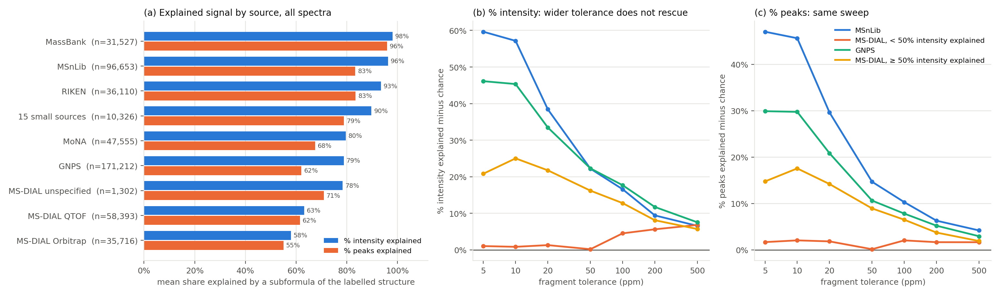

# MASSter on Spectraverse: evaluation, ceilings and data audits

> **Status:** FINDING · **Updated:** 2026-10-18
> Five Spectraverse findings: recall at instrument tolerance, `[M]+` handling, the oracle cosine ceiling, the source/replicate audit, and why `[M+Na]+`/`[M+K]+` spectra are unexplained.

Merged 2026-10-18 from 5 findings on one topic. Each part below is the original
document unchanged except for heading levels; its own status line keeps its original date.
Former file names are listed so old links and `git log -- <former path>` can be traced.

| Part | Updated | Verdict | Former file |
| --- | --- | --- | --- |
| [Spectraverse MASSter recall at instrument tolerance](#spectraverse-masster-recall-at-instrument-tolerance) | 2026-10-06 | Recall rescored at instrument tolerance on two folds; logging corrected | `spectraverse_recall_tolerance_2026_10_01.md` |
| [MASSter `[M]+` handling on Spectraverse](#masster-m-handling-on-spectraverse) | 2026-10-06 | `[M]+` is always a pre-charged cation on SPV; no change needed | `spectraverse_mplus_handling_2026_10_01.md` |
| [Spectraverse MASSter oracle cosine ceiling](#spectraverse-masster-oracle-cosine-ceiling) | 2026-10-06 | Oracle ceiling on cv0/cv1: intensity allocation is the largest gap | `spectraverse_oracle_ceiling_2026_10_03.md` |
| [Spectraverse sources, replicates and merge shape](#spectraverse-sources-replicates-and-merge-shape) | 2026-10-06 | Sources, replicates and merge shape; led to the merged-train arm | `spectraverse_source_replicate_audit_2026_10_03.md` |
| [Why Spectraverse `[M+K]+` and `[M+Na]+` spectra are unexplained](#why-spectraverse-mk-and-mna-spectra-are-unexplained) | 2026-10-06 | Why `[M+K]+` and `[M+Na]+` spectra are unexplained | `spectraverse_subformula_filter_2026_10_03_na_k.md` |

## Spectraverse MASSter recall at instrument tolerance

> **Status:** FINDING · **Updated:** 2026-10-06
> Two finished validation folds rescored on 4,096 spectra each; recall logging corrected for future evaluations (historical W&B metrics unchanged).

### Result

**Caveat (2026-10-01):** both checkpoints were trained with the retired `FT` label, and the script builds them from the current OB config. The sorted instrument index therefore fed OB spectra the trained NA embedding. OB rows below were scored with the wrong instrument row; QTOF rows are unaffected. See [the `[M]+` finding](#old-spv-checkpoints-carry-the-retired-ft-label).

The W&B `val_recall` and `val_wrecall` metrics use the global 10 ppm tolerance with a 200 Da floor. The SPV loss uses 10 ppm / 200 Da for OB, 20 ppm / 750 Da for QTOF, and 20 ppm / 500 Da for Other and NA. Thus the logged recall is stricter than the loss for non-OB spectra. The independent scoring implementation was checked against `calculate_match_mzs` on 100 random mass sets at all three tolerances.

| Last checkpoint and validation fold | Sampled spectra | Peak recall, flat 10 ppm | Peak recall, instrument tolerance | Intensity-weighted recall, flat 10 ppm | Intensity-weighted recall, instrument tolerance |
| --- | ---: | ---: | ---: | ---: | ---: |
| [cv0 `ggifzj9m`](https://wandb.ai/frag-gnn/frag-gnn/runs/ggifzj9m) | 4,096 | 0.4619 | 0.5419 | 0.6415 | 0.7068 |
| [cv1 `u46v0k0g`](https://wandb.ai/frag-gnn/frag-gnn/runs/u46v0k0g) | 4,096 | 0.4098 | 0.5399 | 0.6184 | 0.7302 |

The QTOF change is largest: cv0 recall 0.2817 to 0.5139 (1,339 spectra), and cv1 0.3985 to 0.6935 (1,663 spectra). OB uses the same tolerance in both reads, so its recall stays 0.5597 on cv0 and 0.4202 on cv1. Other remains low even at its wider tolerance: 0.1129 on cv0 (73 spectra), 0.1752 on cv1 (156 spectra). NA is present too: 116 spectra at 0.7417 recall on cv0 and 210 at 0.7726 on cv1. The literal `NA` label must be preserved when reading the CSV (`keep_default_na=False`); pandas otherwise treats it as missing and omits that group from `groupby` summaries.

The `candidate_mzs_by_cut` mass set and emitted `pred_mzs` give **identical target coverage on every sampled spectrum** at both tolerances, including intensity-weighted coverage. Here candidate coverage is the ceiling from the run's selected fragment/ion mass set, not an exhaustive chemical-formula ceiling. The gap after rescoring is missing mass support under that set; these recall values do not measure intensity ranking among covered masses.

### Method and limits

Run `scripts/debug/spectraverse/analyze_spectraverse_recall.py` with each fold's W&B `ckpt/last.ckpt`, `--sample-size 4096`, and the corresponding `--fold`. The script samples validation spectrum IDs with seed 20261001, uses the checkpoint's original local SPV config and split, preprocesses targets with `preproc_spec`, and scores each emitted prediction and candidate m/z against those same targets. Per-spectrum tables are in `output/analysis/spectraverse_recall_2026_10_01/` (ignored artifact store). The checkpoint SHA-256 values are `f87d11dab3b70c15803890633aa70cdff03eb407a06c41c235d3db0867aad0a9` for cv0 and `9a9c0cf6a46c71d55d89039805790acc9a0d62bb16b48e034c717693349fcfd9` for cv1. Source revision was `69209277`; unrelated working-tree edits existed, while the two SPV configs had no diff.

These are sampled last-checkpoint results, not full validation or best-checkpoint results. W&B's full-validation last-epoch recall was 0.4499 / 0.4125 for cv0 / cv1; sample values differ by sampling. The diagnostic does not adjudicate whether the instrument-specific loss windows are chemically appropriate. A further mass-error calibration read would be needed before tightening them.

### Metric correction (2026-10-01)

`SpectrumPL` now uses `inst_type_loss_tol` for `recall` and `wrecall` when that map is configured. The historical W&B values above remain flat-10-ppm results; they were not retroactively rewritten. The OB/QTOF regression checks that both recall metrics differ at an 8 mDa offset at m/z 500. Precision retains its existing global-tolerance definition. The focused tolerance suite passed (36 tests).

### Wider-window diagnostic (2026-10-01)

A checkpoint sweep on 512 validation spectra per fold reused the same sampled predictions and targets. The shifted-mass control adds 0.1 Da to each target m/z before matching against the same selected candidate masses. It estimates chance candidate proximity, not formal false-discovery rate; only one shift and two small samples were tested. Means below pool both folds by spectrum.

| Instrument (spectra) | Window | Candidate recall | Candidate wRecall | Shifted-target recall | Shifted-target wRecall |
| --- | --- | ---: | ---: | ---: | ---: |
| OB (567) | current 10 ppm / 200 Da | 0.521 | 0.733 | 0.011 | 0.009 |
| OB (567) | 20 ppm / 500 Da | 0.610 | 0.773 | 0.053 | 0.043 |
| OB (567) | 50 ppm / 750 Da | 0.745 | 0.865 | 0.142 | 0.119 |
| QTOF (375) | current 20 ppm / 750 Da | 0.603 | 0.735 | 0.061 | 0.053 |
| QTOF (375) | 30 ppm / 750 Da | 0.645 | 0.766 | 0.080 | 0.068 |
| QTOF (375) | 50 ppm / 750 Da | 0.692 | 0.803 | 0.126 | 0.110 |

The OB 20 ppm / 500 Da window adds 0.040 observed weighted recall but also 0.034 shifted-target weighted recall; a broader window does not clearly recover chemically correct support. QTOF 30 ppm / 750 Da adds 0.031 observed versus 0.015 shifted-target weighted recall. This control is too weak to calibrate a training-loss change. On the full processed SPV data, precursor theoretical-mass errors have 95th-percentile absolute values of 6.08 ppm (OB) and 7.55 ppm (QTOF); precursor calibration alone does not justify a broad increase. The 512-spectrum per-fold sweep artifacts are `output/analysis/spectraverse_recall_2026_10_01/spv_tol_decoy_cv{0,1}_512.csv`. No SPV tolerance config was changed. Next: test multiple decoy offsets and trusted formula-assigned fragment peaks by source and adduct before choosing a new loss window.

### Fixed ±0.1 Da diagnostic (2026-10-01)

On the same 512-validation-spectrum samples per fold, a fixed absolute ±0.1 Da window gives selected-candidate and emitted-prediction coverage that is identical spectrum by spectrum. The checkpoint and target preprocessing are unchanged.

| Fold | Instrument-tolerance candidate recall / wRecall | ±0.1 Da candidate recall / wRecall |
| --- | ---: | ---: |
| cv0 | 0.551 / 0.716 | 0.822 / 0.889 |
| cv1 | 0.546 / 0.733 | 0.780 / 0.894 |

The wider window also raises OB recall from 0.586 to 0.884 (cv0) and 0.433 to 0.742 (cv1), and QTOF from 0.494 to 0.712 and 0.691 to 0.825. At m/z 500, ±0.1 Da is ±200 ppm, versus the current OB 10 ppm and QTOF 20 ppm windows. Precursor theoretical-mass errors on all processed SPV data have 95th-percentile absolute values of 6.08 ppm (OB) and 7.55 ppm (QTOF), so this broad recall gain is not evidence that the instruments are miscalibrated by 0.1 Da. A +0.5 Da shifted-target control matches only 0.026/0.032 peak recall, but it is a weak null because it changes mass defect. The ±0.1 Da numbers are a broad mass-proximity ceiling, not calibrated chemical support. Artifacts: `output/analysis/spectraverse_recall_2026_10_01/spv_abs0p1_cv{0,1}_512.csv`. No training tolerance was changed.

### Fixed ±0.05 Da read (2026-10-01)

Using the saved nearest-candidate errors from the same 512 spectra per fold as the ±0.1 Da read, candidate recall / wRecall is 0.7589 / 0.8443 on cv0 and 0.7145 / 0.8463 on cv1. The ±0.1 Da values on exactly these spectra are 0.8218 / 0.8890 and 0.7803 / 0.8944. OB contributes 0.8337 / 0.9117 (cv0) and 0.6721 / 0.8323 (cv1) at ±0.05 Da; QTOF contributes 0.6289 / 0.7244 and 0.7756 / 0.8816. At m/z 500, ±0.05 Da is ±100 ppm, so this is still a broad mass-proximity diagnostic rather than a calibrated training tolerance. Source peak-level artifacts: `output/analysis/spectraverse_recall_2026_10_01/spv_nearest_cv{0,1}_512_peaks.csv`.

### Follow-up training decision (2026-10-01)

The user selected fixed ±0.05 Da for a new SPV MASSter training arm. The ten prepared configs and checks are recorded in the training plan (removed 2026-10-18; `git show 95341fce:docs/plans/masster/spectraverse_abs005_training_plan.md`). This decision does not make the wider-window matches chemically validated; the historical instrument-tolerance configs and completed runs remain the control. No full training run has started.

## MASSter `[M]+` handling on Spectraverse

> **Status:** FINDING · **Updated:** 2026-10-06
> Code read, SPV census and inference checks; `[M]+` is always a pre-charged cation on SPV; no code or config changed.

### Decision

On Spectraverse (SPV), `[M]+` means a pre-charged cation in every case. All 3,405 `[M]+` spectra
belong to formal-charge +1 molecules (457 molecules). No `[M]+` spectrum belongs to a neutral
molecule, so SPV has no odd-electron radical-cation precursors. Every precursor m/z matches the
atom-sum mass minus one electron within 0.01 Da. MASSter's `[M]+` candidate space covers these
spectra better than any other adduct, at 0.874 mean intensity recall. That figure comes from only
101 sampled spectra. The worst sampled spectra are data-quality failures, not chemistry gaps.

There is one real candidate gap. The `valence` hydrogen-transfer bound used by the SPV configs
blocks `[HN(CH3)3]+` (C3H10N+, m/z 60.0808), the diagnostic fragment of quaternary ammonium
compounds. A quaternary `[N+]` gets −1 free valence slots, so a trimethylamine piece cut from the
cation can gain no hydrogen. The ion reaches ≥1% of base peak in 18.9% of the 1,277 SPV
trimethylammonium `[M]+` spectra: 57.6% on OB and 6.5% on QTOF. It averages 1.9% of total ion
current (TIC), or 4.6% on OB. That is about 0.26% of SPV spectra. Any fix changes the candidate
chemistry, so it is not made here.

### How `[M]+` flows through MASSter

- **Tables.** In [`formula_utils.py`](../../../src/fragnnet/utils/formula_utils.py),
  `[M]+` has formula delta `""` and mass delta `−e`. It has no CMF entry, so it emits charge-retention
  (CRF) rows only. Each fragment's ion m/z is its neutral atom-sum mass (implicit hydrogens
  included), plus the ±`max_h_transfer` hydrogen ladder, minus one electron.
- **Charge site.** The ion-mass code applies one electron correction whatever the atoms' formal
  charges are (`_fragment_masses_and_valid_channels` in
  [`masster_model.py`](../../../src/fragnnet/model/masster_model.py)). The earlier
  double-electron bug (code audit §2 (removed 2026-10-13; `git show e65339ed:docs/findings/masster/masster_code_audit.md`)) is no longer present. The charged
  atom is not required to be in the ion: either side of a cut can be the ion, and the hydrogen
  ladder covers hydride or proton bookkeeping. The encoder sees the charge site only through
  the `a_formal` atom feature.
- **Data guards.** [`proc_utils.py`](../../../src/fragnnet/utils/proc_utils.py) keeps molecules
  with charge 0 or +1, and drops charge +1 molecules paired with any adduct other than `[M]+`. The
  graph builder rejects any other net charge. A neutral molecule with `[M]+` would be treated as
  an odd-electron `M−e` precursor, the EI case in the
  [EI plan](../../plans/masster/masster_ei_nominal_plan.md). SPV has none.
- **Valence bound.** `_atom_free_valence_slots` in
  [`feat_utils.py`](../../../src/fragnnet/utils/feat_utils.py) subtracts the positive formal charge
  of a cationic atom that carries no hydrogen. That gives `C[N+](C)(C)C` −1 slots and aromatic
  `[n+]` 0 slots. Neutral pyridine N gets 1 slot.
- **Reproduction.** Checkpoint `ggifzj9m` (cv0) predicted acetylcholine, myristoylcarnitine and
  cetrimonium at 30 eV on OB and QTOF with `--min_intensity 0`. Each output contains 59.0730
  (C3H9N+•) and 58.0651 (C3H8N+). None contains 60.0808. Aromatic `[n+]` is not affected in
  practice, because the other ring atoms supply slots. The thiazole `C6H10NOS+` (144.0478, +1 H)
  is predicted for every thiazolium below.

### SPV `[M]+` census

| Item | Value |
| --- | --- |
| Spectra / molecules | 3,405 / 457. QTOF 2,362, OB 1,022, NA 20, Other 1 |
| Charge site (spectra) | Quaternary N+ 1,937; aromatic n+ 575; P+ 564; aromatic o+ (flavylium) 251; S+ 27; other 51 |
| Zwitterions / radicals / charged atom carrying H | 5 / 0 / 6 molecules |
| Subformula retention at 1× instrument tolerance | 93.8% of intensity (subformula census (removed 2026-10-18; `git show 731fe493:docs/findings/masster/spectraverse_subformula_filter_2026_10_01.md`)) |
| Base peak equals precursor (±0.02 Da) | 19.6% of spectra |

Candidate recall below joins the per-spectrum tables from the
[recall finding](#spectraverse-masster-recall-at-instrument-tolerance) (4,096 validation spectra per fold,
cv0 + cv1) to precursor type. It is mean intensity-weighted candidate recall at instrument
tolerance. The caveat in the last section applies to OB rows.

| Adduct | n | Mean | Median |
| --- | ---: | ---: | ---: |
| `[M+H]+` | 4,080 | 0.761 | 0.925 |
| `[M-H]-` | 1,947 | 0.809 | 0.923 |
| `[M+Na]+` | 988 | 0.388 | 0.283 |
| `[M+NH4]+` | 559 | 0.725 | 0.856 |
| `[M]+` | 101 | 0.874 | 0.939 |

The four lowest `[M]+` spectra are not chemistry gaps. Spectra 227874 and 213903 are QTOF
acylcarnitines whose top peaks have negative mass defects (281.9445, 262.8293), and they lack the
carnitine ions 85.028 and 60.081. Spectrum 414427 (cetrimonium, QTOF) is offset by about +0.006 Da
at low m/z (60.0862 vs 60.0808). Spectrum 322279 (acetylcholine, OB) matches 43.0178, 87.044 and
60.0807, but its unmatched peaks are inorganic-defect noise.

### Thiazolium predictions and m/z 123.08

The two queried thiamine analogues are isomers, C14H18NO3S+ (280.1002). Neither is in SPV.
Thiamine (`Cc1ncc(C[n+]2csc(CCO)c2C)c(N)n1`) and its mono- and diphosphates are in the
**training** split of both cv0 and cv1, so their predictions are fits, not held-out results. Below,
the two fold checkpoints are averaged and ACE 10–40 eV is shown. The shared label that both
query rows carry, C8H9O2+, is the same mass for both, but the structure differs. For the
dihydroxyphenethyl analogue it is the 3,4-dihydroxyphenethyl cation. For the vanillyl analogue it
is the vanillyl cation.

| Molecule | Top predicted ions | Candidates within 0.06 Da of 123.08 |
| --- | --- | --- |
| `Cc1c(CCO)sc[n+]1CCc1ccc(O)c(O)c1` | 137.0597 C8H9O2+ (base), 144.0478 C6H10NOS+ 0.15–0.25; at 40 eV 108.0570, 109.0648, 126.0372, 114.0372 | 123.0441 C7H7O2+ (dihydroxybenzyl) rises with CE to 0.17 (QTOF 40 eV); 123.0804 C8H11O+ ≈ 0 (rank 380–730) |
| `COc1cc(C[n+]2csc(CCO)c2C)ccc1O` | 137.0597 C8H9O2+ (base), 143.0399 C6H9NOS+• 0.1–0.3, 144.0478 0.06–0.19; at 40 eV 122.0362 C7H6O2+• (−CH3•) to 0.51, 107.0491 to 0.36 | 123.0441 C7H7O2+ to 0.12 (QTOF 40 eV); 123.0804 C8H11O+ ≈ 0 (rank 150–440) |
| Thiamine (train) | 122.0713 C6H8N3+ (base), 144.0478, 81.0447 | 123.0791 C6H9N3+• 2–3% on QTOF, ~0.1% on OB |

**What 123.08 is.** In the observed SPV thiamine OB spectra, the ~123.08 peak is 123.0747–123.0751
at ~10% of base. That is the ¹³C isotope of 122.0713 (123.0746 expected). It is not the C6H9N3+•
radical (123.0791, 36 ppm away). Isotope rows are off (`masster_isotope_envelope: none`). The OB
loss window is ±2 mDa at that mass and excludes the radical channel. The QTOF window is ±15 mDa
(`min_mz` 750) and includes it. The QTOF predictions therefore put the isotope's intensity on
123.0791: the model learned a +1 H stand-in for ¹³C on QTOF only. The query predictions repeat the
pattern at 138.0675 (C8H10O2+•, 2–3% on QTOF), 4.4 mDa from the 138.0631 ¹³C isotope of 137.0597.
For the two query molecules, C8H11O+ at 123.0804 would require losing a phenolic oxygen and
gaining 2 H. Chemically it is implausible, and MASSter correctly gives it near-zero intensity. A
measured 123.08 peak from either compound would more likely be miscalibrated C7H7O2+ (123.0441)
or a contaminant. Checking needs the observed spectrum.

### Old SPV checkpoints carry the retired `FT` label

The `spectraverse_masster` checkpoints `ggifzj9m` (cv0) and `u46v0k0g` (cv1) were trained with
`inst_types` FT/QTOF/Other/NA. Instrument indices are sorted, so training used FT 0, NA 1, Other 2,
QTOF 3. The current YAML says OB/QTOF/Other/NA, which sorts to NA 0, OB 1, Other 2, QTOF 3. Loading
these checkpoints with the current config therefore gives OB spectra the trained NA row and NA
spectra the FT row. The swap is silent: strict loading checks keys and shapes, not what each row
means.
[`analyze_spectraverse_recall.py`](../../../scripts/debug/spectraverse/analyze_spectraverse_recall.py) builds
the model this way. The OB rows of the [recall finding](#spectraverse-masster-recall-at-instrument-tolerance)
were therefore scored with the NA embedding. Its QTOF rows are unaffected. The predictions above
used copies with rows 0 and 1 swapped and hparams relabelled, made by
`output/thiazolium_pred_2026_10_01/patch_ft_to_ob_ckpt.py`. They were run through
`scripts/run_inference.py --template_fp config/template.yml --custom_fp config/spectraverse/masster/cv{0,1}.yml`.
The fold config supplies `fill_missing_ace`, which postdates the checkpoints.

### Artifacts

Everything is in `output/thiazolium_pred_2026_10_01/` (ignored artifact store): input data frames
for the queries and thiamine (OB/QTOF × ACE 10/20/30/40, CID, `ce_type` single); the patched
checkpoints `*_ob.ckpt`; predictions `pred_{ggifzj9m,u46v0k0g}/` and the long table
`pred_peaks_long.csv`; and the quaternary-ammonium check under `quat/`. The thiazolium runs
finished at 18:55, before concurrent working-tree edits to the MASSter modules started at 18:56.
The quaternary check ran after them, on edits that only add an opt-in JEPA path.

Next: if the 60.0808 gap matters, decide whether the `valence` slot for a hydrogen-free cationic
atom should count its charge as a heavy-bond slot (currently −1 for quaternary N) or keep the
neutral-valence convention (0). The same quantity is used in FraGNNet's `compute_cc_h_cap`.
Re-run the OB recall rows with an index-corrected checkpoint before relying on them.

## Spectraverse MASSter oracle cosine ceiling

> **Status:** FINDING · **Updated:** 2026-10-06
> 1,024 sampled validation spectra per fold (cv0, cv1), last checkpoints, CPU; intensity allocation is the largest gap. No config or training change.

### Result

The SPV cosine is held down mostly by intensity allocation, not by the candidate ceiling. A
second, separate drag is a 14% block of spectra that no subformula explains.

Each oracle keeps the true m/z and intensity of the target peaks that a rule calls reachable,
zeroes the rest, and scores that with the training metric's 0.01 Da binning (`cos_sim_0.01`).

| Score (pooled, n = 2,048) | cv0 | cv1 | Pooled [95% CI] |
| --- | ---: | ---: | --- |
| `model`: MASSter `cos_sim_0.01` | 0.457 | 0.459 | 0.458 [0.443, 0.473] |
| `opt_emit`: repo `opt_cos_sim` over the emitted bins | 0.737 | 0.732 | 0.734 [0.718, 0.750] |
| `cand_inst`: candidate mass within instrument tolerance | 0.806 | 0.799 | 0.803 [0.788, 0.817] |
| `cand_inst_iso`: plus +1/+2 × 1.003355 above a candidate | 0.827 | 0.818 | 0.822 |
| `cand_005`: candidate within ±0.05 Da | 0.898 | 0.895 | 0.896 |
| `sub_inst`: any precursor-bounded subformula ion, instrument tolerance | 0.881 | 0.830 | 0.855 [0.843, 0.869] |
| `sub_005`: subformula within ±0.05 Da | 0.940 | 0.927 | 0.934 |

The pooled headroom splits into these steps:
- 0.145 is lost to target intensity that no subformula reaches (1 − `sub_inst`).
- 0.052 is subformulas that MASSter's candidate set lacks.
- 0.068 is between "a candidate within tolerance" and "an exact emitted 0.01 Da bin".
- **0.276** is between the emitted-bin oracle and the model. MASSter reaches 62% of its own
  emitted-bin ceiling.

`sub_inst` is bimodal: median 0.999, 25th percentile 0.957, 10th percentile 0.213.

| `sub_inst` bin | n | `model` | `opt_emit` | `cand_005` | `sub_inst` |
| --- | ---: | ---: | ---: | ---: | ---: |
| ≤ 0.5 | 287 | 0.037 | 0.127 | 0.467 | 0.141 |
| 0.5–0.9 | 142 | 0.204 | 0.497 | 0.779 | 0.721 |
| 0.9–0.99 | 227 | 0.443 | 0.766 | 0.954 | 0.961 |
| > 0.99 | 1,392 | 0.574 | 0.879 | 0.987 | 0.999 |

On the 86% of spectra with `sub_inst` > 0.5, the model scores 0.527 against an emitted-bin
ceiling of 0.833. On the cleanest 68%, it scores 0.574 against 0.879. The ≤ 0.5 block is 54% of
`[M+K]+`, 42% of `[M+Na]+`, 44% of Other, 16% of ORB and 10% of QTOF spectra. On those spectra
the ±0.05 Da candidate ceiling (0.467) sits far above the instrument-tolerance subformula
ceiling (0.141). That is either a mass offset or chance proximity; this read cannot tell which.

| Instrument | n | `model` | `opt_emit` | `sub_inst` |
| --- | ---: | ---: | ---: | ---: |
| ORB | 1,154 | 0.502 | 0.771 | 0.839 |
| QTOF | 750 | 0.419 | 0.699 | 0.888 |
| NA | 85 | 0.475 | 0.893 | 0.976 |
| Other | 59 | 0.084 | 0.242 | 0.584 |

| Adduct | n | `model` | `opt_emit` | `sub_inst` |
| --- | ---: | ---: | ---: | ---: |
| `[M+H]+` | 1,041 | 0.488 | 0.782 | 0.883 |
| `[M-H]-` | 471 | 0.538 | 0.809 | 0.924 |
| `[M+Na]+` | 238 | 0.208 | 0.404 | 0.590 |
| `[M+NH4]+` | 137 | 0.461 | 0.771 | 0.895 |
| `[M+K]+` | 46 | 0.117 | 0.340 | 0.489 |

### Reading

- Better candidates alone cannot close the gap to FraGNNet-level or NIST-level scores. The
  emitted-bin ceiling is already 0.73, and the model uses 62% of it, the same intensity-allocation
  pattern as NIST20 and the [EI audit](masster_ei_evaluation.md#masster-ei-performance-audit).
- The 14% unexplained block caps every formula-constrained model, FraGNNet included. On it the
  model scores 0.04. Dropping or repairing those spectra moves the reported mean, not the model.
- Isotope rows (`cand_inst_iso`) add at most +0.019 to the ceiling.
- The ±0.05 Da window lifts the candidate ceiling by +0.09, but part of that is chance
  proximity (see the shifted-target control in the
  [recall finding](#wider-window-diagnostic-2026-10-01)).

### Method and limits

Script: `scripts/debug/spectraverse/spectraverse_oracle_ceiling.py`. Checkpoints: the row-swapped copies
`output/thiazolium_pred_2026_10_01/{ggifzj9m,u46v0k0g}_ob.ckpt` of the W&B `last.ckpt`. Their
`state_dict` holds the EMA weights, and their instrument rows match the current
NA/ORB/Other/QTOF order; the model is built from the current fold config. Sampling uses seed
20261001 on each fold's validation IDs (1,024 per fold), the same seed as the recall finding.
The recomputed model cosine matches `inference_step`'s `cos_sim_0.01` to 2e-7. Last-epoch W&B
full-validation values are 0.430 / 0.456. `has_ce` was recorded but is True everywhere,
because `fill_missing_ace` fills the missing CE.

The `sub_*` ceilings use `_subformula_masses`, which includes charge-migration ions, so they
are generous for Na/K. At ±0.05 Da, subformula matches on large molecules are partly chance.
These are last-checkpoint numbers on a sample, not best-checkpoint full-validation numbers.

Artifacts (ignored): `output/analysis/spectraverse_oracle_2026_10_03/oracle_cv{0,1}_1024.csv`,
logs, and the sampled subsets.

### Train versus validation (cv0, added 2026-10-03)

The same script with `--split train` (1,024 sampled cv0 training spectra, same checkpoint)
separates fitting from generalization:

| cv0 | `model` | `opt_emit` | `model` / `opt_emit` | `model`, `sub_inst` > 0.99 | `model`, `sub_inst` ≤ 0.5 |
| --- | ---: | ---: | ---: | ---: | ---: |
| train | 0.590 | 0.706 | 0.84 | 0.719 | 0.050 |
| val | 0.457 | 0.737 | 0.62 | 0.555 | 0.029 |

Most of the intensity gap is generalization (0.13 train-to-val), not fitting. The model also
cannot fit the unexplained spectra even in training. The W&B val curve agrees: it peaks at
epoch 15 (cv0 0.439) and epoch 15–18 (cv1 0.465), then falls to 0.430 / 0.456 at epoch 39. The
config already has cosine LR, EMA 0.999 and pre-norm, and dropout is 0.1 throughout.
Regularization has never been varied on SPV. Artifact: `oracle_train_cv0_1024.csv`.

### MassSpecGym comparison (added 2026-10-03)

Same script, `--config config/masster/massspecgym/msgym_benchmark_1_5_unmerged_dual_ce_fast_batch512_cuda_glacier_feats.yml`,
on `ll04i00m` at its best epoch 60 (`output/annotation_retrieval_pilot_2026_10_02/ckpt/ll04i00m_ep060_orb.ckpt`),
1,024 sampled spectra per split. Artifacts: `output/analysis/msgym_overfit_2026_10_03/`.

| | `model` | `opt_emit` | `model` / `opt_emit` | `sub_inst` |
| --- | ---: | ---: | ---: | ---: |
| MSGYM train | 0.884 | 0.952 | 0.93 | 0.997 |
| MSGYM val | 0.584 | 0.933 | 0.63 | 0.997 |
| SPV cv0 train | 0.590 | 0.706 | 0.84 | 0.871 |
| SPV cv0 val | 0.457 | 0.737 | 0.62 | 0.881 |

- MSGYM has a 0.30 train-to-val gap with a near-perfect ceiling: it is almost all
  generalization. ORB train 0.920 vs val 0.605; QTOF 0.816 vs 0.484.
- Its val curve does not decline much. The three finished MASSter runs (`1imawkx1`, `ll04i00m`,
  `57bavwzy`) peak at epoch 60–62 (0.570–0.581) and lose 0.003–0.006 by epoch 127. The model
  memorizes the training molecules and val plateaus; it is not getting worse.
- On SPV, the train-to-val gap is smaller (0.13) because the noisy targets also cap train fit.
  Its val curve does decline after epoch 15.
- Validation efficiency is the same on both datasets (62–63% of the emitted-bin ceiling). The
  shared limit is generalization to unseen molecules, not SPV data quality.

## Spectraverse sources, replicates and merge shape

> **Status:** FINDING · **Updated:** 2026-10-06
> Data audit plus a re-read of the oracle finding's sampled scores; led to the merged-train arm. A 2026-10-06 section records the reproducible pipeline.

### Result

- **MS-DIAL is the largest single drag.** It holds 95,411 spectra (20% of SPV) on 6,895
  molecules, with a median of 9 peaks. It is 16% of the validation sample but 46% of its
  `sub_inst` ≤ 0.5 block. The sampled validation mean is 0.458, or 0.508 without MS-DIAL.
- **The Na problem is mostly MS-DIAL.** `[M+Na]+` scores 0.120 inside MS-DIAL and 0.318 outside it.
- **Duplicates are common.** 33% of sampled spectra have a copy with cosine > 0.99 in their
  (molecule, adduct, instrument) group; 26% have one > 0.999. Cross-source pairs within 3 eV
  have a median cosine of 0.994, so the same spectra arrive through several libraries.
- **Replicates agree far above the model.** The leave-one-out mean of the other replicates in a
  group scores 0.70 (CE ignored); within ±3 eV it scores 0.76.
- **CE-missing spectra score like CE-bearing ones** (0.461 vs 0.456). GNPS and RIKEN carry no
  CE. Source confounds this comparison, so it is only a hint that the CE input does little here.

### Sources

`spec_df.pkl` drops the raw `SOURCE` field. Record *i* of `spectraverse-1.0.2.mgf` is
`dset_spec_id == i` (ACE matches `COLLISION_ENERGY_1` on every row). The mapping is in
`data/proc/spectraverse/spec_source.csv`, written by
`preproc_scripts/spectraverse/source_filter_split.py`. The repo's
`data/df/spectraverse_df.csv` (478,530 rows) is a different build and does not join.

| Source | Spectra | Molecules | Has CE | Val n | `model` | `opt_emit` | `sub_inst` |
| --- | ---: | ---: | ---: | ---: | ---: | ---: | ---: |
| GNPS | 171,212 | 24,392 | 0.2% | 756 | 0.454 | 0.733 | 0.829 |
| MSnLib | 96,656 | 14,916 | 100% | 291 | 0.651 | 0.925 | 0.986 |
| MS-DIAL | 95,411 | 6,895 | 96.8% | 332 | 0.203 | 0.398 | 0.616 |
| MoNA | 47,555 | 8,832 | 87.6% | 271 | 0.484 | 0.792 | 0.896 |
| RIKEN | 36,110 | 7,235 | 1.8% | 158 | 0.500 | 0.747 | 0.976 |
| MassBank | 31,527 | 5,603 | 99.7% | 161 | 0.554 | 0.907 | 0.998 |
| 15 small sources | 10,326 | | | 79 | | | |

| Adduct | MS-DIAL n | MS-DIAL `model` | Other n | Other `model` |
| --- | ---: | ---: | ---: | ---: |
| `[M+H]+` | 164 | 0.217 | 877 | 0.539 |
| `[M+Na]+` | 133 | 0.120 | 105 | 0.318 |
| `[M-H]-` | 22 | 0.496 | 449 | 0.540 |

MS-DIAL is 50% `[M+H]+` and 42% `[M+Na]+`, 61% QTOF. Its replicates within ±3 eV agree at
0.49, against 0.69 for same-source pairs overall. Why its spectra are bad (mass offset,
in-source fragments, or merged acquisitions) has not been checked.

#### Why MS-DIAL spectra fail (added 2026-10-03)

Figure: `scripts/debug/spectraverse/spectraverse_source_quality_plot.py`. Panel (a) uses all spectra; panel (b) uses
the sampled sweep below.

**Explained signal (figure, 2026-10-04).** A peak is *explained* when it lies within tolerance
of a candidate ion of the labelled molecule. Per spectrum:

- **% intensity explained** = Σ I over explained peaks / Σ I over all peaks. I is the stored,
  base-peak-normalized intensity, taken linearly.
- **% peaks explained** = explained peaks / all peaks.
- **Candidates.** `_subformula_masses(formula, adduct)`: every subformula of the precursor ion
  whose neutral part has RDBE ≥ 0, plus charge-migration ions (`[M+Na]+` → `[frag+H]+`,
  `[M+Cl]-` → `[frag-H]-`).
- **Tolerance.** The SPV loss tolerance, rel × max(m/z, min_mz): Orbitrap 10 ppm / 200,
  QTOF 20 ppm / 750, ion trap and unspecified 20 ppm / 500.
- **Caveats.** Chance matches inflate both measures, and isotopes are not credited.
- **Data.** `preproc_scripts/spectraverse/subformula_explained.py` writes both measures for every
  spectrum to `data/proc/spectraverse/subformula_explained.csv`. The same matching code
  (`clean_train_split.subformula_hits`) reproduces the stored ceiling exactly.

| Source (all spectra) | n | % intensity explained | % peaks explained | < 50% intensity explained |
| --- | ---: | ---: | ---: | ---: |
| MassBank | 31,527 | 98.0 | 95.8 | 0.9% |
| MSnLib | 96,653 | 96.3 | 83.3 | 1.2% |
| RIKEN | 36,110 | 93.4 | 83.4 | 0.7% |
| 15 small sources | 10,326 | 89.7 | 78.9 | 6.2% |
| MoNA | 47,555 | 79.6 | 67.5 | 17.0% |
| GNPS | 171,212 | 78.8 | 62.1 | 17.3% |
| MS-DIAL unspecified | 1,302 | 78.3 | 70.9 | 22.0% |
| MS-DIAL QTOF | 58,393 | 63.1 | 61.5 | 35.7% |
| MS-DIAL Orbitrap | 35,716 | 58.0 | 55.0 | 41.7% |
| All | 488,794 | 81.5 | 70.4 | 15.6% |

The table gives means; medians are higher (all: 97.0% intensity, 80.0% peaks), because the
distribution is bimodal. Even clean sources explain fewer peaks than intensity: the unexplained
peaks are small (noise, isotopes, contaminants).

The earlier sections use the **subformula ceiling**,
sqrt(Σ I² explained / Σ I² all), with "unexplainable" meaning ceiling ≤ 0.5. It is the best
cosine a model limited to this molecule's ion masses could reach, and it is stored in
`data/proc/spectraverse/subformula_ceiling.csv` (`clean_train_split.py`).

The sample is 6,000 spectra per source; "bad" means a subformula ceiling ≤ 0.5. In it, 31% of
MS-DIAL spectra are bad, against 12% for GNPS and under 1% for MSnLib, MassBank and RIKEN.
Most bad MS-DIAL spectra hold fragments of a compound other than the labelled one.

- **Chimeric, about 43% of bad MS-DIAL.** On average 27% of their squared intensity sits more
  than 0.5 Da above the labelled precursor, against 2.9% for good MS-DIAL and 0.000 for MSnLib.
  These heavy peaks are not the compound's own adduct or dimer ions; only 1.4% of bad MS-DIAL
  spectra carry those.
  - The top heavy peak lands on some SPV compound's precursor m/z 50% of the time, against 15%
    for mass-shifted controls.
  - It sits +1 Da above the precursor in the commonest case (the ¹³C isotope), +4 Da at the
    median and +29.5 Da at p90. That fits co-isolation through a wide, DIA-like window.
- **Wrong compound, the rest.** Spectra without heavy peaks still do not fit the labelled
  structure. Only 9% of their base peaks are within 5 mDa of a subformula (good MS-DIAL 89%,
  MSnLib 99%), with signed errors spread ±170 mDa (p10/p90). Their ±3 mDa ceiling, 0.13, is
  about twice that of a same-width shifted window (0.06).
- **Not the cause: precision.** 82% of MS-DIAL spectra give m/z to ≤ 3 decimals, against
  < 4% elsewhere. But good MS-DIAL spectra still fit at 0.975 within ±10 mDa, so precision does
  not explain the failures.
- **GNPS shows the same pattern more weakly.** 12% are bad; their base peaks are within 5 mDa
  in 19% of cases, with a ±75–113 mDa spread.

**Cross-source check, no subformula logic (added 2026-10-04).** "Bad" below means < 50%
intensity explained.

- **Bad MS-DIAL spectra disagree with other sources of the same compound.** For each sampled
  spectrum, cosine (0.01 Da bins) against every other-source spectrum of the same molecule and
  adduct, any instrument (1,500 per group):
  - Median agreement: MSnLib 0.69, GNPS 0.50, good MS-DIAL 0.34, bad MS-DIAL 0.14.
  - 83% of bad MS-DIAL spectra have a well-explained other-source spectrum of the same molecule
    and adduct. Their best agreement with it is median 0.008, and 86% are below 0.5.
  - Only 52% of MS-DIAL spectra have the same molecule and adduct in another source at all.
- **The bad spectra are not MS-DIAL's own; MS-DIAL redistributes them.**
  - 61% of bad MS-DIAL spectra have a near-identical twin (> 0.9) in another source: 89% in GNPS,
    10% in MoNA.
  - The twins are just as bad (98.3% below 50% explained).
  - Spectraverse's compound-name cleaning removed library prefixes (99% plain names), so the
    upstream library cannot be named from the MGF. Names are mostly natural products.
- **Acquisition signature.**
  - CE ladder 10 / 20 / 40 / 60 / 80 eV; bad share by CE is 63% / 48% / 23% / 20% / 25%, against
    2–8% at 30, 35 and 50 eV.
  - 93% of bad spectra give m/z to ≤ 3 decimals.
  - At 10–20 eV the labelled precursor peak (±10 ppm) is present in 8% of bad spectra, 24% of
    good MS-DIAL and 73% of MSnLib.
  - The base peak sits near the labelled precursor but not on it: offset median +0.08 Da,
    quartiles −0.14 / +4.99 Da, commonest offsets ±0.1 Da and +2 / +4 / +6 / +8 Da.
- **Reading.** A base peak 0.1 Da from the labelled precursor is a different, near-isobaric ion,
  far beyond rounding or calibration error. Even-Da steps above it fit a co-isolated homologue
  series. These spectra look like wide-window acquisitions assigned to a target that was absent
  or weak.

Scripts: `msdial_vs_other_sources.py`, `msdial_twins.py`.

**ppm sweep.** Wider tolerance does not rescue bad MS-DIAL spectra. The sample is 4,000
MS-DIAL spectra plus 1,000–2,000 per comparison source. The ceiling uses pure ppm with no
absolute floor, against a chance control that moves every peak ±7 Da (keeping a realistic
mass defect).

| Excess over chance | 5 ppm | 10 | 20 | 50 | 100 | 200 | 500 |
| --- | ---: | ---: | ---: | ---: | ---: | ---: | ---: |
| MS-DIAL bad (ceiling ≤ 0.5) | −0.002 | −0.013 | −0.013 | −0.019 | +0.059 | +0.083 | +0.108 |
| MS-DIAL ok | +0.226 | +0.256 | +0.215 | +0.164 | +0.131 | +0.086 | +0.064 |
| MSnLib | +0.561 | +0.513 | +0.321 | +0.194 | +0.149 | +0.085 | +0.058 |
| MassBank | +0.585 | +0.589 | +0.497 | +0.345 | +0.294 | +0.206 | +0.106 |
| GNPS | +0.495 | +0.455 | +0.316 | +0.217 | +0.176 | +0.116 | +0.078 |

- **Bad MS-DIAL sits at chance through 50 ppm.** Only 3.8% (50 ppm) and 6.3% (100 ppm) gain
  more than 0.5 over chance. Each spectrum's intensity-weighted median signed error (peaks
  within 100 ppm) spreads from −72 to +66 ppm (p10/p90), against −7 to +9 for GNPS and −7 to +1
  for MSnLib. There is no shared offset to recalibrate. This is the wrong compound, not
  calibration.
- **MS-DIAL QTOF is near chance at every tolerance**, at +0.06–0.08. MS-DIAL Orbitrap carries
  real signal (+0.31 at 5 ppm). QTOF is 61% of MS-DIAL.
  Over all spectra, though, the share of bad spectra is similar: 34.6% of MS-DIAL Orbitrap
  (35,716) and 30.2% of MS-DIAL QTOF (58,393). Orbitrap has more good spectra that fit well,
  but just as many bad ones, so an instrument-only filter would miss a third of MS-DIAL Orbitrap.
- **Good MS-DIAL spectra are less accurate** (p10/p90 −11/+16 ppm). They need about 20 ppm
  (ceiling 0.840) to reach where MSnLib is at 10 ppm (0.970).
- **Wide windows mostly match by chance.** At 50 ppm the chance control already explains
  0.62–0.80 of every source's intensity, and at 100 ppm 0.70–0.85. This applies to any loss or
  oracle window beyond about 20 ppm, including the ±0.05 Da arm (100 ppm at m/z 500).

Script: `msdial_ppm_sweep.py` (rows in `msdial_ppm_sweep.csv`).

Why Spectraverse's filters pass these spectra
([curation note](../../notes/spectraverse_curation_paper.md)):

- The precursor check (≤ 10 ppm from the annotated structure) tests only the precursor m/z,
  which matches.
- The above-precursor filter drops a spectrum only when *every* fragment is above the precursor.
- No step tests whether the fragments fit the annotated structure. The paper also skips
  denoising and source-specific rules on purpose.

The MS-DIAL compound names carry no sub-library tag (99% untagged), so which upstream
contributor or acquisition mode produced these spectra cannot be traced from the MGF.
Scripts: `msdial_defects.py`, `msdial_chimera.py`, `msdial_masserr.py` in the artifact
directory.

### Replicates

4,000 sampled groups with ≥ 3 spectra; one held-out spectrum each, cosine at 0.01 Da on raw
intensity.

| | n | Mean | Median |
| --- | ---: | ---: | ---: |
| Mean of other replicates, any CE | 4,000 | 0.700 | 0.795 |
| Nearest replicate, any CE | 4,000 | 0.842 | 0.954 |
| Mean of replicates within ±3 eV | 1,476 | 0.761 | 0.872 |
| Same-source pair within ±3 eV | 1,275 | 0.689 | 0.775 |
| Cross-source pair within ±3 eV | 276 | 0.849 | 0.994 |

Near-duplicate share (nearest > 0.99) by source: MoNA 0.70, GNPS 0.48, MassBank 0.35,
MS-DIAL 0.25, MSnLib 0.14, RIKEN 0.12. These are same-molecule ceilings, not a model target:
validation molecules are unseen.

### Merge shape (cv0 train)

`group_id` is (molecule, adduct, instrument) and spans sources and CE patterns.

| | Value |
| --- | --- |
| Train rows → groups | 387,399 → 75,148 (5.16×) |
| Rows per group | p50 3, p90 10, p99 39, max 370 |
| Groups spanning > 1 source | 27.8% |
| Groups all CE-missing / mixed | 43.8% / 20.9% |
| Groups all MS-DIAL / mixed with MS-DIAL | 6.4% / 9.3% |
| Exact-sum peaks per group | p99 4,645, max 37,224 |
| Tolerance-consensus peaks per group (4,000-group sample) | p50 69, p99 1,772, max 12,415 |

Relative floors do not bound the consensus tail (1% floor: p99 426, max 9,268). A top-512 cap
touches 8.8% of groups and keeps cosine ≥ 0.999 to the uncapped target for 99% of them; the
groups it cuts hard are flat noise with thousands of peaks.

### Data version and folds

- **Version.** The local MGF is Zenodo v1.0.2 (2026-05-03, DOI 10.5281/zenodo.19927403), md5
  `50803b370a118299bfef3e9485ef6895`. As of 2026-10-03 it is the latest of three releases
  (v1.0.0 2025-10-02, v1.0.1 2025-12-10).
- **`spec_df.pkl` matches it** on all 488,797 records: order, precursor m/z, adduct and peak count.
- **Our folds are the MGF's own `FOLD` field.** `data/split/spectraverse_benchmark/cv{k}` uses
  test = `FOLD` k+1 and val = the fold before it (cv0: test 1, val 10), and train is the other
  eight. All ten checked with `scripts/debug/spectraverse/spectraverse_data_check.py`, which also
  checks the md5 and the record-by-record match.
- **`FOLD` is the benchmark's MCES split.** It is disjoint by 2D InChIKey (0 of 44,234
  skeletons span folds) but not by formula (4,481 formulas do), and it keeps close analogs
  together. Of the analogs at Morgan-2048 Tanimoto ≥ 0.9 to 3,000 sampled molecules, 10.6% sit
  in another fold, against 90.0% under a random skeleton-level split of the same sizes.
  Same-fold nearest neighbours are also more similar than other-fold ones (0.658 vs 0.626;
  random split 0.584 vs 0.715). The benchmark paper defines its folds as MCES-distance-3
  single-linkage clusters packed greedily into ten folds
  ([note](../../notes/spurious_evaluations_spectraverse.md)). Each fold holds about 4.2k
  skeletons; fold 1 has 6,079.
- **Earlier releases are now local.** v1.0.0 and v1.0.1 (md5-verified) are in
  `data/raw/spectraverse/spectraverse-1.0.{0,1}/`. v1.0.1 holds the same spectra as v1.0.2 without the
  `FOLD` field. See the [curation note](../../notes/spectraverse_curation_paper.md) for the release
  comparison.
- **The fold CSVs in `data/df/` are pre-1.0.2.** `spectraverse_fold_{inchi,form,mces,mcesform}_*.csv`
  and `spectraverse_df.csv` (Oct 2025) are built from v1.0.0 and do not join to `spec_df`.
- **Candidate sets are not local.** The v1.0.2 candidate JSONs (formula and mass) are on Zenodo
  but not in `data/raw/spectraverse/`.

### Method and limits

Artifacts (ignored): `output/analysis/spectraverse_source_audit_2026_10_03/`
(`spv_replicates2.py`, `spv_replicates.csv`, `spv_merge_probe.py`). Model scores are the
oracle finding's last-checkpoint values (`ggifzj9m` / `u46v0k0g`, pre-`fill_missing_ace`) on
1,024 sampled validation spectra per fold, re-grouped by source. Replicate cosines use raw
intensity, not the model's transform. An earlier pass in this session joined source through
`spectraverse_df.csv` by title number; that join was wrong (precursor m/z agreed on 0.03% of
rows) and nothing from it is used here.

### Reproducible pipeline (2026-10-06, from project-state handoff; uncommitted at the time)

- **Problem.** Step 1 (`preproc_scripts/01_prepare_df.py`) could not read the v1.0.2 MGF (a single `FOLD` field, no `INDEX`), and nothing in git built the benchmark folds.
- **Now.** `01_prepare_df.py` reads v1.0.2 and writes `<name>_fold.csv` (`spec_id,dset_spec_id,fold`). `preproc_scripts/spectraverse/build_benchmark_split.py` rebuilds `cv0..9` (test = `FOLD` k+1, val = `FOLD` k); its output matches all 30 existing fold files by `spec_id`.
- **Step 2** needs `--skip_standardize` to match the stored pickles (checked on 2,000 spectra).
- **Stale columns.** The existing `data/split/spectraverse_benchmark*` `mol_id`/`group_id` columns are a stale permutation; loaders select by `spec_id`, so earlier runs are unaffected. Nothing under `data/` was rewritten.
- Commands: [`preproc_scripts/README.md`](../../../preproc_scripts/README.md). Tests: `tests/test_spectraverse_mgf_reader.py`, `tests/test_spectraverse_benchmark_split.py`.

## Why Spectraverse `[M+K]+` and `[M+Na]+` spectra are unexplained

> **Status:** FINDING · **Updated:** 2026-10-06
> Full SPV table, no model; explains why `[M+K]+` and `[M+Na]+` spectra are unexplained (answers the Na/K next step of the subformula filter screen).

"Bad" means a peak-level subformula ceiling ≤ 0.5 (`data/proc/spectraverse/subformula_ceiling.csv`,
built by `preproc_scripts/spectraverse/clean_train_split.py`). Scripts:
`output/analysis/spectraverse_mk_2026_10_03/mk_probe{,2}.py` (ignored).

### `[M+K]+`: 42% bad, a potassium problem, not a source problem

- **Labels are right.** All 9,508 precursor m/z values sit within 0.01 Da of the theoretical
  `[M+K]+` mass (median error 0.0001 Da). Relabelling bad spectra as `[M+H]+`, `[M+Na]+` or
  `[M+NH4]+` lowers or barely moves the ceiling (0.22 / 0.25 / 0.33 against 0.24).
- **Not the dirty sources.** Grouping spectra by `dset_spec_id` blocks of 20,000, `[M+K]+` is
  38–63% bad on ORB even in blocks where `[M+H]+` is only 2–4% bad. None of the bad `[M+K]+`
  spectra fall in blocks where `[M+H]+` is more than 20% bad. ORB is 46% bad, QTOF 13%.
- **The analyte signal is mostly missing.** The precursor is absent from 82% of `[M+K]+`
  spectra, good and bad alike, against 42% for ORB `[M+H]+`. Bare K+ (38.963) never appears;
  the median lowest recorded m/z is 53–55. The textbook main channel of alkali adducts under CID
  is loss of the metal cation, which here falls below the scan range. That is an inference: the
  K+ ion cannot be seen in this data.
- **What fills the spectrum is background.** 99.6% of bad spectra have an unexplained base
  peak, 66% of their intensity sits below the precursor, and the same peaks recur across
  hundreds of molecules (exact median m/z, brute-force formula within 1 mDa):

| m/z | Formula | Spectra / molecules | Likely source |
| --- | --- | ---: | --- |
| 56.9651 | CaOH+ | 2,087 / 654 | calcium salt |
| 98.9755 | Ca(C2H3O2)+ | 1,993 / 578 | calcium acetate |
| 73.0469 | Si(CH3)3+ | 1,354 / 410 | siloxane / silylation |
| 61.0109 | C2H5S+ | 3,001 / 832 | likely a DMSO-type solvent ion |
| 91.0548 | C7H7+ (0.6 mDa) | 4,391 / 905 | tropylium; not a subformula of these molecules at tolerance |
| 222.8987, 240.9092, 281.9119, 360.8389, 419.8520 | not unique | 128–547 molecules each | strongly negative mass defect: inorganic salt clusters |

Bad spectra also have lower median ACE (32 against 43 eV) and fewer peaks (252 against 339).

### `[M+Na]+`: mostly a source problem

`[M+Na]+` is 39% bad inside the source blocks where `[M+H]+` is also >20% bad (50,250 spectra),
and 17% bad elsewhere (19,225). In those blocks `[M+H]+` itself is 31% bad, against 3% in clean
blocks. Bad ORB `[M+Na]+` and `[M+H]+` spectra share a precursor-absent rate near 76–78%.

### Consequence

Dropping the bad spectra from training (`masster_subceil05`) removes mostly background-only K
spectra and the dirty-source block, not hard chemistry. A filter by source block would catch the
`[M+H]+`/`[M+Na]+` part but not the K part.
