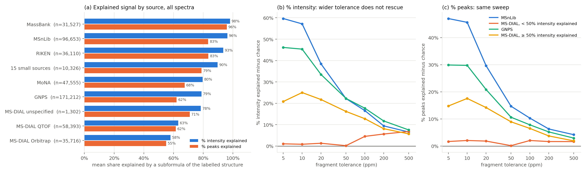

# Spectraverse sources, replicates and merge shape

> **Status:** FINDING · **Updated:** 2026-10-06
> Data audit plus a re-read of the oracle finding's sampled scores; led to the merged-train arm. A 2026-10-06 section records the reproducible pipeline.

## Result

- **MS-DIAL is the largest single drag.** It holds 95,411 spectra (20% of SPV) on 6,895
  molecules, with a median of 9 peaks. It is 16% of the validation sample but 46% of its
  `sub_inst` ≤ 0.5 block. The sampled validation mean is 0.458, or 0.508 without MS-DIAL.
- **The Na problem is mostly MS-DIAL.** `[M+Na]+` scores 0.120 inside MS-DIAL and 0.318 outside it.
- **Duplicates are common.** 33% of sampled spectra have a copy with cosine > 0.99 in their
  (molecule, adduct, instrument) group; 26% have one > 0.999. Cross-source pairs within 3 eV
  have a median cosine of 0.994, so the same spectra arrive through several libraries.
- **Replicates agree far above the model.** The leave-one-out mean of the other replicates in a
  group scores 0.70 (CE ignored); within ±3 eV it scores 0.76.
- **CE-missing spectra score like CE-bearing ones** (0.461 vs 0.456). GNPS and RIKEN carry no
  CE. Source confounds this comparison, so it is only a hint that the CE input does little here.

## Sources

`spec_df.pkl` drops the raw `SOURCE` field. Record *i* of `spectraverse-1.0.2.mgf` is
`dset_spec_id == i` (ACE matches `COLLISION_ENERGY_1` on every row). The mapping is in
`data/proc/spectraverse/spec_source.csv`, written by
`preproc_scripts/spectraverse/source_filter_split.py`. The repo's
`data/df/spectraverse_df.csv` (478,530 rows) is a different build and does not join.

| Source | Spectra | Molecules | Has CE | Val n | `model` | `opt_emit` | `sub_inst` |
| --- | ---: | ---: | ---: | ---: | ---: | ---: | ---: |
| GNPS | 171,212 | 24,392 | 0.2% | 756 | 0.454 | 0.733 | 0.829 |
| MSnLib | 96,656 | 14,916 | 100% | 291 | 0.651 | 0.925 | 0.986 |
| MS-DIAL | 95,411 | 6,895 | 96.8% | 332 | 0.203 | 0.398 | 0.616 |
| MoNA | 47,555 | 8,832 | 87.6% | 271 | 0.484 | 0.792 | 0.896 |
| RIKEN | 36,110 | 7,235 | 1.8% | 158 | 0.500 | 0.747 | 0.976 |
| MassBank | 31,527 | 5,603 | 99.7% | 161 | 0.554 | 0.907 | 0.998 |
| 15 small sources | 10,326 | | | 79 | | | |

| Adduct | MS-DIAL n | MS-DIAL `model` | Other n | Other `model` |
| --- | ---: | ---: | ---: | ---: |
| `[M+H]+` | 164 | 0.217 | 877 | 0.539 |
| `[M+Na]+` | 133 | 0.120 | 105 | 0.318 |
| `[M-H]-` | 22 | 0.496 | 449 | 0.540 |

MS-DIAL is 50% `[M+H]+` and 42% `[M+Na]+`, 61% QTOF. Its replicates within ±3 eV agree at
0.49, against 0.69 for same-source pairs overall. Why its spectra are bad (mass offset,
in-source fragments, or merged acquisitions) has not been checked.

### Why MS-DIAL spectra fail (added 2026-10-03)

Figure: `scripts/debug/spectraverse/spectraverse_source_quality_plot.py`. Panel (a) uses all spectra; panel (b) uses
the sampled sweep below.

**Explained signal (figure, 2026-10-04).** A peak is *explained* when it lies within tolerance
of a candidate ion of the labelled molecule. Per spectrum:

- **% intensity explained** = Σ I over explained peaks / Σ I over all peaks. I is the stored,
  base-peak-normalized intensity, taken linearly.
- **% peaks explained** = explained peaks / all peaks.
- **Candidates.** `_subformula_masses(formula, adduct)`: every subformula of the precursor ion
  whose neutral part has RDBE ≥ 0, plus charge-migration ions (`[M+Na]+` → `[frag+H]+`,
  `[M+Cl]-` → `[frag-H]-`).
- **Tolerance.** The SPV loss tolerance, rel × max(m/z, min_mz): Orbitrap 10 ppm / 200,
  QTOF 20 ppm / 750, ion trap and unspecified 20 ppm / 500.
- **Caveats.** Chance matches inflate both measures, and isotopes are not credited.
- **Data.** `preproc_scripts/spectraverse/subformula_explained.py` writes both measures for every
  spectrum to `data/proc/spectraverse/subformula_explained.csv`. The same matching code
  (`clean_train_split.subformula_hits`) reproduces the stored ceiling exactly.

| Source (all spectra) | n | % intensity explained | % peaks explained | < 50% intensity explained |
| --- | ---: | ---: | ---: | ---: |
| MassBank | 31,527 | 98.0 | 95.8 | 0.9% |
| MSnLib | 96,653 | 96.3 | 83.3 | 1.2% |
| RIKEN | 36,110 | 93.4 | 83.4 | 0.7% |
| 15 small sources | 10,326 | 89.7 | 78.9 | 6.2% |
| MoNA | 47,555 | 79.6 | 67.5 | 17.0% |
| GNPS | 171,212 | 78.8 | 62.1 | 17.3% |
| MS-DIAL unspecified | 1,302 | 78.3 | 70.9 | 22.0% |
| MS-DIAL QTOF | 58,393 | 63.1 | 61.5 | 35.7% |
| MS-DIAL Orbitrap | 35,716 | 58.0 | 55.0 | 41.7% |
| All | 488,794 | 81.5 | 70.4 | 15.6% |

The table gives means; medians are higher (all: 97.0% intensity, 80.0% peaks), because the
distribution is bimodal. Even clean sources explain fewer peaks than intensity: the unexplained
peaks are small (noise, isotopes, contaminants).

The earlier sections use the **subformula ceiling**,
sqrt(Σ I² explained / Σ I² all), with "unexplainable" meaning ceiling ≤ 0.5. It is the best
cosine a model limited to this molecule's ion masses could reach, and it is stored in
`data/proc/spectraverse/subformula_ceiling.csv` (`clean_train_split.py`).

The sample is 6,000 spectra per source; "bad" means a subformula ceiling ≤ 0.5. In it, 31% of
MS-DIAL spectra are bad, against 12% for GNPS and under 1% for MSnLib, MassBank and RIKEN.
Most bad MS-DIAL spectra hold fragments of a compound other than the labelled one.

- **Chimeric, about 43% of bad MS-DIAL.** On average 27% of their squared intensity sits more
  than 0.5 Da above the labelled precursor, against 2.9% for good MS-DIAL and 0.000 for MSnLib.
  These heavy peaks are not the compound's own adduct or dimer ions; only 1.4% of bad MS-DIAL
  spectra carry those.
  - The top heavy peak lands on some SPV compound's precursor m/z 50% of the time, against 15%
    for mass-shifted controls.
  - It sits +1 Da above the precursor in the commonest case (the ¹³C isotope), +4 Da at the
    median and +29.5 Da at p90. That fits co-isolation through a wide, DIA-like window.
- **Wrong compound, the rest.** Spectra without heavy peaks still do not fit the labelled
  structure. Only 9% of their base peaks are within 5 mDa of a subformula (good MS-DIAL 89%,
  MSnLib 99%), with signed errors spread ±170 mDa (p10/p90). Their ±3 mDa ceiling, 0.13, is
  about twice that of a same-width shifted window (0.06).
- **Not the cause: precision.** 82% of MS-DIAL spectra give m/z to ≤ 3 decimals, against
  < 4% elsewhere. But good MS-DIAL spectra still fit at 0.975 within ±10 mDa, so precision does
  not explain the failures.
- **GNPS shows the same pattern more weakly.** 12% are bad; their base peaks are within 5 mDa
  in 19% of cases, with a ±75–113 mDa spread.

**Cross-source check, no subformula logic (added 2026-10-04).** "Bad" below means < 50%
intensity explained.

- **Bad MS-DIAL spectra disagree with other sources of the same compound.** For each sampled
  spectrum, cosine (0.01 Da bins) against every other-source spectrum of the same molecule and
  adduct, any instrument (1,500 per group):
  - Median agreement: MSnLib 0.69, GNPS 0.50, good MS-DIAL 0.34, bad MS-DIAL 0.14.
  - 83% of bad MS-DIAL spectra have a well-explained other-source spectrum of the same molecule
    and adduct. Their best agreement with it is median 0.008, and 86% are below 0.5.
  - Only 52% of MS-DIAL spectra have the same molecule and adduct in another source at all.
- **The bad spectra are not MS-DIAL's own; MS-DIAL redistributes them.**
  - 61% of bad MS-DIAL spectra have a near-identical twin (> 0.9) in another source: 89% in GNPS,
    10% in MoNA.
  - The twins are just as bad (98.3% below 50% explained).
  - Spectraverse's compound-name cleaning removed library prefixes (99% plain names), so the
    upstream library cannot be named from the MGF. Names are mostly natural products.
- **Acquisition signature.**
  - CE ladder 10 / 20 / 40 / 60 / 80 eV; bad share by CE is 63% / 48% / 23% / 20% / 25%, against
    2–8% at 30, 35 and 50 eV.
  - 93% of bad spectra give m/z to ≤ 3 decimals.
  - At 10–20 eV the labelled precursor peak (±10 ppm) is present in 8% of bad spectra, 24% of
    good MS-DIAL and 73% of MSnLib.
  - The base peak sits near the labelled precursor but not on it: offset median +0.08 Da,
    quartiles −0.14 / +4.99 Da, commonest offsets ±0.1 Da and +2 / +4 / +6 / +8 Da.
- **Reading.** A base peak 0.1 Da from the labelled precursor is a different, near-isobaric ion,
  far beyond rounding or calibration error. Even-Da steps above it fit a co-isolated homologue
  series. These spectra look like wide-window acquisitions assigned to a target that was absent
  or weak.

Scripts: `msdial_vs_other_sources.py`, `msdial_twins.py`.

**ppm sweep.** Wider tolerance does not rescue bad MS-DIAL spectra. The sample is 4,000
MS-DIAL spectra plus 1,000–2,000 per comparison source. The ceiling uses pure ppm with no
absolute floor, against a chance control that moves every peak ±7 Da (keeping a realistic
mass defect).

| Excess over chance | 5 ppm | 10 | 20 | 50 | 100 | 200 | 500 |
| --- | ---: | ---: | ---: | ---: | ---: | ---: | ---: |
| MS-DIAL bad (ceiling ≤ 0.5) | −0.002 | −0.013 | −0.013 | −0.019 | +0.059 | +0.083 | +0.108 |
| MS-DIAL ok | +0.226 | +0.256 | +0.215 | +0.164 | +0.131 | +0.086 | +0.064 |
| MSnLib | +0.561 | +0.513 | +0.321 | +0.194 | +0.149 | +0.085 | +0.058 |
| MassBank | +0.585 | +0.589 | +0.497 | +0.345 | +0.294 | +0.206 | +0.106 |
| GNPS | +0.495 | +0.455 | +0.316 | +0.217 | +0.176 | +0.116 | +0.078 |

- **Bad MS-DIAL sits at chance through 50 ppm.** Only 3.8% (50 ppm) and 6.3% (100 ppm) gain
  more than 0.5 over chance. Each spectrum's intensity-weighted median signed error (peaks
  within 100 ppm) spreads from −72 to +66 ppm (p10/p90), against −7 to +9 for GNPS and −7 to +1
  for MSnLib. There is no shared offset to recalibrate. This is the wrong compound, not
  calibration.
- **MS-DIAL QTOF is near chance at every tolerance**, at +0.06–0.08. MS-DIAL Orbitrap carries
  real signal (+0.31 at 5 ppm). QTOF is 61% of MS-DIAL.
  Over all spectra, though, the share of bad spectra is similar: 34.6% of MS-DIAL Orbitrap
  (35,716) and 30.2% of MS-DIAL QTOF (58,393). Orbitrap has more good spectra that fit well,
  but just as many bad ones, so an instrument-only filter would miss a third of MS-DIAL Orbitrap.
- **Good MS-DIAL spectra are less accurate** (p10/p90 −11/+16 ppm). They need about 20 ppm
  (ceiling 0.840) to reach where MSnLib is at 10 ppm (0.970).
- **Wide windows mostly match by chance.** At 50 ppm the chance control already explains
  0.62–0.80 of every source's intensity, and at 100 ppm 0.70–0.85. This applies to any loss or
  oracle window beyond about 20 ppm, including the ±0.05 Da arm (100 ppm at m/z 500).

Script: `msdial_ppm_sweep.py` (rows in `msdial_ppm_sweep.csv`).

Why Spectraverse's filters pass these spectra
([curation note](../../notes/spectraverse_curation_paper.md)):

- The precursor check (≤ 10 ppm from the annotated structure) tests only the precursor m/z,
  which matches.
- The above-precursor filter drops a spectrum only when *every* fragment is above the precursor.
- No step tests whether the fragments fit the annotated structure. The paper also skips
  denoising and source-specific rules on purpose.

The MS-DIAL compound names carry no sub-library tag (99% untagged), so which upstream
contributor or acquisition mode produced these spectra cannot be traced from the MGF.
Scripts: `msdial_defects.py`, `msdial_chimera.py`, `msdial_masserr.py` in the artifact
directory.

## Replicates

4,000 sampled groups with ≥ 3 spectra; one held-out spectrum each, cosine at 0.01 Da on raw
intensity.

| | n | Mean | Median |
| --- | ---: | ---: | ---: |
| Mean of other replicates, any CE | 4,000 | 0.700 | 0.795 |
| Nearest replicate, any CE | 4,000 | 0.842 | 0.954 |
| Mean of replicates within ±3 eV | 1,476 | 0.761 | 0.872 |
| Same-source pair within ±3 eV | 1,275 | 0.689 | 0.775 |
| Cross-source pair within ±3 eV | 276 | 0.849 | 0.994 |

Near-duplicate share (nearest > 0.99) by source: MoNA 0.70, GNPS 0.48, MassBank 0.35,
MS-DIAL 0.25, MSnLib 0.14, RIKEN 0.12. These are same-molecule ceilings, not a model target:
validation molecules are unseen.

## Merge shape (cv0 train)

`group_id` is (molecule, adduct, instrument) and spans sources and CE patterns.

| | Value |
| --- | --- |
| Train rows → groups | 387,399 → 75,148 (5.16×) |
| Rows per group | p50 3, p90 10, p99 39, max 370 |
| Groups spanning > 1 source | 27.8% |
| Groups all CE-missing / mixed | 43.8% / 20.9% |
| Groups all MS-DIAL / mixed with MS-DIAL | 6.4% / 9.3% |
| Exact-sum peaks per group | p99 4,645, max 37,224 |
| Tolerance-consensus peaks per group (4,000-group sample) | p50 69, p99 1,772, max 12,415 |

Relative floors do not bound the consensus tail (1% floor: p99 426, max 9,268). A top-512 cap
touches 8.8% of groups and keeps cosine ≥ 0.999 to the uncapped target for 99% of them; the
groups it cuts hard are flat noise with thousands of peaks.

## Data version and folds

- **Version.** The local MGF is Zenodo v1.0.2 (2026-05-03, DOI 10.5281/zenodo.19927403), md5
  `50803b370a118299bfef3e9485ef6895`. As of 2026-10-03 it is the latest of three releases
  (v1.0.0 2025-10-02, v1.0.1 2025-12-10).
- **`spec_df.pkl` matches it** on all 488,797 records: order, precursor m/z, adduct and peak count.
- **Our folds are the MGF's own `FOLD` field.** `data/split/spectraverse_benchmark/cv{k}` uses
  test = `FOLD` k+1 and val = the fold before it (cv0: test 1, val 10), and train is the other
  eight. All ten checked with `scripts/debug/spectraverse/spectraverse_data_check.py`, which also
  checks the md5 and the record-by-record match.
- **`FOLD` is the benchmark's MCES split.** It is disjoint by 2D InChIKey (0 of 44,234
  skeletons span folds) but not by formula (4,481 formulas do), and it keeps close analogs
  together. Of the analogs at Morgan-2048 Tanimoto ≥ 0.9 to 3,000 sampled molecules, 10.6% sit
  in another fold, against 90.0% under a random skeleton-level split of the same sizes.
  Same-fold nearest neighbours are also more similar than other-fold ones (0.658 vs 0.626;
  random split 0.584 vs 0.715). The benchmark paper defines its folds as MCES-distance-3
  single-linkage clusters packed greedily into ten folds
  ([note](../../notes/spurious_evaluations_spectraverse.md)). Each fold holds about 4.2k
  skeletons; fold 1 has 6,079.
- **Earlier releases are now local.** v1.0.0 and v1.0.1 (md5-verified) are in
  `data/raw/spectraverse/spectraverse-1.0.{0,1}/`. v1.0.1 holds the same spectra as v1.0.2 without the
  `FOLD` field. See the [curation note](../../notes/spectraverse_curation_paper.md) for the release
  comparison.
- **The fold CSVs in `data/df/` are pre-1.0.2.** `spectraverse_fold_{inchi,form,mces,mcesform}_*.csv`
  and `spectraverse_df.csv` (Oct 2025) are built from v1.0.0 and do not join to `spec_df`.
- **Candidate sets are not local.** The v1.0.2 candidate JSONs (formula and mass) are on Zenodo
  but not in `data/raw/spectraverse/`.

## Method and limits

Artifacts (ignored): `output/analysis/spectraverse_source_audit_2026_10_03/`
(`spv_replicates2.py`, `spv_replicates.csv`, `spv_merge_probe.py`). Model scores are the
oracle finding's last-checkpoint values (`ggifzj9m` / `u46v0k0g`, pre-`fill_missing_ace`) on
1,024 sampled validation spectra per fold, re-grouped by source. Replicate cosines use raw
intensity, not the model's transform. An earlier pass in this session joined source through
`spectraverse_df.csv` by title number; that join was wrong (precursor m/z agreed on 0.03% of
rows) and nothing from it is used here.

## Reproducible pipeline (2026-10-06, from project-state handoff; uncommitted at the time)

- **Problem.** Step 1 (`preproc_scripts/01_prepare_df.py`) could not read the v1.0.2 MGF (a single `FOLD` field, no `INDEX`), and nothing in git built the benchmark folds.
- **Now.** `01_prepare_df.py` reads v1.0.2 and writes `<name>_fold.csv` (`spec_id,dset_spec_id,fold`). `preproc_scripts/spectraverse/build_benchmark_split.py` rebuilds `cv0..9` (test = `FOLD` k+1, val = `FOLD` k); its output matches all 30 existing fold files by `spec_id`.
- **Step 2** needs `--skip_standardize` to match the stored pickles (checked on 2,000 spectra).
- **Stale columns.** The existing `data/split/spectraverse_benchmark*` `mol_id`/`group_id` columns are a stale permutation; loaders select by `spec_id`, so earlier runs are unaffected. Nothing under `data/` was rewritten.
- Commands: [`preproc_scripts/README.md`](../../../preproc_scripts/README.md). Tests: `tests/test_spectraverse_mgf_reader.py`, `tests/test_spectraverse_benchmark_split.py`.
