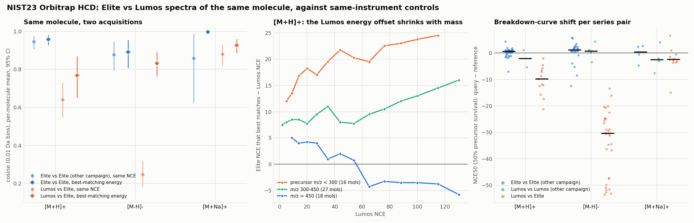
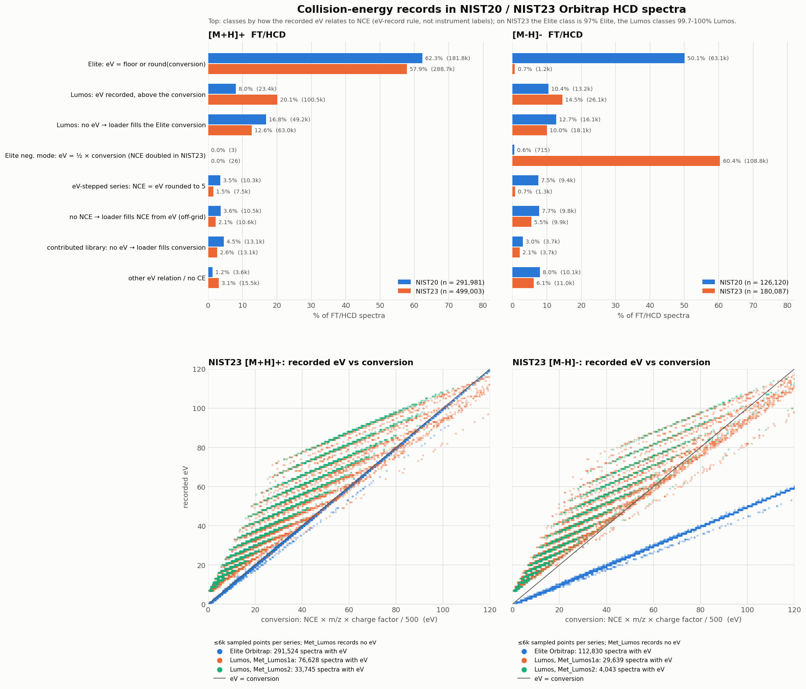
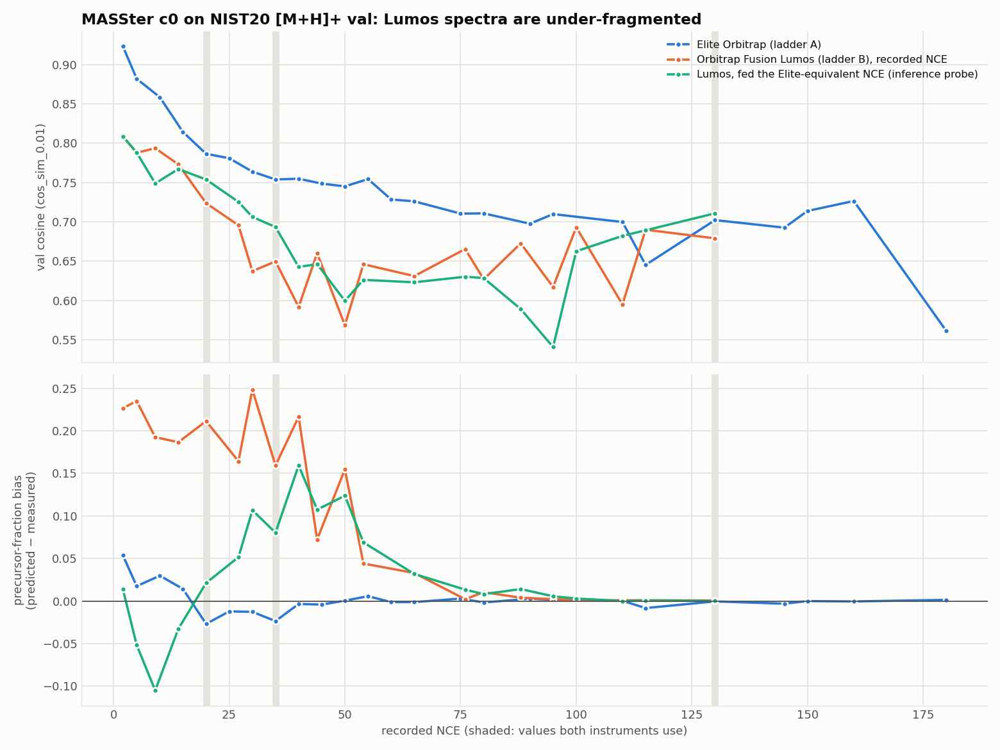

# NIST Orbitrap instruments: two collision-energy scales, and MASSter's Lumos bias

> **Status:** FINDING · **Updated:** 2026-10-01
> `OB` / `OB_F` were renamed `ORB` / `ORB_F` on 2026-10-01 (§7); `i1`/`i2` have finished (§8).
> The two NCE "ladders" in NIST20/NIST23 Orbitrap HCD are two instruments, the Elite Orbitrap
> and the Orbitrap Fusion Lumos. For the same molecule their spectra differ well beyond
> same-instrument repeat variation. Part of the difference is a mass-dependent energy offset;
> part remains at the best-matching energy. MASSter `c0` under-fragments Lumos val spectra, and
> no energy relabel at inference fixes it. **Implemented:** `inst_type` now labels Orbitraps
> `OB` / `OB_F`, renamed `ORB` / `ORB_F` on 2026-10-01, and `FT` is retired (§7); NIST20/NIST23 are relabelled locally from their raw
> MSP instrument fields, and the template's `ace_max` is 460. **Training (§8):** `n4`
> on the new labels (`i1`) leads `n4` by +0.021 val cosine epoch-matched, and the smooth-energy
> penalty falls from −0.021 to −0.004 (`i2` − `i1`). On the finished `i1`, full-split Lumos val
> gains +0.054 and Elite +0.025 over `c0`, and the Lumos precursor-fraction bias falls from +0.092
> to +0.020 (§8). **Revisions:** same-molecule tests use NIST23's recorded instrument labels with
> same-instrument null controls. NIST23 turned out to have doubled the negative-mode Elite NCE,
> which reverses the negative-mode reading. Five earlier claims are withdrawn (§Withdrawn).

## Answer

1. **The ladders are instruments.** NIST23's raw MSP names the instrument in every record.
   - `[M+H]+` ladder A (NCE 10, 15, 20, … 60, 75, 90, 110, 130, 160) is the **Thermo Elite
     Orbitrap** (NIST campaigns `Met_2017`-`Met_2022`).
   - Ladder B (NCE 2, 5, 9, 14, 20, 27, 35, 44, 54, 65, 76, 88, 100, 115, 130) is the
     **Orbitrap Fusion Lumos** (`Met_Lumos`, `Met_Lumos1a`, `Met_Lumos2`).
   - Our `spec_df.pkl` drops both fields (§1).
2. **For the same molecule, Elite and Lumos spectra are far apart** (§3, figure). The null
   control is the same instrument, same molecule, same NCE, but a different NIST campaign.

   | `[M+H]+`, same NCE | Elite vs Elite (null) | Lumos vs Elite |
   | --- | ---: | ---: |
   | cosine, 0.01 Da bins | 0.946 [0.907, 0.976] (46 molecules) | **0.640** [0.547, 0.728] (34) |
   | cosine, tolerance-matched | 0.985 [0.972, 0.995] | **0.715** [0.648, 0.775] |
   | breakdown curve, ΔNCE50 | +0.5 (44 pairs) | **−9.8** [−12.5, −6.4] (13) |

   The gap is not binning, m/z calibration (≈1 ppm), the intensity floor, the low-m/z range or
   interpolation (§3.3).
3. **Part of it is energy, and the offset depends on mass.** A Lumos `[M+H]+` spectrum best
   matches the Elite at higher NCE:
   - +17 to +21 below m/z 300;
   - +9 to +10 at m/z 300-450;
   - about 0 above m/z 450.

   `[M+Na]+` barely shifts. `[M-H]-` looks like 2.1-2.3× in NIST23's labels, but that is
   NIST23 doubling the Elite's negative-mode NCE (item 7). On NIST20's NCE it is about
   1.1-1.2×, like positive mode.
4. **Part of it is not energy.** At each Lumos spectrum's best-matching Elite energy:
   - `[M+H]+` cosine is 0.768 against 0.957 for the Elite-vs-Elite null (tolerance-matched:
     0.848 [0.784, 0.905] vs 0.966 [0.951, 0.980]).
   - At that energy the Lumos spectrum still has less precursor (−0.092) and more deep
     fragments (+0.071).

   A Lumos spectrum is not an Elite spectrum at another energy.
5. **Recorded eV is a common axis only where it exists, and NIST20 lacks it.** For `Met_Lumos1a`
   the recorded eV equals the Elite recorded eV at the matched energy (ratio 0.99, 440 spectra).
   `Met_Lumos`, the bulk of NIST20's Lumos, records no eV, and `Met_Lumos2` cannot be tested
   (1 molecule).
6. **MASSter `c0` under-fragments Lumos spectra of new molecules** (§5). With NIST20's raw
   instrument labels:
   - Val cosine is 0.745 on Elite against 0.688 on Lumos; the gap is +0.053 after matching NCE
     bin, novelty and m/z.
   - Lumos precursor-fraction bias is +0.092; train shows none.
   - Relabelling the input at inference does not fix it (§6). An Elite-equivalent NCE costs
     −0.006 net, and an eV-derived NCE costs −0.039 and flips the bias to −0.066.
   - A fix needs an instrument input at training time.
7. **NIST23 doubled the NCE of Elite and Velos negative-mode spectra, and kept their eV** (§2).
   - Matched spectrum for spectrum (molecule, adduct, m/z and eV), NCE_NIST23 / NCE_NIST20 is
     2.00 for 163,246 Elite negative-mode spectra; only 0.8% are unchanged. By NIST# in the two
     raw exports, the collision-energy string is identical for 8.8% of Elite negative-mode
     spectra and for 100% of Lumos spectra.
   - Elite positive mode is 95.2% identical. NIST23 raised the other 24,191 by one ladder step
     (45 → 50, 65 → 75, 95 → 110; median ×1.13) and kept the eV. For those the eV fits
     `floor(conversion)` at neither NCE (`[M+H]+`: 21% on NIST20's, 37% on NIST23's, against 95%
     for unchanged spectra), so which NCE is right is open.
   - So NIST23's "eV = ½ × conversion" is a doubled NCE, not a halved eV. The eV is the same
     in both releases, and it matches the Lumos eV at the matched energy (0.97).
   - The NIST23 NCE values above 200 (28,298 spectra, 1.8% of FT/HCD) are these doubled
     values.
8. **Implemented: `OB` / `OB_F` instrument labels** (§7). A config or `spec_df` that still says
   `FT` is refused. The c0/n4 configs now feed a two-class instrument embedding, so rerunning
   n4 on the relabelled data is the instrument-input arm.
9. **The instrument input is worth about +0.02 val cosine mid-run** (§8, one seed, running).
   `i1` (`i50ig7rf`, `n4` on `OB` / `OB_F`) leads `n4` at every epoch, +0.021 over epochs
   10-21. It passes `n4`'s 64-epoch best at epoch 9. The gain exceeds what closing the Lumos
   gap alone would give (about +0.015).

*NIST23 labels. The `[M-H]-` Elite NCE is NIST23's doubled value (item 7), which is most of that
column's gap in the right panel.*

## Data and method

- **Data.** `data/proc/nist20/spec_df.pkl` and `data/proc/nist23/spec_df.pkl`, FT/HCD MS2, all
  splits unless stated. NIST23 instrument, raw CE string and `Notes` (campaign
  `Data_source`, `Vial_ID`, `Nreps`) come from `data/df/nist23_hr_df.csv` (`inst`, `col_energy`,
  `notes`), joined on `dset_spec_id` = NIST# (96.4% of FT/HCD rows; the rest are contributed
  libraries).
- **NIST20 instrument labels.** NIST20 comes from the raw export
  `data/raw/nist_20/nist_20_hr_msms.zip` (re-exported 2026-09-28, 1,019,986 records, joined on
  NIST#). The export lacks 5,537 of the processed spectra; NIST23 names them by the same NIST#,
  all Lumos. NIST# is stable across releases: 1,011,493 records are in both, and none changes
  instrument. The 142,175 `mona23` rows of `data/proc/nist20` (MoNA 2023) name no model.
  - Until the export arrived, NIST20 labels were inferred, and two sets are still used below.
    One takes the NIST23 instrument of spectra with the same InChIKey block 1, adduct, NCE and
    precursor m/z (2 dp). The other is an eV-record rule: floor/round eV → Elite; eV above the
    conversion, or a NIST spectrum with no eV → Lumos.
  - On NIST20 `[M+H]+` FT/HCD (291,981), the eV rule labels 87.1% and is 97.0% right where it
    labels. The NIST23 match labels 84.8% and is 97.9% right. The rule calls an Elite high-NCE
    add-on series (NCE 95/115, eV about 4% above the conversion) Lumos, and 91% of Velos spectra
    Elite.
  - The eV-rule labels feed the §2 census, the §4 table and the §5 figure. The NIST23-matched
    labels feed §6. The §5 table uses the raw field.
- **Fragmentation extent**, on a unit-normalized peak list:
  - *precursor fraction* is the intensity within max(0.01 Da, 10 ppm) of the precursor m/z;
  - *deep* is the intensity below half the precursor m/z;
  - *centroid* is the intensity-weighted m/z divided by the precursor m/z.

  Model *bias* is prediction minus target, on the evaluated arrays `cos_sim_0.01` bins.
- **Same-molecule design (NIST23).**
  - A *series* is (molecule, adduct, instrument, campaign).
  - Spectra are compared at exact shared NCE values; against an Elite ladder interpolated as a
    linear mixture of the two bracketing spectra, over a shift or scale grid; or at each query's
    best-matching Elite energy.
  - Nulls: Elite-vs-Elite and Lumos-vs-Lumos pairs from different campaigns, run through the
    same computation.
  - Intervals are 95% molecule bootstraps.
- **Model.** `c0` (`vcpho5qm`, `saved_ckpts/c0_control_vcpho5qm.ckpt`,
  [config](https://github.com/FraGNNet/frag-gnn/blob/8c52c6d3/config/masster/mh_ft_memorization_route_2026_09_24/c0_control.yml)), NIST20
  `[M+H]+`/FT unmerged. It was run on all 52,020 val spectra and on every spectrum of 4,000
  seeded train molecules. Novelty is the max Tanimoto (Morgan r2, 2,048 bits) to the train
  split.

## 1. Which spectra come from which instrument

NIST23 HR-MS/MS by raw `Instrument` field:

| Instrument | Spectra | Of which HCD | NIST campaigns (`Notes: Data_source`) | eV recorded (`[M+H]+`) |
| --- | ---: | ---: | --- | --- |
| Thermo Finnigan Elite Orbitrap | 1,120,945 | 1,030,767 | `Met_2017` … `Met_2022`, `Met_Isotopic` | yes |
| Orbitrap Fusion Lumos | 749,126 | 641,065 | `Met_Lumos1a` (393k), `Met_Lumos` (209k), `Met_Lumos2` (96k), `Met_Isotopic` | `Met_Lumos` never; `Met_Lumos1a`, `Met_Lumos2` always |
| Thermo Finnigan Velos Orbitrap | 13,925 | 13,042 | none recorded | yes |
| Agilent QTOF 6530 | 50,647 | – | – | – |

- The non-HCD rows are ion-trap CID at `NCE=35%`.
- All three Orbitraps record `res` 4 and N2, so `res` and `col_gas` cannot separate them.
- NIST20 holds 79% of NIST23's `Met_Lumos` and 68% of `Met_Lumos2` FT/HCD spectra, but 0.7% of
  `Met_Lumos1a`.
- Lumos rises from 25% of `[M+H]+` FT/HCD in NIST20 (72,357, raw field) to 35% in NIST23
  (173,992).
- NIST's Elite and Lumos campaigns mostly measured different molecules. NIST23 has 105
  `[M+H]+`, 67 `[M-H]-` and 32 `[M+Na]+` molecules on both instruments.

## 2. How collision energy is recorded

*Top: `[M+H]+` and `[M-H]-` FT/HCD spectra by eV-record class; bar labels say what the dual-CE
loader does. Bottom: NIST23 recorded eV against the conversion, with Elite, `Met_Lumos1a` and
`Met_Lumos2` shown separately (`Met_Lumos` records none).*

Share of `[M+H]+` FT/HCD spectra by CE record (eV-rule classes), which is what the dual-CE loader
sees:

| Class | What the loader does | NIST20 (291,981) | NIST23 (499,003) |
| --- | --- | ---: | ---: |
| Elite: NCE set, eV = floor/round of the conversion | both exact to 1 eV | 62.3% | 57.9% |
| Lumos: eV recorded above the conversion | eV on its own scale | 8.0% | 20.1% |
| Lumos: no eV | fills eV by the Elite conversion | 16.8% | 12.6% |
| eV-stepped series: NCE = eV rounded to 5 | NCE off by up to ±2.5 | 3.5% | 1.5% |
| no NCE (eV only; contributed) | fills NCE from eV, off the NCE grid | 3.6% | 2.1% |
| contributed library, no eV | fills eV by conversion | 4.5% | 2.6% |
| other relation / no CE | – | 1.2% | 3.1% |

- **Conversion.** `conversion = NCE × m/z × charge factor / 500`.
  - Elite positive mode records `floor(conversion)`, e.g. `NCE=15% 11eV`.
  - Lumos `Met_Lumos1a` records `≈ 0.998·conversion − 18.4·(m/z/500) + 22.0`, and `Met_Lumos2`
    `≈ 1.21·conversion − 26.5·(m/z/500) + 21.7`, e.g. `NCE=2% 7eV`. Both sit above the
    conversion by an amount that shrinks with m/z.
  - `Met_Lumos` has `NCE=44%` with no eV.
  - **Better form (added 2026-09-29).** Below m/z 500 the Lumos eV is a mass-independent offset
    plus an NCE slope that is linear in m/z with an intercept:
    - `Met_Lumos1a`: `eV = 5.66 + NCE × (0.397 + 0.00098·m/z)`, within 1 eV for 90.9% of
      71,035 `[M+H]+` spectra;
    - `Met_Lumos2`: `eV = 5.86 + NCE × (0.396 + 0.00102·m/z)`, within 1 eV for 100% of 33,823.

    The Elite slope is `m/z/500 = 0.002·m/z` with no intercept. Above m/z 500 the Lumos eV rises
    faster than this form (median residual +0.7 eV at 500-700, +8 to +16 above 700). The rule
    reproduces §3.2's mass-dependent Elite-equivalent NCE shift from the eV record alone (at
    NCE 20-35: about +17 to +21 at m/z 250, +8 at 375, +2 to 0 at 500). The two instruments
    share one eV axis; the Lumos NCE is on its own scale. No Thermo document for the Tribrid conversion was found.
  - **Lumos HCD is not ion-trap CID (checked 2026-09-29).** NIST labels ion-trap rows
    `IT-FT/ion trap with FTMS`, always `NCE=35%` and never with an eV; the `HCD` filter drops
    them. On NIST23 `[M+H]+` MS2 at m/z 300-900 (15,000 sampled spectra per group), the share
    with a ≥ 1% peak below 0.25 × precursor m/z is 0.720 for Lumos HCD (0.289 at NCE ≤ 14),
    0.655 for Elite HCD, and 0.000 / 0.007 for Lumos / Elite ion-trap CID, whose resonance
    activation leaves a cutoff near 0.28 × precursor m/z.
- **The loader keeps recorded values.** It converts only missing ones, by the Elite
  convention (`base_dataset.py`, `_fill_ce_scalar_vectorized`). It fills every `Met_Lumos`
  spectrum, which is 68% of NIST20 Lumos `[M+H]+`.
- **NIST23 negative mode.** NIST23 records Elite and Velos negative-mode spectra at twice
  NIST20's NCE, with the same eV (spectra matched on molecule, adduct, m/z and eV:
  NCE ratio 2.00, 10th-90th percentile 2.00-2.25, 163,246 spectra). That is why their eV reads
  as ½ × conversion in NIST23. NIST20's NCE and both releases' eV agree with the Lumos
  (§3.2). Which NCE the instrument was actually set to cannot be told from the data. NIST23
  also moved 4.8% of Elite positive-mode spectra up one NCE ladder step (Answer item 7).
- **Energy maxima.**
  - Recorded FT eV reaches 457 (NIST20) and 375 (NIST23; 376.4 after filling). Under
    `embed`/`embed_clamped` everything above `ace_max` shares one row: 3.5% (NIST20) and 3.9%
    (NIST23) of FT spectra at the old template value 100, and 0.003% at the 300 MASSter configs
    pin.
  - Recorded NCE tops out at 195 in NIST20. NIST23 goes to 320 (220, 250, 280, 320): the
    doubled Elite negative-mode values.

## 3. How different: same molecule, with null controls (NIST23)

### 3.1 At the same NCE

| same molecule, same NCE | `[M+H]+` | `[M-H]-` | `[M+Na]+` |
| --- | ---: | ---: | ---: |
| Elite vs Elite, other campaign (null) | 0.946 [0.907, 0.976] (46) | 0.876 (28) | 0.858 (6) |
| Lumos vs Elite | **0.640** [0.547, 0.728] (34) | **0.247** (25) | 0.880 (20) |
| interpolation ceiling (Elite leave-one-out, gap 10) | 0.994 | 0.962 | 0.994 |

Cosine is on 0.01 Da bins, per-molecule means (molecules in brackets).

- **Tolerance matching.** With greedy matching at max(0.01 Da, 10 ppm) for `[M+H]+`, the null
  is 0.985 [0.972, 0.995] and Lumos vs Elite 0.715 [0.648, 0.775].
- **m/z calibration.** Matched peaks differ by +1.1 ppm (Lumos − Elite) against −1.2 ppm
  between Elite campaigns.

### 3.2 Energy: how much, and in what form

- **Breakdown curves (NCE50, 50% precursor survival; series with ≥ 4 NCE values).** Query minus
  reference:
  - `[M+H]+`: −9.8 [−12.5, −6.4] (13 pairs), against +0.5 [+0.3, +0.7] (44) Elite-Elite.
  - `[M-H]-`: −30.4 [−36.3, −26.5] (31), in NIST23's doubled Elite NCE (§2).
  - `[M+Na]+`: −2.5 [−3.6, −0.5] (11).
  - Lumos-Lumos, all adducts: +0.4 (12).
- **Best shift of the interpolated Elite ladder** (maximizing mean cosine of each series pair):
  - `[M+H]+`: +7.0 [+1.5, +10.5], positive for 77% of 22 molecules. Elite-Elite gives −0.2
    [−0.5, 0.0] (46).
  - `[M-H]-`: a multiplicative scale fits better than a shift (cosine 0.842 against 0.741), at
    median ×2.23. The Elite side is NIST23's doubled NCE (§2), so on NIST20's labels this is
    about ×1.1.
  - `[M+Na]+`: +0.8 [−4.0, +1.5].
- **The `[M+H]+` offset depends on mass** (Elite-equivalent NCE of each Lumos spectrum, 61
  molecules, figure centre). The median shift is:
  - +17 at m/z 200-300 (16 molecules);
  - +9.5 at 300-450 (24);
  - +0.2 above 450 (18).

  It is the same in `Met_Lumos` (no eV) and `Met_Lumos1a`. It is neither constant in NCE nor in
  eV (+9.6 eV → +0.2 eV). Pooled over masses it is +7 to +11 at every Lumos value
  (per-NCE table).
- **Offset or scale, by adduct.** A linear fit of the Elite-equivalent NCE of each Lumos spectrum
  against its NCE (interior optima; 95% molecule-bootstrap CI;
  `elite_vs_lumos_scale.py`):

  | adduct | molecules | slope | offset (NCE) | ratio at NCE ≥ 20 | Lumos eV ÷ Elite eV at match |
  | --- | ---: | --- | --- | ---: | ---: |
  | `[M+H]+` | 61 | 0.92 [0.81, 1.00] | +11.8 [+9.0, +14.4] | 1.14 | 1.00 |
  | `[M+H-H2O]+` | 28 | 0.94 [0.88, 1.01] | +15.2 [+11.2, +19.6] | 1.16 | 0.95 |
  | `[M+Na]+` | 28 | 0.85 [0.60, 0.95] | +8.4 [+2.9, +17.9] | 1.00 | 1.02 |
  | `[M-H]-` | 55 | 1.73 [1.49, 1.93] | +30.2 [+22.9, +38.2] | 2.31 | 0.97 |

  - Positive mode is an offset with slope about 1, shrinking with mass: the `[M+H]+` ratio at
    NCE ≥ 20 is 1.37 below m/z 300, 1.15 at 300-450 and 0.99 above 450.
  - Negative mode shows a scale factor in NIST23's labels: 3.3× below m/z 300, 2.4× at
    300-450, 2.1× above 450. The Elite side of these is the doubled NCE (§2). Halving it
    gives about 1.1-1.2× at NCE ≥ 20, like positive mode.
- **Recorded eV at the matched energy.** Lumos recorded eV ÷ Elite recorded eV at the Elite NCE
  that best matches:
  - `[M+H]+` 1.00 (IQR 0.92-1.08; 440 of 449 spectra from `Met_Lumos1a`);
  - `[M-H]-` 0.97 (the eV is the same in NIST20 and NIST23);
  - `[M+Na]+` 1.02.

  It holds in every NCE bin (0.91-1.10). The NCE conversion gives 0.41 below NCE 15 and 0.82
  overall. For `Met_Lumos1a`, then, the recorded eV captures the energy offset. `Met_Lumos` has
  no eV, and `Met_Lumos2` is 1 molecule.

### 3.3 Beyond energy

- **At each query's best-matching Elite energy** (a max over the grid, so optimistic; the null
  gets the same treatment):
  - `[M+H]+`: Lumos 0.768 (tolerance 0.848 [0.784, 0.905], 26 molecules); null 0.957 (0.966
    [0.951, 0.980], 46).
  - `[M-H]-`: 0.831 against 0.891.
  - `[M+Na]+`: 0.926 against 0.996 (5 null molecules).
- **Shape at that energy.** Where the Elite precursor fraction is 0.05-0.95, the Lumos spectrum
  has:
  - `[M+H]+`: precursor −0.092 [−0.144, −0.044] and deep fragments +0.071 [+0.002, +0.148]
    (20 molecules);
  - `[M+Na]+`: −0.091 and +0.049;
  - `[M-H]-`: −0.050 and +0.048.

  The Elite-Elite null is −0.015 / +0.004. So the cosine-best energy still under-fragments the
  Lumos: its spectra combine a lower-energy fragment pattern with more depletion and more deep
  fragments.
- **Artefact checks.** At the best shift, a common 1% intensity floor leaves `[M+H]+` cosine
  unchanged (0.757), and dropping m/z < 100 moves it to 0.744.
- **Acquisition.** At every NCE bin, Lumos spectra carry about twice as many peaks (`[M+H]+` at
  NCE 30-50: median 28 vs 15). They also have a lower relative floor (0.0012 vs 0.0017) and more
  intensity below m/z 100 (0.237 vs 0.136).
- **Lumos campaigns among themselves.** Lumos-Lumos cross-campaign pairs agree less well than
  Elite-Elite ones (`[M+H]+` 0.888, 6 molecules, vs 0.956). That is too few molecules to
  separate `Met_Lumos`, `Met_Lumos1a` and `Met_Lumos2`.

## 4. Per-NCE comparison

`[M+H]+`, E = Elite, L = Lumos, NIST20 labels matched to NIST23; – means fewer than 100 spectra
(8 molecules for the equivalence column).

- Measured columns are all splits. They compare different molecules, so chemistry is not
  controlled; §3 is.
- The equivalence column is the same-molecule NIST23 median over all masses, which hides the
  mass dependence of §3.2.
- [CSV](../figures/nist_orbitrap_elite_vs_lumos_per_nce.csv).

| NCE | NIST20 spectra E / L | measured prec. frac. NIST20 E / L | NIST23 E / L | Lumos → Elite-equivalent NCE, NIST23 same-molecule (mols) | `c0` val cos E / L | `c0` prec-frac bias E / L |
| ---: | ---: | ---: | ---: | ---: | ---: | ---: |
| 2 | 1,975 / 1,996 | 0.782 / 0.630 | 0.816 / 0.605 | 10.5 (21) | 0.920 / 0.812 | +0.056 / +0.229 |
| 5 | 2,093 / 2,760 | 0.760 / 0.559 | 0.780 / 0.520 | 15.0 (27) | 0.880 / 0.792 | +0.025 / +0.234 |
| 9 | – / 3,529 | – / 0.479 | – / 0.444 | 18.5 (35) | – / 0.795 | – / +0.194 |
| 10 | 4,625 / – | 0.652 / – | 0.679 / – | – | 0.856 / – | +0.044 / – |
| 14 | – / 4,418 | – / 0.393 | – / 0.359 | 22.5 (39) | – / 0.775 | – / +0.188 |
| 15 | 6,289 / – | 0.547 / – | 0.583 / – | – | 0.809 / – | +0.022 / – |
| 20 | 8,251 / 5,215 | 0.466 / 0.296 | 0.499 / 0.262 | 28.8 (44) | 0.776 / 0.725 | −0.025 / +0.205 |
| 25 | 8,983 / – | 0.387 / – | 0.416 / – | – | 0.774 / – | −0.007 / – |
| 27 | – / 4,859 | – / 0.193 | – / 0.166 | 36.2 (45) | – / 0.696 | – / +0.166 |
| 30 | 10,372 / 736 | 0.312 / 0.155 | 0.336 / 0.154 | – | 0.761 / 0.640 | −0.010 / +0.251 |
| 35 | 10,416 / 5,118 | 0.244 / 0.103 | 0.267 / 0.083 | 45.5 (48) | 0.750 / 0.647 | −0.023 / +0.157 |
| 40 | 11,698 / 757 | 0.198 / 0.064 | 0.216 / 0.064 | – | 0.753 / 0.596 | −0.001 / +0.218 |
| 44 | – / 4,973 | – / 0.039 | – / 0.031 | 51.8 (47) | – / 0.658 | – / +0.074 |
| 45 | 11,121 / – | 0.159 / – | 0.175 / – | – | 0.746 / – | −0.002 / – |
| 50 | 11,654 / 759 | 0.129 / 0.020 | 0.142 / 0.020 | – | 0.744 / 0.572 | +0.002 / +0.157 |
| 54 | – / 4,953 | – / 0.011 | – / 0.009 | 60.8 (47) | – / 0.643 | – / +0.045 |
| 60 | 11,126 / – | 0.075 / – | 0.084 / – | – | 0.724 / – | −0.000 / – |
| 65 | 773 / 5,663 | 0.062 / 0.003 | 0.050 / 0.002 | 71.8 (51) | 0.712 / 0.629 | +0.003 / +0.033 |
| 75 | 11,471 / – | 0.034 / – | 0.038 / – | – | 0.705 / – | +0.004 / – |
| 76 | – / 4,824 | – / 0.000 | – / 0.000 | 84.0 (45) | – / 0.665 | – / +0.002 |
| 88 | – / 4,711 | – / 0.000 | – / 0.000 | 98.8 (43) | – / 0.671 | – / +0.004 |
| 90 | 10,903 / – | 0.012 / – | 0.017 / – | – | 0.691 / – | +0.003 / – |
| 100 | – / 4,545 | – / 0.000 | – / 0.000 | 111.0 (41) | – / 0.691 | – / +0.002 |
| 110 | 11,371 / 589 | 0.004 / 0.000 | 0.006 / 0.000 | – | 0.694 / 0.595 | +0.000 / +0.001 |
| 115 | 157 / 4,370 | 0.026 / 0.000 | 0.010 / 0.000 | 123.8 (37) | – / 0.688 | – / +0.001 |
| 130 | 10,905 / 4,751 | 0.002 / 0.000 | 0.003 / 0.000 | 140.5 (30) | 0.696 / 0.676 | −0.000 / +0.001 |
| 160 | 9,591 / – | 0.001 / – | 0.001 / – | – | 0.723 / – | −0.000 / – |

## 5. MASSter `c0` on the two instruments

*(The figure uses the eV-rule labels; the table uses the raw instrument field. Every `c0` val
spectrum has a NIST#. With the NIST23-matched labels used before, which left 4,890 val spectra
unlabelled, the Lumos column read 0.6872 / +0.0921 / +0.0512.)*

| NIST20 `[M+H]+`, raw instrument | Elite | Lumos | Velos |
| --- | ---: | ---: | ---: |
| val spectra / molecules | 36,864 / 2,952 | 13,710 / 1,173 | 1,446 / 104 |
| val cosine | 0.7450 [0.7383, 0.7518] | **0.6880** [0.6777, 0.7002] | 0.7166 |
| val precursor-fraction bias | −0.0008 [−0.0044, +0.0022] | **+0.0923** [+0.0871, +0.0979] | +0.0008 |
| val centroid bias | −0.0095 [−0.0117, −0.0074] | **+0.0515** [+0.0482, +0.0548] | −0.0272 |
| train-sample cosine | 0.9143 | 0.9166 | 0.8845 |
| train precursor-fraction bias | +0.0066 | +0.0055 | +0.0003 |

- **The gap is not the molecules.** Reweighting Elite cells to Lumos's NCE-bin × novelty-bin ×
  m/z-quartile mix (all Lumos weight covered) leaves the Elite − Lumos val cosine gap at +0.053
  (raw +0.057). The precursor-fraction bias difference stays −0.090 (raw −0.093).
- **Generalization, not fit.** On train molecules the Lumos bias is gone and cosine is equal.
  For a new molecule the energy response follows the Elite majority, even at the Lumos-only
  codes 9 and 14 (+0.19 bias).
- The eV-stepped series (rule labels) carry mild under-fragmentation on train and val alike
  (+0.03); their NCE is rounded.

## 6. Inference probes: relabel the Lumos input

All Lumos val spectra were run through `c0` with only `spec_nce` changed. Base runs reproduce
the collected cosines (mean |diff| < 10⁻⁵). The probes predate the raw NIST20 labels: by the raw
field, 13,439 of the 13,512 matched-label spectra and 13,706 of the 13,783 rule-label spectra
are Lumos, and the rest are Elite or Velos.

| Lumos val | cosine | precursor-fraction bias |
| --- | ---: | ---: |
| recorded NCE (13,512, matched labels) | 0.6872 | +0.0921 |
| eV-derived: `eV × 500 / m/z` (imputed by the Lumos fit where missing), snapped to the Elite ladder | 0.6465 | −0.0662 |
| … spectra with a recorded eV (4,689) | 0.6931 → 0.6644 | +0.0864 → −0.0474 |
| empirical Elite-equivalent (constant per Lumos value), snapped (13,783, rule labels) | 0.6875 → 0.6830 | +0.0919 → +0.0236 |

- **eV-derived − base: −0.0388 per molecule** (95% CI −0.0472 to −0.0306), better for 40%.
  - It overshoots, most at low energy: NCE 2-14 goes to Elite 10-35, cosine −0.16 to −0.23.
  - It gains at 40, 50, 80, 95, 110 and 130.
  - Consistent with §3.3: at a matched fragment pattern the Lumos is more depleted, so no single
    energy input reproduces it.
- **Empirical-equivalent snap − base: −0.0059** (95% CI −0.0098 to −0.0020). It gains at the
  shared and Elite-grid values Lumos uses (+0.03 at 20, +0.044 at 35, +0.087 at 110). It loses at
  the Lumos-only codes the model partly learned (−0.045 at 9, −0.084 at 88).
- **Bound.** Taking the better of base and snap per NCE value after the fact gains +0.003 on
  all val. The snap used the withdrawn NIST20 equivalence estimates, which put the same snapped
  input as NIST23's at every Lumos value except 130.

## 7. Instrument labels `OB` / `OB_F` (implemented 2026-09-28)

> **Renamed 2026-10-01: `OB` → `ORB`, `OB_F` → `ORB_F`.** The labels mean the same instruments;
> this finding keeps the names its measurements were made with. Configs, `spec_df.pkl` files and
> checkpoint hparams that name `OB` / `OB_F` are now refused, like `FT`.
> `preproc_scripts/dataset_migration/rename_orbitrap_inst_type.py` migrates a `spec_df.pkl`
> (only `inst_type` changes) or a checkpoint (only `hyper_parameters` change; embedding rows
> follow the sorted labels, whose order the rename keeps)
> ([usage](../../preproc_scripts/README.md#renaming-orbitrap-labels-ob--ob_f--orb--orb_f-2026-10-01)).
> The local NIST20, NIST23, Spectraverse and MSGYM files are renamed; NIST20 `spec_df.pkl` is
> now md5 `ce029870badc9e9e05935a4424f44c8d`. Cluster copies and other checkpoints are not.

`inst_type` now says which Orbitrap: `OB_F` is the Orbitrap Fusion family (NIST's Lumos), and
`OB` is every other Orbitrap (Elite, Velos, and Orbitraps with no model recorded). `FT` is
retired; FTICR, which is not an Orbitrap, maps to `Other`.

- **Preprocessing.** `parse_inst_info` (`src/fragnnet/utils/data_utils.py`) maps every Orbitrap
  string to `OB`, and to `OB_F` when the instrument field contains "Fusion".
  `01_prepare_df.py` streams an MSP from a plain, `.gz` or `.zip` file (a 5,000-record NIST20
  sample parses identically to the old reader in all three forms).
- **Existing data.** `preproc_scripts/dataset_migration/relabel_orbitrap_inst_type.py`
  relabels a `spec_df.pkl` in place after a byte copy
  ([usage](../../preproc_scripts/README.md#relabelling-existing-orbitrap-spectra-ft--orb--orb_f-2026-09-28)).
  - The label comes from the raw instrument name joined on `dset_spec_id`. `--inst_fp` takes
    `data/df` tables or raw MSPs in priority order, and FT rows without a name become `OB`.
  - NIST23 uses `data/df/nist23_hr_df.csv`, which matches the NIST23 raw zip on all 1,934,643
    records. NIST20 uses its raw export, then NIST23 for the 5,537 NIST# the export lacks.
  - Existing groups are split by instrument, never regrouped, because the stored group ids come
    from a finer key than today's `02_prepare_proc.py`. The first attempt regrouped NIST23 from
    370,613 to 229,271 groups; it was restored from its backup.
  - Run on the pre-migration backups, the script reproduces both saved `spec_df.pkl` files
    exactly, labels and groups.

  | dataset | OB (evidence) | OB_F (evidence) | groups |
  | --- | --- | --- | --- |
  | NIST23 | 1,016,119 instrument field + 66,528 unnamed | 703,626 instrument field | 370,613 → 370,894 |
  | NIST20 | 712,969 instrument field + 65,703 unnamed (MoNA 2023) | 251,326 instrument field (5,537 via NIST23) | 212,096 → 212,366 |

  - **NIST20's first relabel was inferred, and it was replaced.** It used a NIST23 match on
    molecule, adduct, m/z and eV, then the eV rule, before the export arrived. Checked against
    the export, 6,607 of 958,758 labels (0.69%) were wrong:
    - 4,379 defaulted to `OB` but are Lumos: negative-mode HCD and ion-trap CID, which the rule
      skipped.
    - 732 came from the eV rule: 8.3% of its `OB_F` calls and 0.4% of its `OB` calls.
    - 1,496 came from the NIST23 match.

    Its 65,207 MoNA "matches" found the same MoNA 2023 rows in `data/proc/nist23`, which name no
    instrument either, so they carried no evidence. They are `OB` either way. The file was
    restored from its backup and relabelled from the export; the inferred run had split to
    213,059 groups.
- **Code tables.** The `FT` entries of the instrument tolerance tables (`clean_spectra_utils`,
  `isotope_utils`, `03_prepare_dag_feats.py`, `no_dag_exp`, 18 eval/stats/plotting scripts) are
  now `OB` and `OB_F`, with the same values. The one-off probes in `scripts/debug` are left as
  they were.
- **Configs.** Every `FT` key or list item in `config/` (template plus 571 files) is now `OB` +
  `OB_F`. Each edited file was checked to parse to exactly the original under that rename.
  Three files that already fail to parse are untouched.
- **Guards.** `load_config` raises on any `FT` key or list item. `BaseDataset` raises on a
  `spec_df` with `FT` rows and names the migration script. So an old config or an unmigrated
  dataset fails loudly; it cannot silently fall back to default tolerances or skip CE filters.
- **Spectraverse and MSGYM** record only a generic type (`orbitrap` / `Orbitrap`) and no model,
  so every Orbitrap there is `OB`. The local `spectraverse`, `ms_gym_all_1_5`,
  `ms_gym_benchmark_1` and `ms_gym_benchmark_1_5` are relabelled: 290,183, 172,041, 81,313 and
  81,313 FT rows become `OB`, and every other column and group id is unchanged.
  - The 71 Spectraverse/MSGYM configs that list instruments no longer list `OB_F`. Each file was
    checked to parse to the original minus `OB_F`, and every `OB_F` value was a copy of `OB`.
  - 91 Spectraverse configs inherit the template's `[OB, OB_F]` with the instrument embedding
    off, so `OB_F` only filters and matches nothing.
- **What breaks.** Checkpoints trained with `inst_types: [FT]` cannot run on relabelled data.
  Other local datasets (PCDL and the NIST23 derivatives) still say `FT` until migrated, and so
  do the cluster copies.
- **Pre-fix W&B checkpoints deleted (2026-09-28, user request).** The `.ckpt` files of 33
  NIST20 `[M+H]+` MASSter runs with `inst_types: [FT]` are gone from W&B `frag-gnn/frag-gnn`
  (66 files, 7.5 GB), including `c0` (`vcpho5qm`), `k1` (`wg0nxymi`), `k1_ema` (`j4u25qfd`),
  `n1`-`n3`, `s1` and `s1_k1_ema`.
  - Kept on W&B: `n4` (`shjgv9im`, for the per-instrument read in §8), Spectraverse cv0/cv1
    (`ggifzj9m`, `u46v0k0g`) and MSGYM (`ll04i00m`). Those three datasets record no Lumos,
    so for them the fix only renamed `FT` to `OB`.
  - Local copies of the deleted checkpoints exist only under `saved_ckpts/`: `c0`, `f0`, `f1`,
    `k1`, `k1_ema` (epoch 50), `m1`, `nl1`, `nl2`, `r0`-`r2`, `u2`.
- **Model effect.** MASSter embeds `inst_type` whenever `spec_params.inst_type` is true, as in
  `c0`/`n4`. Before, that embedding had one class and carried nothing. Now it has two: a
  2,000-spectrum NIST20 val sample reads `OB` 1,462 / `OB_F` 538.
  - A 2-epoch local smoke of `n4` on relabelled NIST20 exits 0 (val cosine 0.074 → 0.229).
  - Rerunning `n4` now is the instrument-input arm, and new `c0`/`n4` runs are not comparable to
    the old ones.
- **Tests.** `tests/test_orbitrap_inst_type.py` (22 tests) covers the mapping, reading names
  from tables and raw MSPs (first source wins, conflicting ids refused), group splitting, the
  end-to-end migration with its backup, and both guards. `tests/test_01_prepare_df.py` covers
  `.gz`/`.zip` MSP input.

## 8. Training with the instrument input: `i1` and `i2` (running; read 2026-09-28)

Both arms are 64-epoch unmerged `[M+H]+` screens (seed 397623, constant lr 1e-3), configs in
`config/masster/mh_ft_memorization_route_2026_09_24/`:

- `i1_inst_ob_obf` (`i50ig7rf`) is `n4` unchanged on the relabelled NIST20;
- `i2_qet_ob_obf` (`jshvk4gv`) is `n1` (`ce_insert_type: qet`) unchanged on it.

At the read `i1` had finished epoch 21 and `i2` epoch 14. The splits hold the same
157,678 / 52,020 / 52,621 spectra as the `FT` runs (val: `OB` 38,310, `OB_F` 13,710; checked
against the local `spec_df.pkl`, md5 `bdc009bb…`). So the two-class instrument embedding is
the only change from `n4` and `n1`. The metric is `val_cos_sim_0.01_epoch/mean` from W&B.

| arm | run | labels | val cosine, epochs 10-21 | vs `n4` |
| --- | --- | --- | ---: | ---: |
| `c0` | `vcpho5qm` | `FT` | 0.7169 | −0.0082 |
| `n4` | `shjgv9im` | `FT` | 0.7251 | — |
| `i1` | `i50ig7rf` | `OB` / `OB_F` | **0.7462** | **+0.0211** |

- **`i1` leads `n4` at every epoch**, by +0.015 to +0.026 over epochs 1-21: five times the
  0.0042 seed spread. The lead is not shrinking: +0.018 over epochs 5-14, +0.022 over 12-21.
- **By wall-clock too.** At epoch 9 (0.56 h) `i1` passes `n4`'s best over all 64 epochs
  (0.7356, epoch 46, about 2.4 h). At epoch 21 it reads 0.7522. Time per epoch is equal (1.15 h
  vs 1.13 h to epoch 21).
- **Train fits better as well.** Train loss is −0.026 against `n4` over epochs 10-21 and val loss
  −0.04 to −0.10. Candidate coverage (`val_candidate_wrecall`) is equal within 0.001.
- **The gain is larger than the Lumos gap alone.** Lumos is 26% of val. Raising it all the way to
  `c0`'s Elite cosine (+0.057, §5) would add about +0.015 overall; the epoch-matched gain is
  +0.021 over `n4` and +0.029 over `c0`. Either Lumos val passes the Elite level, or Elite spectra
  gain too. Only the per-instrument read can tell these apart.

| smooth input minus per-NCE code | labels | epochs 10-14 | epochs 54-63 |
| --- | --- | ---: | ---: |
| `n1` − `n4` | `FT` | −0.0213 | −0.0174 |
| `i2` − `i1` | `OB` / `OB_F` | **−0.0036** | pending |

- **The smooth-energy penalty mostly goes away with the instrument input.** On five epochs of one
  seed it falls to inside the seed spread. This supports the
  [QET finding](masster/masster_qet_projection_candidate_union_2026_09_26.md#final-read-2026-09-27)'s
  reading that the per-NCE code carried the instrument: a val molecule's NCE value named its
  ladder.
- **Pending.**
  - Per instrument, on the best checkpoints (`upload_checkpoints` is on; nothing is on W&B until
    the runs end): Lumos val cosine and precursor-fraction bias against `n4` and `c0` (§5 used
    `output/ev_ladder_census_2026_09_28/nist20_raw_labels.py`). `i1` passes if the Lumos bias
    falls well below +0.09 with no Elite loss.
  - The epoch 54-63 tails. `n4` rose +0.0072 from epochs 12-21 to its tail.
- **Limits.** One seed per arm, and both runs are unfinished.
- **If it holds, `i1` becomes the NIST20 `[M+H]+` control.** Every earlier arm in this campaign
  was read against `c0` or `n4` on the one-class embedding. Their deltas are not guaranteed to
  carry over.
- **Stacking arms on `i1`** (`i3`: `k1` + EMA; `i4`: plus pre-norm) are built, not submitted
  ([plan](../history/masster_memorization_route_plan_log.md#stacking-on-the-instrument-input-i3-and-i4-built-2026-09-28-not-submitted)).

**`i1` final read (2026-09-28).** `i1` finished its 64 epochs.

- **Tail.** Epochs 54-63 average 0.7607, +0.0278 over `n4` (0.7329) and above it at 64 of 64
  epochs. Coverage is +0.0002.
- **Per instrument.** On the full val split at the best checkpoint (epoch 59):

  | | Elite (`OB`) | Lumos (`OB_F`) |
  | --- | ---: | ---: |
  | `i1` | 0.7693 | 0.7423 |
  | `c0` (§5) | 0.7439 | 0.6880 |

- **Both halves of the question hold.** Lumos closes half its gap to Elite (0.056 → 0.027), and
  Elite spectra gain too (+0.025). Lumos does not pass the Elite level.
- **Precursor-fraction bias, the pass criterion: Lumos passes.**
  - Lumos val falls from +0.092 to +0.020.
  - Elite cosine rises (+0.025), but Elite's precursor bias goes from −0.001 to +0.023. At NCE
    ≤ 35, `i1` predicts Elite val spectra under-fragmented; train shows no such bias.
  - [Per-NCE read and figure](masster/masster_i1_memorization_read_2026_09_28.md#result-by-nce-from-predicted-spectra).
- **No Lumos-specific energy or shape error is left**
  ([follow-up](masster/masster_i1_memorization_read_2026_09_28.md#is-an-energy-or-shape-error-left-follow-up-2026-09-28)).
  - The leftover precursor bias is shared by both instruments and grows with novelty. It costs
    no cosine: a cross-fitted precursor rescale gains +0.0002 on `i1` Lumos, against +0.0117 on
    `c0`.
  - The mass dependence of the Lumos offset (§3.2) is absorbed.
  - Matched on the measured extent instead of NCE, the Elite − Lumos val cosine gap is +0.005
    [−0.007, +0.018] (`c0`: +0.033). The remaining 0.024 at matched NCE is that Lumos spectra at
    a given NCE are more fragmented.
- The memorization probe on the same checkpoint is in a separate finding:
  [memorization read](masster/masster_i1_memorization_read_2026_09_28.md).
- **Test split (2026-09-28).** This is the first test read.
  - Export: `run_save_inference_eval.py --eval_split test --auxiliary_scores cos_sim cos_hun
    cos_hun_inst_tol --eval_batch_size 256` on epoch 59, to
    `output/inference_eval/i50ig7rf/predictions_test.hdf5` (local).
  - Over 52,621 spectra, `cos_sim_0.01` is 0.7656 and `cos_hun_inst_tol` 0.7909.
  - `OB`: 0.7751 / 0.8020. `OB_F`: 0.7411 / 0.7622.
  - `plot_predictions_hdf5.py` stats and 20 random mirror plots are under `plots/` beside the
    export.
  - Its CE-breakdown panels drop every spectrum at NCE ≥ 70, a hard-coded cap for non-QTOF
    instruments. That is 36.9% of test, the harder part (0.746 against 0.817).

## Implications

- **Model input.** Give the model the instrument, now done through `inst_type` (§7).
  - Energy relabels fail at inference (§6), and the spectra differ beyond energy (§3.3).
  - `n4` on the relabelled NIST20 is running as `i1` (§8), +0.021 epoch-matched. Next: read the
    Lumos val gap and the precursor-fraction bias against the old `n4`, not only overall cosine.
- **eV as an input.** For NIST23 it is a better energy axis than NCE where recorded: it
  captures the `Met_Lumos1a` offset, and it is unaffected by NIST23's NCE doubling.
  - It cannot replace an instrument input, because `Met_Lumos` has none and the shape
    difference remains.
  - Before any dual-CE arm, stop converting missing Lumos eV by the Elite convention.
    *Done 2026-09-29, opt-in:* `spec_params.fill_missing_ace: false` leaves a missing eV missing.
    The first arm using it is `i5`
    ([plan](../history/masster_memorization_route_plan_log.md#dual-ce-on-i1-i5-built-2026-09-29-not-submitted)).
  - For NIST23 negative-mode Elite spectra the NCE is doubled against NIST20 and against the
    Lumos. Use eV there, or halve that NCE, and keep NIST20 and NIST23 on the same convention.
- **Smooth-CE failures.** `n1`-`n3`
  ([QET finding](masster/masster_qet_projection_candidate_union_2026_09_26.md#final-read-2026-09-27))
  put both instruments on one axis. The per-NCE code kept the Lumos-only values apart. That
  finding's ladder A/B val scores (0.755 / 0.703 on `u2`) are this instrument gap.
- **Dual CE, mechanically.** `nce: true, ace: true` runs with `embed` + `int_embedder: fourier`
  at `ace_max: 460`: a 2-epoch local smoke of `n4` + ACE rose from 0.076 to 0.232. The fourier
  eV table is 461 × 22, with no two values sharing a row, and missing eV maps to a learned
  token. `n4` (`shjgv9im`, NCE only) finished +0.0053 over `c0` (single seed, 1.3× the 0.0042
  seed spread).
- **`ace_max`.** The template default is now 460, covering NIST20's 457.
  - About 168 dual-CE configs, mostly FraGNNet and NEIMS, inherit it. Under `embed`/
    `embed_clamped` their abs-sines table widens from 7 to 9 columns, so their future runs
    differ from past ones.
  - Checkpoints store `ace_max`, and very old ones backfill 100.
  - MASSter configs pin 300; fourier rows 0-300 are identical at 300 and 460.
  - NIST23 runs need `nce_max` ≥ 320, which is unchanged.
- **Replicate audit** ([intensity reliability plan](../plans/masster/masster_intensity_reliability_plan.md)).
  - Match on instrument, and preferably campaign, as well as NCE. Only 81 of 11,654 NIST20
    `[M+H]+` same-molecule, same-NCE groups mix instruments. Of the 4,669 others with differing
    eV, 2,930 are an Elite series overlapping an eV-stepped series and 1,325 are Elite only.
  - Same-instrument cross-campaign pairs give a repeat floor: tolerance cosine 0.985,
    0.01-bin 0.946, `[M+H]+`.
  - NIST23 `Notes` carry `Data_source`, `Vial_ID` and consensus `Nreps` upstream.
- **NIST23.** Lumos becomes 35% of `[M+H]+` and 38% of all FT/HCD, the negative-mode Elite NCE
  doubles (so it exceeds 200). A NIST23 model inherits the bias with more weight on it.

## Withdrawn (same day)

- **"The Lumos recorded eV overshoots the equivalence about twofold."** Wrong. It compared
  population medians over different molecule sets. Per spectrum, the `Met_Lumos1a` recorded
  eV matches the Elite recorded eV at the matched energy (§3.2).
- **"An NCE-95 Lumos group" and "+0.007 cosine from reading the Elite ladder at the recorded
  eV".** Those spectra are Elite: an Elite high-NCE add-on series whose eV sits about 4% above
  the conversion, which the eV rule called Lumos. So that test compared Elite with Elite.
  The earlier "molecules on both instruments" set (485 in NIST20) was mostly this artefact;
  NIST23 has 105.
- **"Elite-equivalent NCE ≈ Lumos NCE + 8-10" as one number.** The offset depends on precursor
  mass (§3.2).
- **"NIST23 halves the negative-mode Elite eV, and the spectra support the halved value."**
  NIST23 doubled the NCE and kept the eV (§2). My earlier "17,333 same spectra" matched on equal
  NCE, so it paired different spectra.
- **"In negative mode the Elite needs about 2.2× the Lumos NCE."** That is NIST23's doubled
  label. On NIST20's NCE, negative mode behaves like positive mode.
- **The inferred NIST20 instrument labels** (NIST23 match + eV rule, first relabel). They were
  replaced by the raw export's instrument field; 0.69% were wrong (§7).

## Limits

- The same-molecule sets are small: 22-61 `[M+H]+` molecules depending on the test, 6 in the
  Lumos-Lumos null. They are the molecules NIST happened to measure on both instruments.
- The Lumos side of the eV test is almost all `Met_Lumos1a`, which NIST20 barely contains.
- One checkpoint (`c0`) and one metric (`cos_sim_0.01`). The novelty/m/z adjustment uses coarse
  bins.
- The physical cause (activation, isolation, source conditions, NCE normalization) cannot be
  determined from the metadata.

## Files

Local and git-ignored: [output/ev_ladder_census_2026_09_28/](../../output/ev_ladder_census_2026_09_28/).

- Census: `ladder_census.py`, `ev_rule.py`, `ladder_x_rule.py`, `instrument_join.py`,
  `load_hr_df_meta.py`, `ce_max.py`, `plot_ev_census.py`.
- Labels: `nist20_labels_from_nist23.py` (+ `_log.txt`, superseded).
- Raw NIST20: `extract_nist20_raw_inst.py`, `nist20_raw_vs_inferred.py` (+ `_breakdown.py`),
  `nist20_vs_nist23_by_nist_no.py`, `nist23_elite_pos_nce_change.py` (+ `_log.txt`),
  `nist20_raw_labels.py` (+ `_log.txt`, §5 table), `verify_migration_v2.py` (+ `.log`),
  `relabel_nist20_from_msp.log`.
- Same molecule (NIST23): `paired_series_shift.py`, `grid_point_check.py`,
  `tolerance_check.py`, `best_match_control.py`, `matched_energy_shape.py`,
  `lumos_equivalent_nce_nist23.py`, `acquisition_stats.py`, `plot_how_different.py`, each with
  a `_log.txt`.
- Per NCE: `per_nce_compare.py`.
- Model: `collect_masster_preds.py`, `ladder_bias.py`, `lumos_nce_shift_probe.py`,
  `lumos_nce_shift_read.py`, `lumos_ev_probe.py`, `plot_ladder_bias.py`.
- W&B `n4` read: `wandb_n4.py`. Smoke: `smoke_n4_dual_ce_ace460.log`.
- Superseded NIST20-rule versions of the equivalence (`same_mol_instrument.py`,
  `lumos_equivalent_nce.py`, `ev_vs_nce_alignment.py`) are kept for the record.
