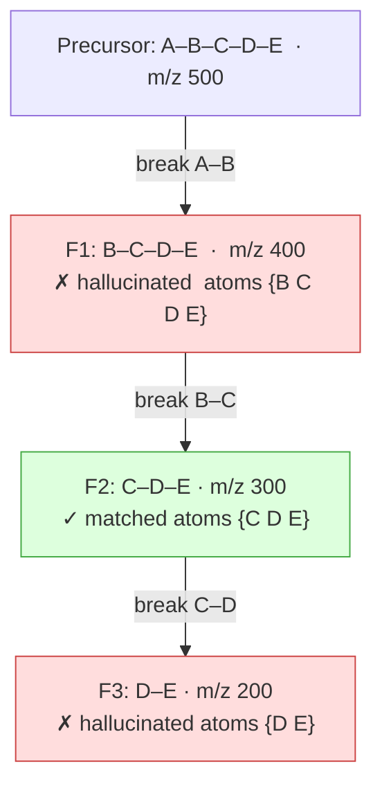
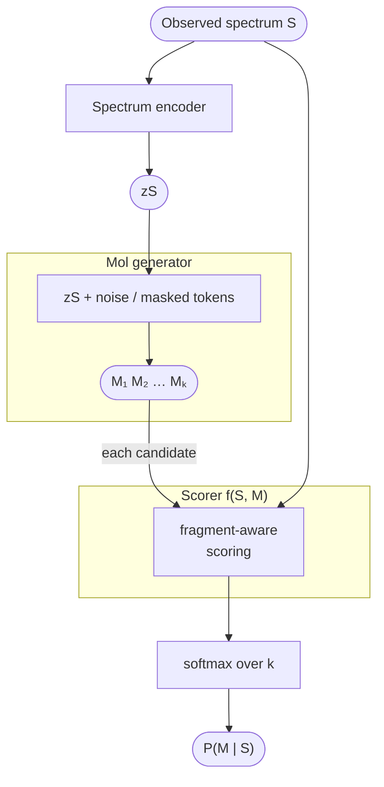

# Molecular Generation from Mass Spectra

> **Status:** NOTE &nbsp;·&nbsp; **Updated:** 2026-06-08
>
> Literature notes on spectrum-conditioned molecular generation (FRIGID, etc.). Sections 1-3; continues in `lz_part2.md`.

## 1. FRIGID

Reference: FRIGID (Bohde et al., 2026) - https://arxiv.org/abs/2604.16648

Diffusion LM over SAFE sequences conditioned on spectrum. At inference, uses ICEBERG as
a forward oracle to iteratively remask tokens:

- Generate M → run ICEBERG → match simulated peaks to observed (±20 ppm)
- Matched fragment atoms: `+1`; hallucinated fragment atoms: `−γ`
- Aggregate to SAFE token level via **min** over constituent atoms → remask → re-denoise


### Problems with FRIGID

**1. ICEBERG's flat fragment list breaks scoring and remasking.**

**Background - fragmentation DAG.** When a molecule fragments in the mass spectrometer,
it does so stepwise: the precursor loses one substructure to produce a depth-1 fragment;
that fragment loses another to produce a depth-2 fragment; and so on. This hierarchy is a
DAG rooted at the precursor. A key consequence: every fragment at depth d+1 is a
structural sub-part of its parent, so its atoms are a strict subset:

```
atoms(F2) ⊂ atoms(F1)
```

**Root cause.** ICEBERG returns fragments as a flat list with no parent-child
relationships. FRIGID therefore has no access to this hierarchy, which causes two failures
in sequence: wrong atom scoring, then wrong remasking decisions.

**An example.** A five-atom chain A–B–C–D–E, three fragments:



What ICEBERG gives FRIGID - depth and parentage are hidden:

| Fragment | m/z | Match | Depth (hidden) | Parent (hidden) |
|---|---|---|---|---|
| F1 | 400 | n | 1 | precursor |
| F2 | 300 | y | 2 | F1 |
| F3 | 200 | n | 3 | F2 |

**Failure 1 - wrong atom scores.** FRIGID scores each atom by every fragment it belongs
to, then takes `min`. Atoms {C,D,E} belong to both F1 (hallucinated) and F2 (matched):

| Atom | Score via F1 | Score via F2 | min → final |
|---|---|---|---|
| C, D, E | −γ | +1 | **−γ** |
| B | −γ | - | **−γ** |

F2 is correct evidence - but `min(+1, −γ) = −γ` erases it.

**Failure 2 - wrong remasking order.** Without the DAG, FRIGID cannot distinguish F1
(hallucinated at depth 1) from F3 (hallucinated at depth 3 whose parent F2 is matched).
The correct repair is top-down:

```
1. Find shallowest hallucination: F1 (depth 1)
2. F1's child F2 is matched → protect atoms {C, D, E}
3. Remask only atom B (F1-unique)
4. Next: F3 (depth 3), no matched children → remask atoms {D, E}
```

Instead, all of {B,C,D,E} are scored −γ and the entire right half of the molecule is
remasked at once - destroying F2 even though it was correct evidence.

**2. No proper posterior.**
Iterative remasking is not an approximation to any well-defined distribution;
P(M | S) ∝ p(S | M) × p(M) is never computed.

## 3. Proposed plan

**Goal:** one MS/MS spectrum → calibrated distribution over generated molecules.

- Not: spectrum → fingerprint → one molecule
- Not: spectrum → one molecule
- Output: `M₁: 0.41   M₂: 0.19   M₃: 0.08   …`

```
P(M | S) ∝ p(S | M) × p(M)
P(Mₖ | S) ≈ softmax_k[ f(S, Mₖ) + log p(Mₖ) ]
```




### 3.1 Molecule Generator

Molecule Generator learns P(M | S): one spectrum → a set of candidate molecules (10-50).

| | |
|---|---|
| **Architecture** | SAFE / SELFIES / graph diffusion / flow matching |
| **Pretraining** | Unconditional molecule LM on large databases |
| **Fine-tuning** | Conditional generation on paired (spectrum, molecule) data |
| **Inference** | Sample candidates; filter invalids and duplicates |

### 3.2 Fragment-Aware Scorer

`f(S, M)` approximates `log p(S | M)` on a **comparable scale** across all candidates.
Inputs: observed peak m/z and intensities; candidate fragment masses and formulae;
matched vs. unmatched peaks; hallucinated predicted fragments.

Molecule Generator quality is a hard floor: if proposal `q(M | S)` is poor, Scorer selects the
least-wrong candidate, not the correct one. The unbiased posterior requires:

```
P(Mᵢ | S) ∝ p(S | Mᵢ) × p(Mᵢ) / q(Mᵢ | S)
```

#### Avoiding Benchmark Leakage

**The Scorer must NOT be trained on the MassSpecGym candidate distribution, or any other pre-defined candidate distribution**

The goal is a support-independent compatibility function `fθ(S, M)` that captures true spectral evidence — *this molecule explains this spectrum* — rather than benchmark-specific candidate-set artifacts. Training directly on MassSpecGym candidates risks inflating retrieval numbers without demonstrating real generalization: the model may learn to distinguish MassSpecGym decoys rather than to score spectral compatibility.

**Training candidate distribution.** Sample candidates dynamically per epoch from:

| Source | Role |
|---|---|
| True molecule | Positive |
| Same-formula decoys | Hard negative (formula shortcut) |
| Same-mass-window decoys | Hard negative (mass shortcut) |
| Same-class / scaffold-neighbor decoys | Hard negative (structural) |
| Molecule Generator samples | Curriculum negative (on-policy) |
| Random external molecules | Easy negative |
| Forward-simulation analogs | Spectrally plausible hard negative |

MassSpecGym candidate sets are reserved for evaluation only.

**Support invariance.** The raw score `fθ(S, M)` must depend only on `(S, M)`, not on which candidate pool `M` came from. The posterior is assembled at inference time:

```
P(Mᵢ | S, C) = softmaxᵢ[ fθ(S, Mᵢ) + log p(Mᵢ) ]
```

where `C` may be generated molecules, database hits, MassSpecGym candidates, or any mix.