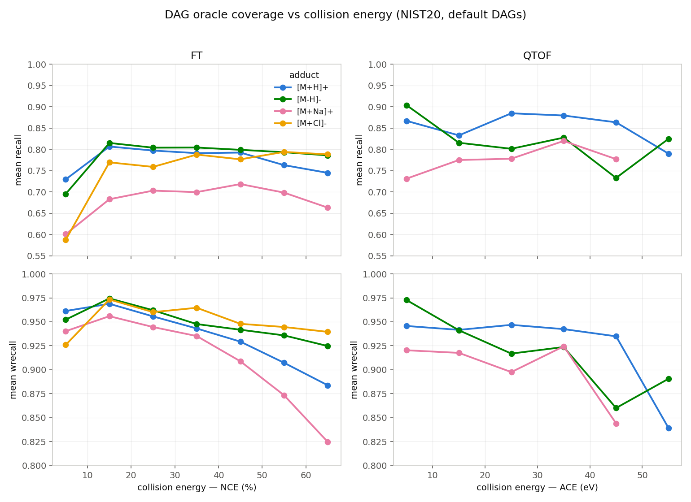
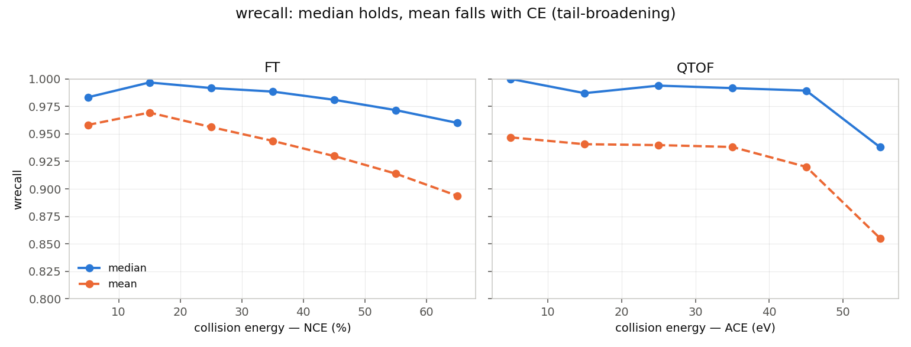
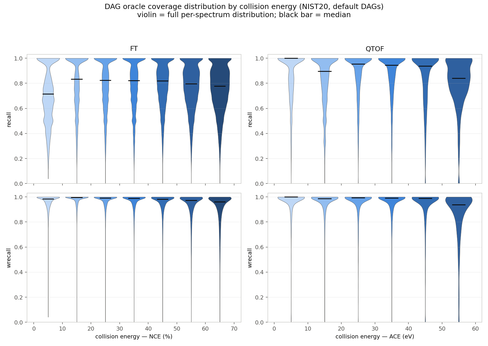

# DAG Oracle Recall / Wrecall by Collision Energy

Measures the fragmentation-DAG **coverage ceiling** (oracle) as a function of collision
energy (CE) and precursor adduct on NIST20. For each spectrum the oracle keeps the true
intensity on every peak the DAG can explain and nothing elsewhere; `recall` / `wrecall`
quantify how much of the spectrum that covers.

- **recall** = (number of true peaks matched by a DAG fragment ion) / (number of true peaks)
- **wrecall** = Σ(true intensity on matched peaks) / Σ(true intensity) — intensity-weighted recall

## Setup

| Item | Value |
|---|---|
| Spectra | NIST20, 370,957 scored (25,850 molecules) |
| DAGs | `data/frag/nist20_ma_mi_d3_h4_isoFalse_smpFalse` (default, D3/H4) |
| Adducts | `[M+H]+`, `[M-H]-`, `[M+Na]+`, `[M+Cl]-` |
| Instruments / CE | FT filtered to NCE ∈ [0, 70]; QTOF filtered to ACE ∈ [0, 60] eV |
| m/z matching | per-instrument tolerance (FT 10 ppm / 200 Da, QTOF 20 ppm / 750 Da) |
| Ion model | CMF ∪ CRF (std) conventions; full H-transfer budget (h4) |

Per-spectrum data: `data/eval/oracle_cos_nist20_default/recall_wrecall_by_ce.csv`
(adduct-binned aggregate: `recall_wrecall_by_ce_adduct.csv`). Reproduce with
`scripts/eval/dag_oracle_scores.py` (`n_achievable_peaks` / `n_true_peaks` give recall)
plus the CE grouping.

## Coverage vs collision energy, by adduct

## The mean falls but the median holds (tail-broadening)

## Full distribution per CE bin (violin)

The violins show the per-spectrum distribution behind the summary lines. wrecall mass stays
pinned near 1.0 at every energy; what changes with CE is the **weight of the low tail**, which
grows steadily. recall is visibly broader (a wide body plus a low-value tail), consistent with
many small unmatched satellite peaks. Violins are colored light→dark by energy; the black bar
is the median.

## Overall by CE

FT (by NCE %):

| NCE | n | recall mean | recall median | recall min | wrecall mean | wrecall median | wrecall min |
|---|---|---|---|---|---|---|---|
| 0–10 | 18,809 | 0.715 | 0.714 | 0.038 | 0.958 | 0.983 | 0.042 |
| 10–20 | 32,343 | 0.798 | 0.833 | 0.000 | 0.969 | 0.997 | 0.000 |
| 20–30 | 55,774 | 0.787 | 0.824 | 0.000 | 0.956 | 0.992 | 0.000 |
| 30–40 | 93,851 | 0.783 | 0.821 | 0.000 | 0.944 | 0.989 | 0.000 |
| 40–50 | 50,867 | 0.785 | 0.818 | 0.000 | 0.930 | 0.981 | 0.000 |
| 50–60 | 34,706 | 0.768 | 0.796 | 0.000 | 0.914 | 0.972 | 0.000 |
| 60–70 | 34,286 | 0.753 | 0.778 | 0.000 | 0.894 | 0.960 | 0.000 |

QTOF (by ACE eV):

| eV | n | recall mean | recall median | recall min | wrecall mean | wrecall median | wrecall min |
|---|---|---|---|---|---|---|---|
| 0–10 | 5,948 | 0.863 | 1.000 | 0.000 | 0.947 | 1.000 | 0.000 |
| 10–20 | 13,786 | 0.827 | 0.895 | 0.000 | 0.941 | 0.987 | 0.000 |
| 20–30 | 10,508 | 0.867 | 0.955 | 0.000 | 0.940 | 0.994 | 0.000 |
| 30–40 | 9,391 | 0.868 | 0.944 | 0.000 | 0.938 | 0.992 | 0.000 |
| 40–50 | 6,159 | 0.839 | 0.938 | 0.000 | 0.920 | 0.989 | 0.000 |
| 50–60 | 2,124 | 0.801 | 0.841 | 0.000 | 0.855 | 0.938 | 0.000 |

`max = 1.000` in every bin (omitted). Edge bins at exactly NCE = 70 / ACE = 60 are excluded.

## By adduct (highlights)

Full mean/median/min/max per (instrument, adduct, CE bin) is in
`recall_wrecall_by_ce_adduct.csv`. Key wrecall-mean trajectories:

| adduct (FT) | wrecall @ low CE | wrecall @ 60–70 NCE | drop |
|---|---|---|---|
| `[M-H]-` | 0.974 | 0.925 | −0.049 (most CE-robust) |
| `[M+Cl]-` | 0.973 | 0.940 | −0.033 |
| `[M+H]+` | 0.969 | 0.884 | −0.085 |
| `[M+Na]+` | 0.956 | 0.825 | **−0.131 (steepest)** |

## Findings

1. **wrecall degrades monotonically with CE** on both instruments (FT 0.969 → 0.894 across
   NCE; QTOF 0.947 → 0.855 across eV). Higher collision energy fragments deeper / more
   exotically, and the D3 DAG explains progressively less of the *intensity*.
2. **recall (unweighted) is much flatter** (~0.78 FT, ~0.85 QTOF) and even dips at the
   *lowest* CE (FT 0–10 = 0.715): low-energy spectra are precursor-dominated with a few
   small unmatched satellite peaks, so recall is low while the one big explained peak keeps
   wrecall high.
3. **The CE effect is tail-broadening, not a uniform shift.** In every bin `median ≫ mean`
   and `min = 0`. The wrecall *median* barely moves (FT 0.997 → 0.960); the *mean* drops
   much more (0.969 → 0.894). Rising CE grows the population of fully-unexplained spectra
   rather than lowering the typical spectrum's coverage.
4. **`[M+Na]+` is the highest-leverage coverage gap.** Lowest FT recall (~0.70 vs ~0.79 for
   `[M+H]+`) and the steepest wrecall collapse with energy. Sodiated precursors fragment via
   pathways the D3 DAG covers poorly, and it worsens fast with CE.
5. **`[M-H]-` is the most CE-robust** — negative-mode fragmentation stays within DAG reach
   across the whole energy range.
6. **`[M+Cl]-`** has low absolute recall (~0.78, Cl-loss dominated) but its recall min never
   reaches 0 — chloride adducts always retain at least one explainable fragment.
