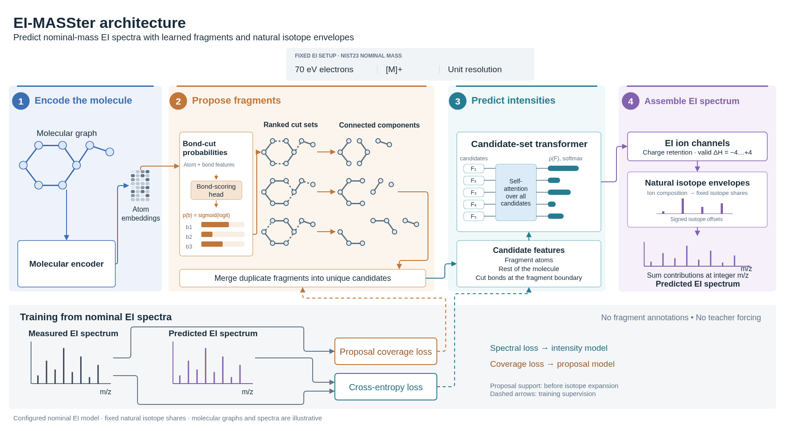

# MASSter EI-MS method

> **Status:** REFERENCE · **Updated:** 2026-10-19
> Chemically constrained probabilistic EI prediction with nominal or exact-mass natural isotope output.

## Overview

MASSter predicts electron-ionization mass spectra (EI-MS) from molecular structures
by allocating normalized intensity across structurally defined fragment-ion channels.
A learned bond-cut proposal distribution selects candidate fragments, and a
candidate-set transformer estimates their spectral contributions. Natural isotope
envelopes distribute each channel's contribution across nominal offsets or exact
isotopologue masses, according to the configured mass mode.

The [core MASSter method](masster_method.md) defines the molecular encoder,
Bernoulli cut-mask probabilities, deterministic probability-ranked enumeration,
charge-retention marginalization, and fragment/channel intensity factorization.
The EI-specific formulation below uses those definitions: $G$ denotes the precursor
graph, $c$ the acquisition context, $\mathcal F$ the selected fragment set,
$\rho_\theta$ the final fragment probability, and $\eta_\theta$ the conditional
ion-channel probability. Proposal weights guide candidate selection and are distinct
from the final intensity probabilities.

This is a model of normalized intensity within a spectrum. It does not by itself
specify a distribution over complete replicate spectra or measurement variability.
The description concerns the configured nominal-mass EI formulation rather than
all optional MASSter mechanisms.

## EI configuration

The [SVG figure](../figures/masster_ei_architecture.svg) shows the configured
nominal-mass EI path. Its drawing source is page 3 of the
[MASSter diagrams](../figures/masster_figures.drawio). Molecular graphs, probability
bars, isotope shares, and spectra are illustrative. The fixed-setup card describes
the data configuration; it does not imply electron-energy or instrument conditioning.

The EI-MS formulation uses the same molecular encoder, ranked bond-cut proposals,
unique-fragment marginalization, and candidate-set intensity model. The NIST23 EI
configuration targets nominal-mass spectra acquired at 70 eV. It uses the positive
molecular-ion precursor type, represented internally as `[M]+`, rather than a
protonated precursor. Collision-energy, instrument-type, and fragmentation-mode
conditioning are disabled in this configuration. The fixed EI setup therefore
does not establish prediction across electron energies or instrument conditions.

## Fragment-ion channels and nominal masses

The EI configuration retains the intact molecule and enables single-bond-cut
support alongside learned proposals. It targets 256 unique fragment atom sets,
with an enumeration cap of 4,096 masks; these are search controls rather than a
guarantee of exactly 256 candidates. The charge-retention channel is enabled,
whereas the alternative charge-migration channel is disabled for `[M]+`.
Hydrogen shifts range from $-4$ to $+4$, subject to the implementation's
composition and valence bounds. These channels represent candidate ion
compositions; they do not explicitly track unpaired-electron locations or an
ordered sequence of radical fragmentation reactions.

Unit-resolution targets require nominal channel masses. For a singly charged
EI channel, let $A_e$ be the mass number of the most abundant isotope of element
$e$, and let $n_e(F,h)$ be its atom count after applying the hydrogen shift.
The base nominal mass is

$$
m_0(F,h)=\sum_e n_e(F,h)A_e.
$$

The electron-mass correction has no effect at this integer resolution. Nominal
masses are constructed from the composition rather than obtained by flooring an
exact mass into a 1 Da bin. Molecular and candidate mass features retain their
exact-mass values; nominal mode changes the emitted channel masses and the masses
used by proposal-support supervision.

## Natural isotope envelopes and probabilistic assembly

Each valid ion channel carries a fixed natural-abundance isotope envelope computed
from its elemental composition, including its channel-specific hydrogen count.
The EI formulation uses this envelope without a learned isotope scale. Let
$s_{F,h}(k)$ denote the retained, normalized isotope share at signed integer mass
offset $k$ relative to $m_0(F,h)$. The predicted intensity distribution is

$$
\widehat I(m\mid G,c,\mathcal F)
=\sum_{F\in\mathcal F}\sum_h\sum_k
\rho_\theta(F\mid G,c,\mathcal F)
\eta_\theta(h\mid F,G,c,\mathcal F)
s_{F,h}(k)\,
\mathbb I[m=m_0(F,h)+k].
$$

The natural-isotope configuration uses a maximum isotope order of 4 and drops
isotope rows whose share is below 0.001 of their channel contribution. Retained
shares are renormalized so that isotope expansion conserves that contribution.
The isotope offsets are signed because the most abundant isotope need not be
the lightest. Contributions from fragments, hydrogen shifts, and isotope rows
that coincide at the same integer mass are summed. The result is a distribution
of normalized intensity over nominal m/z values, with the same within-spectrum
probabilistic interpretation as the tandem-MS formulation.

## Exact-mass isotope output

With `masster_mass_mode: exact` and `masster_isotope_envelope: natural`, each
channel is expanded into its natural isotope fine structure. Exact mass increments
are computed from elemental isotope masses relative to each element's most abundant
isotope. The spectral assembly equation above then uses the exact base ion mass
and an isotopologue-specific increment in place of the integer expression
$m_0(F,h)+k$. Electron-mass corrections remain in the base channel mass.

Different isotopologues with the same nominal offset remain distinct: for example,
carbon-13 and nitrogen-15 substitution contribute different exact M+1 masses.
The maximum order still limits the signed nominal offset; intermediate offsets that
can return to the retained window through negative/positive cancellation are kept.
In exact mode, the minimum-share threshold applies to each fine-structure row,
followed by normalization to conserve each channel's intensity. Nominal mode
retains its existing aggregate-envelope semantics and tensor implementation.

The exact chemistry calculation is cached on CPU by ion composition. Natural
abundances are fixed; emitted scores remain differentiable. This path introduces
no learned parameters or persistent checkpoint buffers. Ordinary spectrum outputs
include isotope peaks. Explanatory tabular exports remain explicitly unsupported
for isotope rows, because their current formula schema cannot label isotope states.
Internal pathway annotations carry both signed nominal isotope offsets and, in
exact mode, exact isotope mass increments.

## EI training and scope

The EI setup uses the proposal-selection-only training formulation described in the
[core method](masster_method.md#training),
with cross-entropy spectrum loss, an absolute matching tolerance of 0.5 Da, and
no relative mass tolerance. Evaluation uses 1 Da bins, and checkpoint selection
uses validation cosine similarity at that resolution. Natural isotope expansion
applies to emitted spectrum rows; candidate and proposal channel tensors remain
monoisotopic, so proposal-support diagnostics do not include isotope-expanded
coverage.

Nominal masses can merge distinct chemical explanations into one observed peak.
Spectrum-level supervision therefore constrains their summed intensity without
uniquely identifying the contributing fragment structures, hydrogen transfers,
or isotope states. Fragment annotations remain model explanations rather than
experimentally established reaction mechanisms. The core bond-cut action space
also retains its limitation on products requiring new heavy-atom bonds.

The [natural-isotope EI configuration](../../config/masster/ei/e1_nominal_natural_isotopes.yml)
defines this setup. The [EI design record](../plans/masster/masster_ei_nominal_plan.md)
and [EI workstream](../workstreams/nist23_ei.md) distinguish implementation behavior
from completed experiments and unresolved validation.

The [HR-EI exclusion plan](../plans/masster/hr_ei_isotopes_holdout_plan.md) records a
separate nominal-training split that excludes resolvable external HR-EI reference
connectivities, alternative supplied identities, and RECETOX native parent structures.
The fresh-training configuration is
[`e5_hr_ei_holdout_nominal.yml`](../../config/masster/ei/e5_hr_ei_holdout_nominal.yml).
It retains nominal targets and natural isotope output during training; exact-mass
natural isotope output is selected for HR-EI evaluation. A checkpoint previously
trained on the excluded molecules is unsuitable for a held-out claim.

