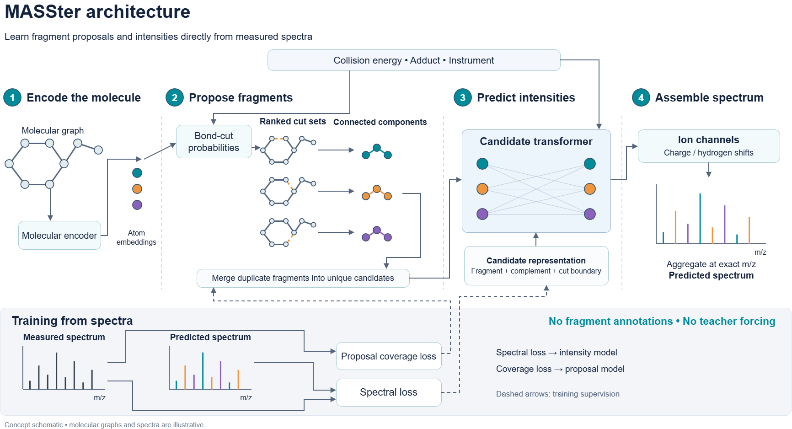

# MASSter method

> **Status:** REFERENCE · **Updated:** 2026-10-16
> Formal description of the core cut-mask method, unique-fragment formulation, and comparison with FraGNNet.

## Overview

MASSter predicts tandem mass spectra from molecular structures by combining learned
fragment generation with context-dependent intensity estimation. A precursor molecule
is represented as a graph in which nodes denote atoms and edges denote chemical
bonds. A graph neural network encodes the intact precursor, and prediction heads use
the resulting representations together with acquisition metadata, such as collision
energy and precursor type, to propose fragment candidates and estimate their spectral
contributions.

The description below concerns the core bond-cut proposal and its unique-fragment,
normalized-output formulation. Optional mechanisms and configuration-dependent
variants are distinguished explicitly. It describes model operations rather than
claiming that a particular configuration has been experimentally validated.



*Figure 1. MASSter encodes the precursor molecular graph, proposes fragments from
ranked bond-cut configurations, and estimates their contributions using a
candidate-set transformer. Chemically valid ion channels provide the masses used
to assemble the predicted spectrum. The lower panel distinguishes spectral
supervision of the intensity model from coverage supervision of the proposal model.
Molecular structures and spectra are schematic.*
The [editable SVG](../figures/masster_architecture_editable.svg) is available for
figure revisions.

## Molecular encoding and bond-cut proposals

Let $G=(V,E)$ denote the precursor molecular graph and $c$ the acquisition context.
The molecular encoder computes atom representations, which the proposal network
uses with bond features and context to predict a cleavage logit $\ell_b$ for each
bond $b$. The corresponding cleavage probability is
$p_b=1/(1+\exp(-\ell_b))$.

A binary mask $\mathbf z$ specifies a complete cleavage configuration, with
$z_b=1$ indicating removal of bond $b$. For a single Bernoulli proposal component,
the probability of a mask is

$$
q_\theta(\mathbf z\mid G,c)
=\prod_{b\in E}p_b^{z_b}(1-p_b)^{1-z_b}.
$$

This formulation permits multiple bonds to be cleaved simultaneously. Conditional
independence applies to bond decisions within this proposal component; it does not
imply that physical fragmentation events are independent. The implementation also
supports a normalized mixture of Bernoulli components,

$$
q_\theta(\mathbf z\mid G,c)
=\sum_{r=1}^{R}\pi_r(G,c)
  \prod_{b\in E}p_{br}^{z_b}(1-p_{br})^{1-z_b},
\qquad \sum_{r=1}^{R}\pi_r=1,
$$

which can represent dependence between bond decisions through a shared latent
component. A cut mask specifies the bonds removed together, without assigning a
chronological order to their cleavage.

## Probability-ranked selection and sampling

The core proposal procedure uses deterministic probability-ranked enumeration.
Although candidate generation may informally be called sampling, it does not draw
independent random masks from the proposal distribution. Instead, it retrieves a
bounded collection of high-probability configurations without constructing all
$2^{|E|}$ masks.

For a single Bernoulli component, the maximum a posteriori (MAP) mask has decisions
$z_b^\star=\mathbb I[\ell_b>0]$. Every alternative mask differs from this mask by a
subset of flipped decisions. Flipping decision $b$ incurs the nonnegative
log-probability cost $|\ell_b|$, giving

$$
\log q_\theta(\mathbf z\mid G,c)
=\log q_\theta(\mathbf z^\star\mid G,c)
-\sum_{b:z_b\ne z_b^\star}|\ell_b|.
$$

Ranking masks therefore reduces to enumerating subsets in increasing total flip
cost. A priority queue retrieves these subsets in order. Decisions with logits near
zero can be reversed at relatively low cost, whereas reversing a confident decision
incurs a larger penalty. This procedure gives an exact probability ordering for
the single-component distribution.

For mixtures, the implementation pools the top-ranked masks from each component,
deduplicates the pool, and ranks its members by their full mixture probabilities.
The probability of each pooled mask is evaluated under the mixture; pooling finite
component prefixes does not by itself establish a globally exact top-$K$ ordering
over the entire mixture mask space.

Each retained mask is applied to the precursor graph, and its connected components
provide candidate atom sets. A mask budget limits the number of configurations. In
unique-fragment mode, enumeration instead seeks a target number of distinct atom
sets, subject to a mask enumeration cap and any enabled probability threshold.
The component count can cross the target when the final mask is processed. Required
masks are incorporated separately: the intact precursor is retained, and complete
single-cut support can be enabled. These required masks bypass the learned-mask
probability floor and are placed before the learned prefix in unique-fragment mode.
They can therefore supply more fragments than the requested target on their own.

The following algorithm specifies the single-component ranked iterator. Its outputs
are consumed by the budget and required-support policies described above. Bond
indices $b_1,\ldots,b_B$ are sorted by increasing $|\ell_b|$; $S$ contains positions
in that ordering, and $\oplus$ denotes binary exclusive OR.

```text
Algorithm 1: Enumerate bond-cut masks in descending Bernoulli probability
Input: finite bond logits ell[1..B]
Output: a deterministic iterator over all cut masks

1. z_star[b] <- 1 if ell[b] > 0, otherwise 0
2. Sort bonds b_1, ..., b_B by (abs(ell[b]), bond index).
3. d[i] <- abs(ell[b_i]).
4. Yield z_star with log probability log q(z_star).
5. If B = 0, stop.
6. Q <- min-priority queue containing (d[1], {1}).
7. While Q is not empty:
     a. Pop (cost, S) with minimum cost; resolve ties deterministically.
     b. z <- z_star XOR the decisions at bonds {b_i : i in S}.
     c. Yield z with log probability log q(z_star) - cost.
     d. j <- max(S).
     e. If j < B:
          Push (cost + d[j+1], S union {j+1}) into Q.
          Push (cost - d[j] + d[j+1],
                (S minus {j}) union {j+1}) into Q.
```

The two queue expansions enumerate every nonempty flip subset exactly once. The
consumer stops when its configured budget or threshold is reached; exhaustive
enumeration is unnecessary for prediction.

## Charge retention and fragment marginalization

For each cut mask, a charge-affinity head scores the resulting components and
normalizes their charge-retention probabilities within that mask. In unique-fragment
mode, components containing the same precursor atom set are identified across masks.
These occurrences are treated as alternative latent pathways to the same fragment.

Let $\mathcal Z$ denote the retained mask set and $a_\theta(F\mid\mathbf z,G,c)$
the probability that component $F$ retains the charge under mask $\mathbf z$.
Its unnormalized marginal proposal weight is

$$
w_F=\sum_{\mathbf z\in\mathcal Z:\,F\in\mathrm{CC}(G\setminus\mathbf z)}
q_\theta(\mathbf z\mid G,c)\,
a_\theta(F\mid\mathbf z,G,c).
$$

Here, $\mathrm{CC}$ returns the connected components after deleting the
selected bonds. These weights are truncated marginals because they sum over retained
masks rather than the complete mask space. Their normalized values define a
distribution over the retained fragments. Combining duplicate pathways avoids
treating repeated occurrences of the same atom set as separate intensity tokens.

## Ion channels and intensity estimation

Each fragment is expanded into chemically valid ion channels that account for
charge retention, enabled charge migration, and hydrogen transfer. The channel
composition determines its mass-to-charge ratio. Chemical validity masks exclude
unsupported channels before the output distribution is normalized.

A candidate-set transformer estimates the fragments' spectral contributions.
Candidate representations incorporate pooled retained-atom and complementary-atom
representations, oriented boundary-bond information, acquisition context, and
configured fragment descriptors, including mass and charge features. Attention
allows each candidate to be evaluated in relation to the other proposed fragments.
Induced attention is supported, while full attention is available for the bounded
unique-fragment representation.

In the normalized formulation, let $\rho_\theta(F\mid G,c,\mathcal F)$ denote
the final fragment probability after intensity scoring, and let
$\eta_\theta(h\mid F,G,c,\mathcal F)$ denote the conditional probability of a
valid ion-mode and hydrogen-transfer channel $h$. The channel contribution is

$$
\widehat I_{F,h}=\rho_\theta(F\mid G,c,\mathcal F)
\eta_\theta(h\mid F,G,c,\mathcal F).
$$

Contributions assigned to the same spectral mass are aggregated. The final sparse
prediction is normalized over generated valid channels. The implementation also
supports an alternative nonnegative independent-intensity formulation; the
probability factorization above describes the normalized formulation.

## Training

In the proposal-selection-only formulation, training separates candidate support
from intensity allocation. An intensity-weighted support objective encourages the
proposal distribution to assign weight to fragments whose chemically valid channels
match observed peaks within the configured mass tolerance. Each fragment is counted
at most once per observed peak, even if several of its channels match. This prevents
the proposal objective from rewarding duplicate matches within one fragment.

A spectrum-level objective trains the predicted intensity distribution against the
observed spectrum. Spectrum-loss gradients are excluded from the proposal
probabilities in this formulation. Mask identities are selected discretely from
detached logits, after which their probabilities are recomputed from live logits
for proposal supervision. Gradients therefore update selected configurations'
probabilities without differentiating through the enumeration operation. Exact
spectrum objectives, auxiliary losses, and encoder gradient routing depend on the
resolved experiment configuration.

## Comparison with FraGNNet

FraGNNet and MASSter both assign spectral contributions to structurally defined
fragment-ion candidates. FraGNNet operates on a fragmentation directed acyclic graph
(DAG) constructed during preprocessing. Nodes represent candidate fragments and
edges record fragmentation relationships. Its candidate support is established by
the configured expansion depth, bond-cut procedure, and enabled rearrangement rules.
The neural model predicts spectral contributions within that predefined support.

MASSter incorporates candidate generation into prediction. Its proposal network
ranks global cleavage configurations using molecular representations and acquisition
context, and connected components of selected configurations provide a flat fragment
set. The number of simultaneously removed bonds is governed by proposal probability
and enumeration limits rather than a prescribed fragmentation depth. Multiple masks
producing the same atom set are marginalized as alternative pathways before
candidate-set intensity estimation.

| Property | FraGNNet | MASSter core cut-mask method |
| --- | --- | --- |
| Candidate construction | Precomputed fragmentation DAG | Learned, probability-ranked masks evaluated during prediction |
| Search limits | Configured DAG expansion procedure and depth | Candidate budget, enumeration cap, and enabled probability thresholds |
| Fragment relationships | Explicit DAG relationships | Flat candidate set with latent mask provenance |
| Acquisition-dependent support | Precomputed structural support | Context-conditioned proposal selection when enabled |
| Alternative pathways | Represented through the generated DAG | Summed across retained masks producing the same atom set |

Both methods remain constrained by candidate support. FraGNNet can omit fragments
outside its preprocessing rules or expansion limits. MASSter can omit fragments
outside the selected mask set, even when their configurations have nonzero proposal
probability. Neither deleting bonds in a DAG expansion nor deleting bonds in a global
mask can generate products that require forming new heavy-atom bonds. Such products
require additional mechanisms, including explicitly enabled rearrangement rules.
These architectural differences do not establish a universal ordering of accuracy
or chemical coverage; those claims require matched experiments.

## Implementation references and scope

- [Model orchestration](../../src/fragnnet/models/masster/masster_model.py).
- [Single-component ranked-mask reference](../../src/fragnnet/models/masster/candidates/reference_cut_masks.py)
  and [candidate builder](../../src/fragnnet/models/masster/candidates/builder.py).
- [Pathway probabilities](../../src/fragnnet/models/masster/masster_pathway_probabilities.py)
  and [candidate transformer](../../src/fragnnet/models/masster/masster_candidate_transformer.py).
- [Training and proposal coverage objective](../../src/fragnnet/models/masster/masster_pl.py).
- [Feature reference](masster_feature_set_audit.md) and
  [FraGNNet DAG generation](frag_gen_prepass.md).
- [Core design record](../plans/masster/masster_plan.md) and
  [current workstream state](../workstreams/masster_core.md).

Optional SMARTS candidates, topology rewiring, connected-fragment beam proposals,
and independent-intensity outputs have additional semantics and are not implied by
this core description. The resolved configuration determines which mechanisms a
particular model uses. Historical paths and module names in the design record and
workstream hub can differ from the current source layout; the source links above
identify the implementation inspected for this document.
