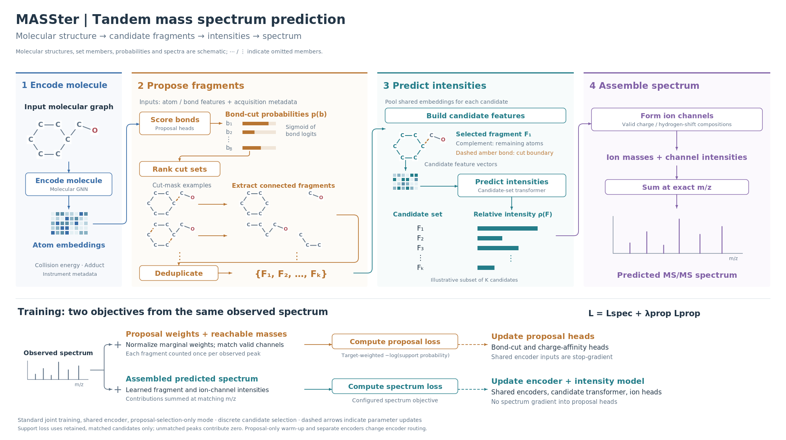

# MASSter method

> **Status:** REFERENCE · **Updated:** 2026-10-19
> Chemically constrained probabilistic spectrum prediction: core cut-mask method, EI-MS extension, unique-fragment formulation, and comparison with FraGNNet.

## Overview

MASSter is a chemically constrained probabilistic model for mass spectrum
prediction, supporting tandem mass spectra and electron-ionization mass spectra
(EI-MS). It predicts spectra from molecular structures by combining learned
fragment proposals with context-dependent intensity allocation. A precursor molecule
is represented as a graph in which nodes denote atoms and edges denote chemical
bonds. A graph neural network encodes the intact precursor, and prediction heads use
the resulting representations together with acquisition metadata, such as collision
energy and precursor type, to propose fragment candidates and estimate their spectral
contributions.

The probabilistic formulation distinguishes a proposal distribution over bond-cut
configurations from an output distribution that allocates normalized spectral
intensity across valid fragment-ion channels. The proposal probabilities guide
candidate selection; the intensity model estimates the contributions of the selected
candidates. These distributions have distinct roles and need not assign the same
relative weights to fragments.

The description below concerns the core bond-cut proposal and its unique-fragment,
normalized-output formulation. Optional mechanisms and configuration-dependent
variants are distinguished explicitly. It describes model operations rather than
claiming that a particular configuration has been experimentally validated.



*Figure 1. MASSter encodes the precursor molecular graph, proposes fragments from
ranked bond-cut configurations, and estimates their contributions using a
candidate-set transformer. Chemically valid ion channels provide the masses used
to assemble the predicted spectrum. The separate [training-objectives figure](../figures/masster_decoupled_design.svg)
distinguishes spectral supervision from proposal-support supervision.
Molecular structures and spectra are schematic.*
The [SVG](../figures/masster_architecture.svg) is available for
figure revisions; the [draw.io source](../figures/masster_figures.drawio) holds this
figure (page 1), the decoupled-design figure (page 2), and the
[EI architecture](masster_ei_method.md#ei-configuration) (page 3), with connected
arrows and grouped drawings.

## Prediction task and data flow

The input is a known molecular structure together with the acquisition metadata
enabled by the resolved configuration. The target is a spectrum: a set of
mass-to-charge values and their relative intensities. Prediction must therefore
address two related questions: which fragment-ion masses are reachable within the
candidate construction, and how much intensity to assign to those candidates.
Candidate support limits what the intensity model can explain. A candidate whose
mass matches an observed peak can still receive an incorrect intensity, while a
peak outside the generated support cannot be recovered by intensity scoring alone.

The core prediction proceeds through the following representations:

1. **Precursor graph:** encode atoms and bonds of the intact molecule.
2. **Cut masks:** score complete sets of removed bonds and enumerate a bounded
   collection of high-probability configurations.
3. **Fragment atom sets:** extract connected components from each selected mask;
   in unique-fragment mode, combine occurrences with the same precursor atom set.
4. **Ion channels:** assign valid charge and hydrogen-transfer alternatives to
   each fragment. An atom set alone does not specify a unique ion mass.
5. **Spectrum:** score candidates in the context of the candidate set, allocate
   intensity to valid channels, and aggregate contributions at matching masses.

These representations have different identities. A mask can produce several
fragments; several masks can produce the same fragment; and several fragments or
channels can contribute to the same mass. Atom-set deduplication combines latent
pathways to one structural candidate, whereas mass aggregation combines their
observable spectral contributions. Neither operation establishes a unique
structural assignment for an observed peak.

### Schematic example

Consider a three-atom chain $A-B-C$ with bonds $AB$ and $BC$. Removing only $AB$
produces components $\{A\}$ and $\{B,C\}$; removing both bonds produces
$\{A\}$, $\{B\}$, and $\{C\}$. The fragment $\{A\}$ therefore occurs under two
different masks. In unique-fragment mode it becomes one candidate, with its
proposal weight summed over the retained pathways after charge allocation.
Its final spectral intensity is estimated by the intensity model and need not
equal that proposal weight. Valid ion-channel choices then determine the masses
to which its intensity contributes.

The example describes graph operations, not an ordered chemical reaction. In
particular, the two-cut mask does not state whether $AB$ or $BC$ breaks first.
The core method ranks possible bond-deletion configurations without simulating
intermediate structures or reaction kinetics. This distinction also explains why
new heavy-atom bonds require an additional mechanism beyond cut masks.

## Molecular encoding and bond-cut proposals

Let $G=(V,E)$ denote the precursor molecular graph and $c$ the acquisition context.
The molecular encoder computes atom representations, which the proposal network
uses with bond features and context to predict a cleavage logit $\ell_b$ for each
bond $b$. The corresponding cleavage probability is
$p_b=1/(1+\exp(-\ell_b))$.

A binary mask $\mathbf z$ specifies a complete cleavage configuration, with
$z_b=1$ indicating removal of bond $b$. For a single Bernoulli proposal component,
the probability of a mask is

$$
q_\theta(\mathbf z\mid G,c)
=\prod_{b\in E}p_b^{z_b}(1-p_b)^{1-z_b}.
$$

This formulation permits multiple bonds to be cleaved simultaneously. Conditional
independence applies to bond decisions within this proposal component; it does not
imply that physical fragmentation events are independent. The implementation also
supports a normalized mixture of Bernoulli components,

$$
q_\theta(\mathbf z\mid G,c)
=\sum_{r=1}^{R}\pi_r(G,c)
  \prod_{b\in E}p_{br}^{z_b}(1-p_{br})^{1-z_b},
\qquad \sum_{r=1}^{R}\pi_r=1,
$$

which can represent dependence between bond decisions through a shared latent
component. A cut mask specifies the bonds removed together, without assigning a
chronological order to their cleavage.

## Probability-ranked selection and sampling

The core proposal procedure uses deterministic probability-ranked enumeration.
Although candidate generation may informally be called sampling, it does not draw
independent random masks from the proposal distribution. Instead, it retrieves a
bounded collection of high-probability configurations without constructing all
$2^{|E|}$ masks.

For a single Bernoulli component, the maximum a posteriori (MAP) mask has decisions
$z_b^\star=\mathbb I[\ell_b>0]$. Every alternative mask differs from this mask by a
subset of flipped decisions. Flipping decision $b$ incurs the nonnegative
log-probability cost $|\ell_b|$, giving

$$
\log q_\theta(\mathbf z\mid G,c)
=\log q_\theta(\mathbf z^\star\mid G,c)
-\sum_{b:z_b\ne z_b^\star}|\ell_b|.
$$

Ranking masks therefore reduces to enumerating subsets in increasing total flip
cost. A priority queue retrieves these subsets in order. Decisions with logits near
zero can be reversed at relatively low cost, whereas reversing a confident decision
incurs a larger penalty. This procedure gives an exact probability ordering for
the single-component distribution.

For mixtures, the implementation pools the top-ranked masks from each component,
deduplicates the pool, and ranks its members by their full mixture probabilities.
The probability of each pooled mask is evaluated under the mixture; pooling finite
component prefixes does not by itself establish a globally exact top-$K$ ordering
over the entire mixture mask space.

Each retained mask is applied to the precursor graph, and its connected components
provide candidate atom sets. A mask budget limits the number of configurations. In
unique-fragment mode, enumeration instead seeks a target number of distinct atom
sets, subject to a mask enumeration cap and any enabled probability threshold.
The component count can cross the target when the final mask is processed. Required
masks are incorporated separately: the intact precursor is retained, and complete
single-cut support can be enabled. These required masks bypass the learned-mask
probability floor and are placed before the learned prefix in unique-fragment mode.
They can therefore supply more fragments than the requested target on their own.

The following algorithm specifies the single-component ranked iterator. Its outputs
are consumed by the budget and required-support policies described above. Bond
indices $b_1,\ldots,b_B$ are sorted by increasing $|\ell_b|$; $S$ contains positions
in that ordering, and $\oplus$ denotes binary exclusive OR.

```text
Algorithm 1: Enumerate bond-cut masks in descending Bernoulli probability
Input: finite bond logits ell[1..B]
Output: a deterministic iterator over all cut masks

1. z_star[b] <- 1 if ell[b] > 0, otherwise 0
2. Sort bonds b_1, ..., b_B by (abs(ell[b]), bond index).
3. d[i] <- abs(ell[b_i]).
4. Yield z_star with log probability log q(z_star).
5. If B = 0, stop.
6. Q <- min-priority queue containing (d[1], {1}).
7. While Q is not empty:
     a. Pop (cost, S) with minimum cost; resolve ties deterministically.
     b. z <- z_star XOR the decisions at bonds {b_i : i in S}.
     c. Yield z with log probability log q(z_star) - cost.
     d. j <- max(S).
     e. If j < B:
          Push (cost + d[j+1], S union {j+1}) into Q.
          Push (cost - d[j] + d[j+1],
                (S minus {j}) union {j+1}) into Q.
```

The two queue expansions enumerate every nonempty flip subset exactly once. The
consumer stops when its configured budget or threshold is reached; exhaustive
enumeration is unnecessary for prediction.

### Comparison with beam search

MASSter's ranked cut-mask enumeration and beam search differ in their search states
and pruning policies. Ranked enumeration represents every complete cleavage mask
as a subset of decisions reversed from the MAP mask. The additive flip costs allow
a priority queue to retrieve configurations in descending probability order. Beam
search instead expands partial candidates and retains a bounded number of states
at each step. A discarded state cannot contribute descendants, even when one of
those descendants would receive a high final score.

| Property | Ranked cut-mask enumeration | Beam search |
| --- | --- | --- |
| Search state | Complete mask represented by flips from the MAP decisions | Partial configuration or growing fragment |
| Expansion | Enumerate flip subsets in increasing total cost | Extend retained states using permitted actions |
| Pruning | Truncate enumeration at a budget or probability threshold | Retain a fixed-width beam at each expansion step |
| Ranking guarantee | Exact descending mask probability for a single Bernoulli component | Generally approximate because intermediate pruning can remove promising paths |
| Search controls | Mask budget or unique-fragment target, enumeration cap, and optional probability floor | Beam width, expansion rules, and stopping criterion |

The exact ordering follows from the single-component proposal's additive
log-probability structure. It does not establish that the selected masks maximize
unique-fragment diversity or observed-peak coverage. Required support masks are
inserted separately from this ordering, and finite-pool mixture ranking does not
inherit its global guarantee. A budget limits the retained prefix even when
additional chemically relevant configurations have nonzero proposal probability.

Beam search accommodates scores that depend on an evolving state, such as previous
cuts, an intermediate molecular structure, or a growing connected fragment. Such
scores need not admit the additive decomposition used by the core MASSter proposal.
The tradeoff is that a low-scoring intermediate state can be pruned before reaching
a high-scoring final candidate. Search quality therefore depends on the beam width
and the relationship between intermediate and final scores.

MASSter's optional connected-fragment beam grows connected atom sets directly,
whereas the core procedure ranks global cut masks and extracts their connected
components. This alternative changes the candidate representation and probability
semantics in addition to the search procedure. It uses retained-fragment boundary
scores without the core method's latent mask-pathway marginalization and charge
allocation. Consequently, it is not an interchangeable approximation to the same
fragment distribution. The implementation is described in the
[connected-fragment beam source](../../src/fragnnet/models/masster/candidates/connected_fragment_beam.py).

## Charge retention and fragment marginalization

For each cut mask, a charge-affinity head scores the resulting components and
normalizes their charge-retention probabilities within that mask. In unique-fragment
mode, components containing the same precursor atom set are identified across masks.
These occurrences are treated as alternative latent pathways to the same fragment.

Let $\mathcal Z$ denote the retained mask set and $a_\theta(F\mid\mathbf z,G,c)$
the probability that component $F$ retains the charge under mask $\mathbf z$.
Its unnormalized marginal proposal weight is

$$
w_F=\sum_{\mathbf z\in\mathcal Z:\,F\in\mathrm{CC}(G\setminus\mathbf z)}
q_\theta(\mathbf z\mid G,c)\,
a_\theta(F\mid\mathbf z,G,c).
$$

Here, $\mathrm{CC}$ returns the connected components after deleting the
selected bonds. These weights are truncated marginals because they sum over retained
masks rather than the complete mask space. Their normalized values define a
distribution over the retained fragments. Combining duplicate pathways avoids
treating repeated occurrences of the same atom set as separate intensity tokens.

## Ion channels and intensity estimation

Each fragment is expanded into chemically valid ion channels that account for
charge retention, enabled charge migration, and hydrogen transfer. The channel
composition determines its mass-to-charge ratio. Chemical validity masks exclude
unsupported channels before the output distribution is normalized.

A candidate-set transformer estimates the fragments' spectral contributions.
Candidate representations incorporate pooled retained-atom and complementary-atom
representations, oriented boundary-bond information, acquisition context, and
configured fragment descriptors, including mass and charge features. Attention
allows each candidate to be evaluated in relation to the other proposed fragments.
Induced attention is supported, while full attention is available for the bounded
unique-fragment representation.

In the normalized formulation, let $\rho_\theta(F\mid G,c,\mathcal F)$ denote
the final fragment probability after intensity scoring, and let
$\eta_\theta(h\mid F,G,c,\mathcal F)$ denote the conditional probability of a
valid ion-mode and hydrogen-transfer channel $h$. The channel contribution is

$$
\widehat I_{F,h}=\rho_\theta(F\mid G,c,\mathcal F)
\eta_\theta(h\mid F,G,c,\mathcal F).
$$

Contributions assigned to the same spectral mass are aggregated. The final sparse
prediction is normalized over generated valid channels. The implementation also
supports an alternative nonnegative independent-intensity formulation; the
probability factorization above describes the normalized formulation.

Here, probability describes the allocation of normalized intensity within a predicted
spectrum. Equivalently, the aggregated output defines a conditional distribution
over mass-to-charge values for an intensity-weighted ion observation, given the
molecule, acquisition context, and selected candidate set. It does not by itself
define a distribution over complete replicate spectra, their peak counts, or their
measurement variability. Sampling individual channels from this distribution would
therefore require additional assumptions to yield a model of replicate spectra.
The method is described as probabilistic spectrum prediction on this basis.

## Electron-ionization mass spectra

The [MASSter EI-MS method](masster_ei_method.md) describes the nominal-mass EI
configuration, fragment-ion channels, natural isotope envelopes, training setup,
and probabilistic interpretation. It uses the shared core formulation defined here.

## Training

### Disjoint proposal and intensity objectives

Candidate selection and intensity allocation address different aspects of spectrum
prediction. The proposal model must retain fragments that can explain observed
peaks, whereas the intensity model must estimate their relative contributions.
In the proposal-selection-only formulation, MASSter trains these components with
separate objectives and gradient paths. The same observed spectrum supervises both
objectives; disjoint training refers to the separation of their parameter updates,
rather than a partition of the training data.

For each spectrum, the core training objective combines a spectrum loss with a
weighted proposal loss,

$$
\mathcal L=\mathcal L_{\mathrm{spec}}
+\lambda_{\mathrm{prop}}\mathcal L_{\mathrm{prop}},
\qquad \lambda_{\mathrm{prop}}>0.
$$

The coefficient $\lambda_{\mathrm{prop}}$ controls the contribution of proposal
supervision. This expression describes the two core objectives during joint
training; enabled auxiliary objectives add their own weighted terms.

### Proposal support loss

The proposal objective assigns probability to fragments according to whether their
valid ion channels can explain observed peaks. Let $y_j$ denote the normalized
target weight of observed peak $j$, after the configured proposal-target intensity
transformation. Let $A_{jF}$ equal one when at least one chemically valid channel of
fragment $F$ matches that peak within the configured mass tolerance, and zero
otherwise. Normalizing the marginal proposal weights defined above gives

$$
\bar w_F=\frac{w_F}{\sum_{F'\in\mathcal F}w_{F'}},
\qquad
u_j=\sum_{F\in\mathcal F}A_{jF}\bar w_F.
$$

Here, $u_j$ is the proposal probability assigned to fragments capable of explaining
peak $j$. Each fragment contributes at most once to a given peak, even when several
of its ion channels match. The support loss is

$$
\mathcal L_{\mathrm{prop}}
=-\sum_{j:u_j>0}y_j\log u_j.
$$

This objective increases the combined probability of fragments that support observed
peaks without requiring a unique structural assignment for each peak. It does not
use the learned ion-mode or hydrogen-transfer probabilities, so the proposal model
is supervised by reachable masses independently of the intensity assigned to those
channels. A fragment may support more than one observed peak; consequently, the
values $u_j$ need not form a normalized distribution over peaks. An optional binary
peak-presence target replaces the intensity weights with equal weights over the
observed peaks.

Only peaks supported by the current candidate set contribute to this loss. An
unmatched peak contributes zero, and the remaining target weights are not
renormalized over matched peaks. Thus, the objective redistributes proposal
probability within the retained support but provides no direct gradient toward an
unselected fragment. Candidate coverage remains constrained by enumeration and
the configured candidate budget.

### Spectrum loss and gradient separation

The spectrum objective compares the assembled prediction with the observed spectrum
to train fragment intensities and conditional ion-channel probabilities. In the
proposal-selection-only formulation, final fragment probabilities are obtained by
normalizing the intensity scores alone. Proposal probabilities are neither added to
these scores nor supplied as candidate features. Consequently, the spectrum loss
does not backpropagate into the bond-cut or charge-affinity proposal heads.

The exact spectrum objective depends on the resolved configuration. For sparse
cross-entropy, observed peaks represented by the predicted support contribute to
the loss. The conditional cross-entropy variant additionally divides this loss by
the represented target intensity, so its scale does not depend on the fraction of
target intensity covered. A spectrum with no represented target intensity contributes
zero to the conditional objective. Other supported spectrum distances retain the
same separation between proposal supervision and intensity supervision.

During standard joint training with a shared molecular encoder, the proposal heads
receive atom and acquisition-context representations through a stop-gradient
operation. The proposal loss therefore updates the bond-cut and charge-affinity
heads, while the spectrum loss updates the shared encoders, candidate transformer,
and intensity heads. The proposal model still uses the evolving shared
representations in its forward pass. With a separate proposal encoder, proposal
supervision also updates that encoder; the acquisition-context representation
remains detached on the proposal path under this routing. The optional staged
training schedule enables proposal gradients into shared representations during
proposal-only warm-up and retains that routing during subsequent joint training
when the molecular encoder is shared. That configuration therefore does not have
fully disjoint encoder updates.

Mask selection itself is discrete. MASSter selects mask identities from detached
logits and then recomputes their probabilities from differentiable logits for
proposal supervision. Gradients update the probabilities of retained configurations
without differentiating through enumeration or fragment membership. Candidate sets
can change on subsequent forward passes as proposal parameters change. At inference,
both components operate from the molecular structure and acquisition context;
observed peaks are required only to construct the training objectives.

## Comparison with FraGNNet

FraGNNet and MASSter both assign spectral contributions to structurally defined
fragment-ion candidates. FraGNNet operates on a fragmentation directed acyclic graph
(DAG) constructed during preprocessing. Nodes represent candidate fragments and
edges record fragmentation relationships. Its candidate support is established by
the configured expansion depth, bond-cut procedure, and enabled rearrangement rules.
The neural model predicts spectral contributions within that predefined support.

MASSter incorporates candidate generation into prediction. Its proposal network
ranks global cleavage configurations using molecular representations and acquisition
context, and connected components of selected configurations provide a flat fragment
set. The number of simultaneously removed bonds is governed by proposal probability
and enumeration limits rather than a prescribed fragmentation depth. Multiple masks
producing the same atom set are marginalized as alternative pathways before
candidate-set intensity estimation.

| Property | FraGNNet | MASSter core cut-mask method |
| --- | --- | --- |
| Candidate construction | Precomputed fragmentation DAG | Learned, probability-ranked masks evaluated during prediction |
| Search limits | Configured DAG expansion procedure and depth | Candidate budget, enumeration cap, and enabled probability thresholds |
| Fragment relationships | Explicit DAG relationships | Flat candidate set with latent mask provenance |
| Acquisition-dependent support | Precomputed structural support | Context-conditioned proposal selection when enabled |
| Alternative pathways | Represented through the generated DAG | Summed across retained masks producing the same atom set |

Both methods remain constrained by candidate support. FraGNNet can omit fragments
outside its preprocessing rules or expansion limits. MASSter can omit fragments
outside the selected mask set, even when their configurations have nonzero proposal
probability. Neither deleting bonds in a DAG expansion nor deleting bonds in a global
mask can generate products that require forming new heavy-atom bonds. Such products
require additional mechanisms, including explicitly enabled rearrangement rules.
These architectural differences do not establish a universal ordering of accuracy
or chemical coverage; those claims require matched experiments.

## Implementation references and scope

- [Model orchestration](../../src/fragnnet/models/masster/masster_model.py).
- [Single-component ranked-mask reference](../../src/fragnnet/models/masster/candidates/reference_cut_masks.py)
  and [candidate builder](../../src/fragnnet/models/masster/candidates/builder.py).
- [Pathway probabilities](../../src/fragnnet/models/masster/masster_pathway_probabilities.py)
  and [candidate transformer](../../src/fragnnet/models/masster/masster_candidate_transformer.py).
- [Training and proposal coverage objective](../../src/fragnnet/models/masster/masster_pl.py).
- [Feature reference](masster_feature_set_audit.md) and
  [FraGNNet DAG generation](frag_gen_prepass.md).
- [Core design record](../plans/masster/masster_plan.md) and
  [current workstream state](../workstreams/masster_core.md).

Optional SMARTS candidates, topology rewiring, connected-fragment beam proposals,
and independent-intensity outputs have additional semantics and are not implied by
this core description. The resolved configuration determines which mechanisms a
particular model uses. Historical paths and module names in the design record and
workstream hub can differ from the current source layout; the source links above
identify the implementation inspected for this document.
